# RCOMP 2025–2026 — Project 1 — Sprint 1

**Terminal 4 — Structured Cabling Project**

---

## 1. Visão Geral do Terminal 4

| Parâmetro         | Detalhe                                                  |
| ------------------ | -------------------------------------------------------- |
| Dimensão          | 200 × 100 metros                                        |
| Pisos              | 2 (Level 0 — Arrivals e Level 2 — Departures)          |
| Cobertura          | WiFi em ambos os pisos                                   |
| Ligação exterior | Vala técnica subterrânea (underground technical ditch) |
| Norma aplicada     | ISO 8877                                                 |

O Terminal 4 possui uma dimensão de aproximadamente 200 × 100 metros, totalizando cerca de **20 000 m² por piso**. O projeto abrange dois dos seis pisos do terminal: o **Level 0 (Arrivals)** e o **Level 2 (Departures)**. A ligação ao campus backbone é realizada através da **vala técnica subterrânea** que percorre o aeroporto, conectando todos os terminais.

---

## 2. Level 0 — Arrivals (Chegadas)

### 2.1 Características do Piso

- **1 passagem vertical** para cabos entre pisos, localizada na Sala 4, com ligação direta à vala técnica subterrânea.
- Distância vertical entre o Level 0 e o ponto de ligação à vala exterior: **3 metros**.
- Altura total do piso: **5 metros**. Teto falso a **4 metros** do chão, cobrindo todo o piso.
- Espaço técnico acima do teto falso: **1 metro** — utilizado para instalar *cable raceways*, WAPs e hardware de rede.
- Existe infraestrutura de *underfloor cable raceway* com pontos de acesso marcados na planta.

> **Salas COM tomadas:** 1, 2, 3, 5, 6, 7, 12, 13, 14, 15 e 16
>
> **Salas SEM tomadas:** 4, 8, 9, 10 e 11
>
> **Sala para Hardware de Rede:** Sala 4 — aloja o HC, IC, patch panels, switches e protectores de sobretensão.

---

### 2.2 Dimensões das Salas — Level 0

| Sala | Comprimento (m) | Largura (m) | Área (m²) |    Tomadas    | Postos (÷2, ↑) |
| ---- | :-------------: | :---------: | :---------: | :------------: | :--------------: |
| 1    |      31,67      |    10,00    |   316,70   |       64       |        32        |
| 2    |      30,00      |    10,00    |   300,00   |       60       |        30        |
| 3    |      23,33      |    10,00    |   233,30   |       48       |        24        |
| 4    |      10,00      |    10,00    |   100,00   | —*(hardware)* |        —        |
| 5    |      18,33      |    10,00    |   183,30   |       38       |        19        |
| 6    |      28,33      |    10,00    |   283,30   |       58       |        29        |
| 7    |      23,33      |    10,00    |   233,30   |       48       |        24        |
| 8    |      25,00      |    10,00    |   250,00   |       —       |        —        |
| 9    |      25,00      |    10,00    |   250,00   |       —       |        —        |
| 10   |      13,33      |    21,67    |   288,90   |       —       |        —        |
| 11   |      13,33      |    21,67    |   288,90   |       —       |        —        |
| 12   |      25,00      |    13,33    |   333,30   |       68       |        34        |
| 13   |      21,67      |    13,33    |   288,90   |       58       |        29        |
| 14   |      30,00      |    13,33    |   400,00   |       80       |        40        |
| 15   |      21,67      |    13,33    |   288,90   |       58       |        29        |
| 16   |      21,67      |    13,33    |   288,90   |       58       |        29        |

---

### 2.3 Cálculo de Tomadas — Paredes Internas

**Fórmula aplicada:** `Nº Tomadas = ⌈Área / 10⌉ × 2`

Cada **posto de trabalho** é composto por **2 tomadas** (ISO 8877) a 30 cm do chão, garantindo 1 posto por cada 10 m².

| Sala      | Área (m²) | Tomadas | Postos |
| --------- | :----------: | :-----: | :-----: |
| 1         |    316,70    |   64   |   32   |
| 2         |    300,00    |   60   |   30   |
| 3         |    233,30    |   48   |   24   |
| 5         |    183,30    |   38   |   19   |
| 6         |    283,30    |   58   |   29   |
| 7         |    233,30    |   48   |   24   |
| 12        |    333,30    |   68   |   34   |
| 13        |    288,90    |   58   |   29   |
| 14        |    400,00    |   80   |   40   |
| 15        |    288,90    |   58   |   29   |
| 16        |    288,90    |   58   |   29   |
| **Total** | **2.900,80** | **578** | **289** |

---

### 2.4 Tomadas para Pontos de Acesso Wireless (WAP)

Cada ponto de acesso wireless requer uma tomada de rede dedicada (PoE).

#### Cenário Teórico

| Parâmetro                   |    Valor    |
| ---------------------------- | :----------: |
| Raio de cobertura            |     30 m     |
| Área de cobertura por WAP   | ≈ 2 827 m² |
| Área total do piso          |  20 000 m²  |
| WAPs necessários (teórico) |     ≈ 7     |

#### Cenário Prático

| Parâmetro                   |    Valor    |
| ---------------------------- | :----------: |
| Raio de cobertura            |     25 m     |
| Área de cobertura por WAP   | ≈ 1 963 m² |
| Área total do piso          |  20 000 m²  |
| WAPs necessários (prático) |    ≈ 11    |

#### Colocação Real — Grelha Hexagonal

A distribuição dos Wireless Access Points foi efetuada de forma uniforme para assegurar a cobertura total da rede sem fios em todo o piso, respeitando os limites de alcance das células. De modo a minimizar a interferência entre canais adjacentes e otimizar a performance da rede, garantiu-se que a sobreposição entre as áreas de cobertura de WAPs vizinhos não excedesse os 15%.

| Parâmetro                         |       Valor       |
| ---------------------------------- | :----------------: |
| Raio de cobertura (R)              |        25 m        |
| Distância entre WAPs vizinhos (D) |      41,14 m      |
| Distância entre linhas (DY)       |      35,62 m      |
| Sobreposição máxima             | ≈ 13,1% ≤ 15% ✓ |
| **Total de WAPs**                  |       **16**       |

Uma vez que cada WAP necessita de uma tomada PoE dedicada, serão necessárias mais **16 tomadas** situadas no teto falso, maximizando a cobertura e propagação do sinal e minimizando a quantidade de obstáculos.

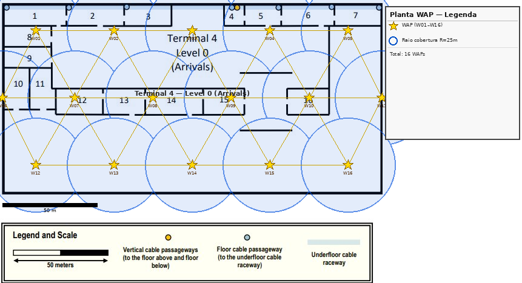

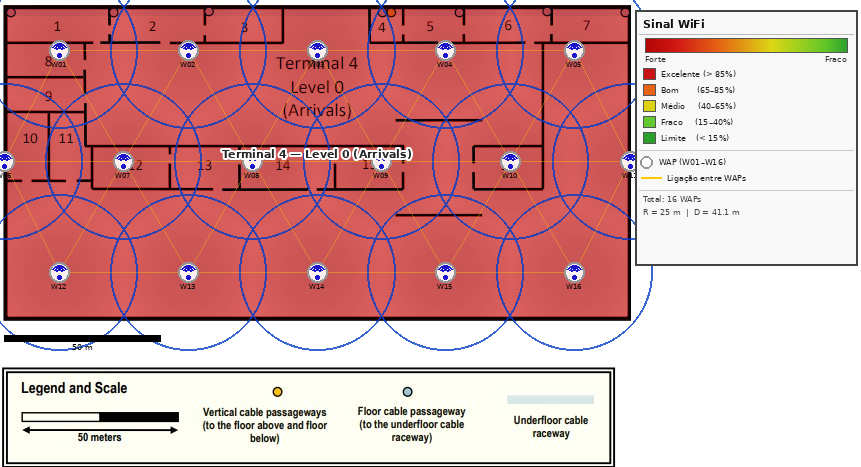

---

### 2.5 Plantas Esquemáticas das Salas — Level 0

#### Sala 1 — 32 postos (64 tomadas)

**Explicação:** A Sala 1 tem uma área de 316,70 m² e deve ser equipada com o número standard de tomadas de rede. A sala exige uma distribuição estruturada e uniforme das tomadas de rede, de modo a garantir que todos os utilizadores tenham acesso fiável e de baixa latência à infraestrutura de rede.

**Justificação:** Foram alocadas 64 tomadas de rede na Sala 1, resultando em 32 postos duplos (cada posto com 2 tomadas). Esta alocação baseia-se numa densidade de 0,20 tomadas por m², cumprindo o standard mínimo recomendado para espaços de trabalho de alta densidade (1 tomada dupla a cada 10 m²). Esta configuração responde às necessidades operacionais actuais e antecipa futuras expansões sem requerer alterações significativas na infraestrutura existente.

---

#### Sala 2 — 30 postos (60 tomadas)

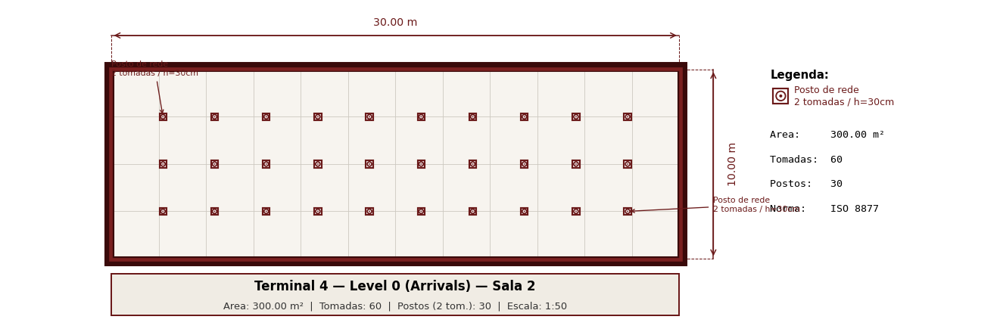

**Explicação:** A Sala 2 tem uma área de 300,00 m² e deve ser equipada com o número standard de tomadas de rede. A sala exige uma distribuição estruturada e uniforme das tomadas de rede, de modo a garantir que todos os utilizadores tenham acesso fiável e de baixa latência à infraestrutura de rede.

**Justificação:** Foram alocadas 60 tomadas de rede na Sala 2, resultando em 30 postos duplos (cada posto com 2 tomadas). Esta alocação baseia-se numa densidade de 0,20 tomadas por m², cumprindo o standard mínimo recomendado (1 tomada dupla a cada 10 m²). Esta configuração responde às necessidades operacionais actuais e antecipa futuras expansões sem requerer alterações significativas na infraestrutura existente.

---

#### Sala 3 — 24 postos (48 tomadas)

**Explicação:** A Sala 3 tem uma área de 233,30 m² e deve ser equipada com o número standard de tomadas de rede. A sala exige uma distribuição estruturada e uniforme das tomadas de rede, de modo a garantir que todos os utilizadores tenham acesso fiável e de baixa latência à infraestrutura de rede.

**Justificação:** Foram alocadas 48 tomadas de rede na Sala 3, resultando em 24 postos duplos (cada posto com 2 tomadas). Esta alocação baseia-se numa densidade de 0,20 tomadas por m², cumprindo o standard mínimo recomendado (1 tomada dupla a cada 10 m²). Esta configuração responde às necessidades operacionais actuais e antecipa futuras expansões sem requerer alterações significativas na infraestrutura existente.

---

#### Sala 5 — 19 postos (38 tomadas)

**Explicação:** A Sala 5 tem uma área de 183,30 m² e deve ser equipada com o número standard de tomadas de rede. O número ímpar de postos implica que a última linha da grelha seja centrada horizontalmente, mantendo a simetria da distribuição.

**Justificação:** Foram alocadas 38 tomadas de rede na Sala 5, resultando em 19 postos duplos (cada posto com 2 tomadas). Esta alocação baseia-se numa densidade de 0,20 tomadas por m², cumprindo o standard mínimo recomendado (1 tomada dupla a cada 10 m²). Esta configuração responde às necessidades operacionais actuais e antecipa futuras expansões sem requerer alterações significativas na infraestrutura existente.

---

#### Sala 6 — 29 postos (58 tomadas)

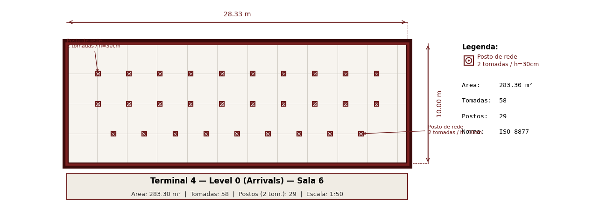

**Explicação:** A Sala 6 tem uma área de 283,30 m² e deve ser equipada com o número standard de tomadas de rede. A sala exige uma distribuição estruturada e uniforme das tomadas de rede, de modo a garantir que todos os utilizadores tenham acesso fiável e de baixa latência à infraestrutura de rede.

**Justificação:** Foram alocadas 58 tomadas de rede na Sala 6, resultando em 29 postos duplos (cada posto com 2 tomadas). Esta alocação baseia-se numa densidade de 0,20 tomadas por m², cumprindo o standard mínimo recomendado (1 tomada dupla a cada 10 m²). Esta configuração responde às necessidades operacionais actuais e antecipa futuras expansões sem requerer alterações significativas na infraestrutura existente.

---

#### Sala 7 — 24 postos (48 tomadas)

**Explicação:** A Sala 7 tem uma área de 233,30 m² e deve ser equipada com o número standard de tomadas de rede. A sala exige uma distribuição estruturada e uniforme das tomadas de rede, de modo a garantir que todos os utilizadores tenham acesso fiável e de baixa latência à infraestrutura de rede.

**Justificação:** Foram alocadas 48 tomadas de rede na Sala 7, resultando em 24 postos duplos (cada posto com 2 tomadas). Esta alocação baseia-se numa densidade de 0,20 tomadas por m², cumprindo o standard mínimo recomendado (1 tomada dupla a cada 10 m²). Esta configuração responde às necessidades operacionais actuais e antecipa futuras expansões sem requerer alterações significativas na infraestrutura existente.

---

#### Sala 12 — 34 postos (68 tomadas)

**Explicação:** A Sala 12 tem uma área de 333,30 m² e deve ser equipada com o número standard de tomadas de rede. As suas proporções distintas (25,00 × 13,33 m) exigem uma grelha adaptada ao rácio da sala para manter espaçamento uniforme nas duas dimensões.

**Justificação:** Foram alocadas 68 tomadas de rede na Sala 12, resultando em 34 postos duplos (cada posto com 2 tomadas). Esta alocação baseia-se numa densidade de 0,20 tomadas por m², cumprindo o standard mínimo recomendado (1 tomada dupla a cada 10 m²). Esta configuração responde às necessidades operacionais actuais e antecipa futuras expansões sem requerer alterações significativas na infraestrutura existente.

---

#### Sala 13 — 29 postos (58 tomadas)

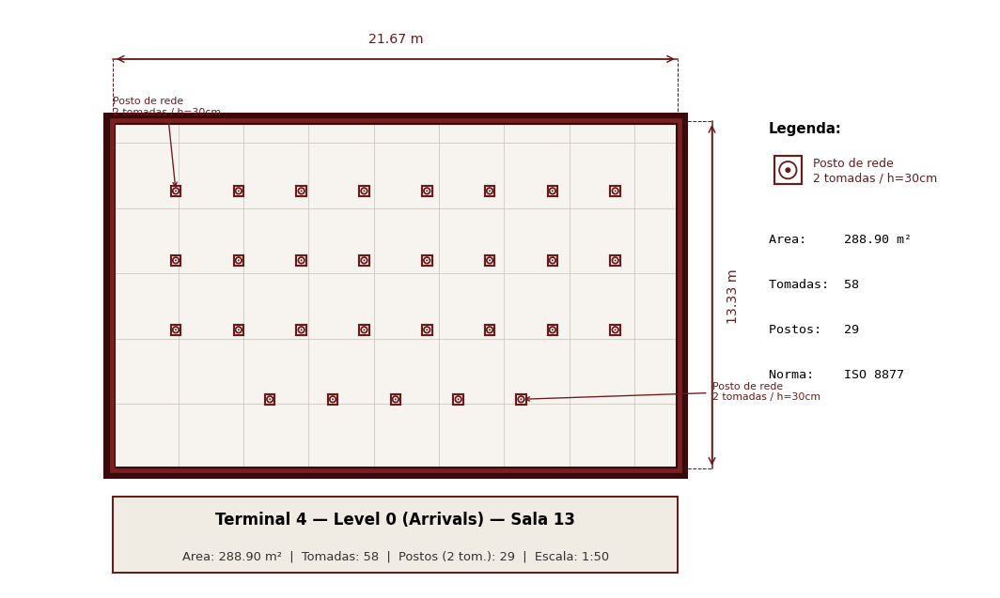

**Explicação:** A Sala 13 tem uma área de 288,90 m² e deve ser equipada com o número standard de tomadas de rede. A sala exige uma distribuição estruturada e uniforme das tomadas de rede, de modo a garantir que todos os utilizadores tenham acesso fiável e de baixa latência à infraestrutura de rede.

**Justificação:** Foram alocadas 58 tomadas de rede na Sala 13, resultando em 29 postos duplos (cada posto com 2 tomadas). Esta alocação baseia-se numa densidade de 0,20 tomadas por m², cumprindo o standard mínimo recomendado (1 tomada dupla a cada 10 m²). Esta configuração responde às necessidades operacionais actuais e antecipa futuras expansões sem requerer alterações significativas na infraestrutura existente.

---

#### Sala 14 — 40 postos (80 tomadas)

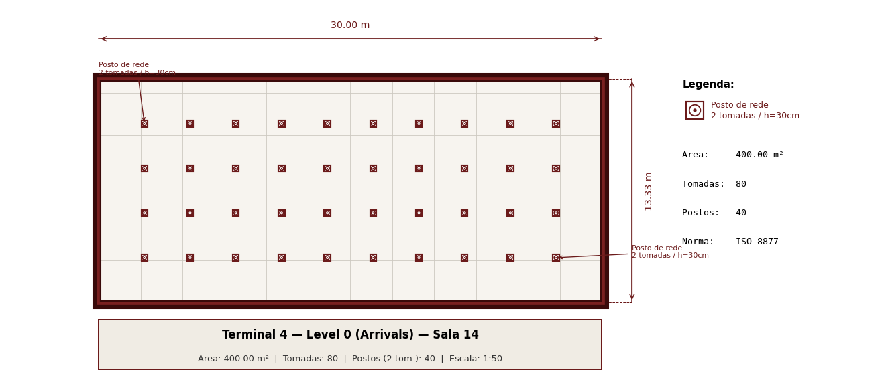

**Explicação:** A Sala 14 é a maior do piso com 400,00 m² (30,00 × 13,33 m) e deve ser equipada com o número standard de tomadas de rede. A sua dimensão considerável exige uma distribuição especialmente cuidada para garantir cobertura total sem zonas mortas.

**Justificação:** Foram alocadas 80 tomadas de rede na Sala 14, resultando em 40 postos duplos (cada posto com 2 tomadas). Os postos distribuem-se em grelha 8×5, garantindo cobertura total e espaçamento homogéneo. Esta alocação baseia-se numa densidade de 0,20 tomadas por m², cumprindo o standard mínimo recomendado (1 tomada dupla a cada 10 m²). Esta configuração responde às necessidades operacionais actuais e antecipa futuras expansões sem requerer alterações significativas na infraestrutura existente.

---

#### Sala 15 — 29 postos (58 tomadas)

**Explicação:** A Sala 15 tem uma área de 288,90 m² e deve ser equipada com o número standard de tomadas de rede. A sala exige uma distribuição estruturada e uniforme das tomadas de rede, de modo a garantir que todos os utilizadores tenham acesso fiável e de baixa latência à infraestrutura de rede.

**Justificação:** Foram alocadas 58 tomadas de rede na Sala 15, resultando em 29 postos duplos (cada posto com 2 tomadas). Esta alocação baseia-se numa densidade de 0,20 tomadas por m², cumprindo o standard mínimo recomendado (1 tomada dupla a cada 10 m²). Esta configuração responde às necessidades operacionais actuais e antecipa futuras expansões sem requerer alterações significativas na infraestrutura existente.

---

#### Sala 16 — 29 postos (58 tomadas)

**Explicação:** A Sala 16 tem uma área de 288,90 m² e deve ser equipada com o número standard de tomadas de rede. A sala exige uma distribuição estruturada e uniforme das tomadas de rede, de modo a garantir que todos os utilizadores tenham acesso fiável e de baixa latência à infraestrutura de rede.

**Justificação:** Foram alocadas 58 tomadas de rede na Sala 16, resultando em 29 postos duplos (cada posto com 2 tomadas). Esta alocação baseia-se numa densidade de 0,20 tomadas por m², cumprindo o standard mínimo recomendado (1 tomada dupla a cada 10 m²). Esta configuração responde às necessidades operacionais actuais e antecipa futuras expansões sem requerer alterações significativas na infraestrutura existente.

---

### 2.6 Planta de Cablagem — Level 0

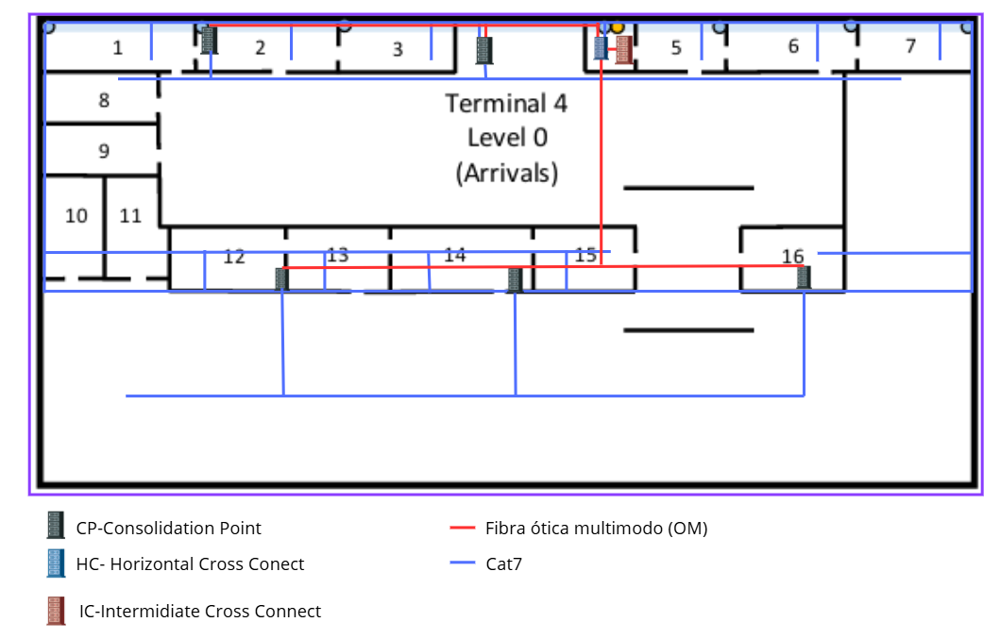

---

### 2.7 Cross-Connects Deployment — Level 0

Foi instalado **1 Horizontal Cross-Connect (HC)** para servir o piso, garantindo o cumprimento dos limites normativos de 90 metros para o comprimento real do cabo e de 80 metros para a distância em linha reta entre o repartidor e as tomadas. A Sala 4 foi escolhida por ser a única sala designada para hardware de rede e por deter a única passagem vertical do piso.

Adicionalmente, foi instalado neste piso o **Intermediate Cross-Connect (IC)** para atuar como o ponto central de distribuição do terminal, partilhando o espaço com o HC na Sala 4. Este repartidor liga-se ao campus backbone através da passagem vertical, descendo 3 metros até à vala técnica subterrânea em fibra ótica multimodo. A ligação ao Main Cross-Connect (MC) do campus é estabelecida em fibra ótica monomodo.

Para a implementação do Subsistema de Cablagem 1 (cablagem horizontal), foram instalados **cinco Consolidation Points (CPs)** distribuídos pelo piso, servindo de ponto de consolidação intermédio entre o HC e as tomadas. Cada CP é ligado ao HC via fibra ótica multimodo ou cabo Cat7 S/FTP conforme o percurso, e serve as tomadas das salas e os WAPs da sua zona de influência. A distribuição dos CPs é a seguinte: **CP1** serve as Salas 1 e 2 e os WAPs da zona esquerda; **CP2** serve a Sala 3 e os WAPs intermédios; **CP3** serve as Salas 12 e 13 e os WAPs da zona inferior esquerda; **CP4** serve as Salas 14 e 15 e os WAPs da zona inferior central; **CP5** serve a Sala 16 e os WAPs da zona inferior direita. O HC serve diretamente as Salas 5, 6 e 7 e os WAPs da zona central-direita.

Para a implementação do Subsistema de Cablagem 1 (cablagem horizontal), foram definidos caminhos de cabos que utilizam o *underfloor cable raceway* existente para ligar o HC aos CPs da fila superior (CP1 e CP2), percorrendo a conduta ao longo da parede superior. Os CPs da fila inferior (CP3, CP4 e CP5) são alcançados a partir do HC através do espaço acima do teto falso, em fibra ótica multimodo, uma vez que o percurso pelo raceway perimetral implicaria distâncias superiores a 180 m, inviáveis para cablagem estruturada. Os cabos Cat7 S/FTP percorrem do CP até às tomadas de cada sala através das condutas visíveis na planta. As salas 8, 9, 10 e 11 não possuem tomadas de dados, sendo a Sala 4 o único espaço técnico deste piso. Os WAPs são alimentados por cabos Cat7 PoE que percorrem o teto falso desde o HC ou CP mais próximo até ao ponto de instalação de cada WAP.

---

## 3. Level 2 — Departures (Partidas)

### 3.1 Características do Piso

- **1 passagem vertical** para cabos entre pisos, localizada na Sala 3, com ligação direta à vala técnica subterrânea.
- Distância vertical entre o Level 2 e o ponto de ligação à vala exterior: **15 metros**.
- Altura total do piso: **5 metros**. Teto falso a **4 metros** do chão, cobrindo todo o piso.
- Espaço técnico acima do teto falso: **1 metro**.
- *Underfloor cable raceway* ao longo de todas as paredes externas, com pontos de acesso marcados na planta.
- **Tomadas externas:** parede direita (100 m) e parede inferior (200 m) — **1 tomada a cada 5 metros** (ISO 8877).

> **Salas COM tomadas:** 1, 2, 4, 5, 7, 9, 12, 13, 14, 15, 16, 17, 18, 19, 20 e 21
>
> **Salas SEM tomadas:** 3, 6, 8, 10 e 11
>
> **Sala para Hardware de Rede:** Sala 3 — aloja o HC, patch panels e switches.
>
> **Tomadas de parede externas:** ao longo da parede direita e parede inferior — **1 tomada a cada 5 metros**.

---

### 3.2 Dimensões das Salas — Level 2

| Sala | Comprimento (m) | Largura (m) | Área (m²) |    Tomadas    | Postos (÷2, ↑) |
| ---- | :-------------: | :---------: | :---------: | :------------: | :--------------: |
| 1    |      33,33      |    11,67    |   388,90   |       78       |        39        |
| 2    |      30,00      |    11,67    |   350,00   |       70       |        35        |
| 3    |      10,00      |    10,00    |   100,00   | —*(hardware)* |        —        |
| 4    |      18,33      |    10,00    |   183,30   |       38       |        19        |
| 5    |      25,00      |    10,00    |   250,00   |       50       |        25        |
| 6    |      23,33      |    10,00    |   233,30   |       —       |        —        |
| 7    |      10,00      |    15,00    |   150,00   |       30       |        15        |
| 8    |      25,00      |    10,00    |   250,00   |       —       |        —        |
| 9    |      10,00      |    15,00    |   150,00   |       30       |        15        |
| 10   |      13,33      |    21,67    |   288,90   |       —       |        —        |
| 11   |      13,33      |    21,67    |   288,90   |       —       |        —        |
| 12   |      23,33      |    6,67    |   155,60   |       32       |        16        |
| 13   |      15,00      |    6,67    |   100,00   |       20       |        10        |
| 14   |      18,33      |    6,67    |   122,20   |       26       |        13        |
| 15   |      18,33      |    6,67    |   122,20   |       26       |        13        |
| 16   |      21,67      |    6,67    |   144,40   |       30       |        15        |
| 17   |      23,33      |    10,00    |   233,30   |       48       |        24        |
| 18   |      21,67      |    10,00    |   216,70   |       44       |        22        |
| 19   |      30,00      |    10,00    |   300,00   |       60       |        30        |
| 20   |      21,67      |    10,00    |   216,70   |       44       |        22        |
| 21   |      21,67      |    10,00    |   216,70   |       44       |        22        |

---

### 3.3 Cálculo de Tomadas — Paredes Internas

**Fórmula aplicada:** `Nº Tomadas = ⌈Área / 10⌉ × 2`

| Sala      | Área (m²) | Tomadas | Postos |
| --------- | :----------: | :-----: | :-----: |
| 1         |    388,90    |   78   |   39   |
| 2         |    350,00    |   70   |   35   |
| 4         |    183,30    |   38   |   19   |
| 5         |    250,00    |   50   |   25   |
| 7         |    150,00    |   30   |   15   |
| 9         |    150,00    |   30   |   15   |
| 12        |    155,60    |   32   |   16   |
| 13        |    100,00    |   20   |   10   |
| 14        |    122,20    |   26   |   13   |
| 15        |    122,20    |   26   |   13   |
| 16        |    144,40    |   30   |   15   |
| 17        |    233,30    |   48   |   24   |
| 18        |    216,70    |   44   |   22   |
| 19        |    300,00    |   60   |   30   |
| 20        |    216,70    |   44   |   22   |
| 21        |    216,70    |   44   |   22   |
| **Total** | **3.100,00** | **620** | **310** |

---

### 3.4 Cálculo de Tomadas — Paredes Externas

**Fórmula aplicada:** `Nº tomadas = ⌊comprimento / 5⌋ + 1`

| Parede          | Comprimento (m) | Tomadas |
| --------------- | :-------------: | :-----: |
| Parede direita  |      100 m      |   21   |
| Parede inferior |      200 m      |   41   |
| **Total**       |                | **62** |

---

### 3.5 Tomadas para Pontos de Acesso Wireless (WAP)

A distribuição dos WAPs foi efetuada de forma uniforme para assegurar a cobertura total da rede sem fios em todo o piso, com sobreposição máxima de 15% entre WAPs adjacentes, utilizando os mesmos parâmetros de grelha hexagonal do Level 0.

| Parâmetro                |       Valor       |
| ------------------------- | :----------------: |
| Raio de cobertura (R)     |        25 m        |
| Distância entre WAPs (D) |      41,14 m      |
| Sobreposição máxima    | ≈ 13,1% ≤ 15% ✓ |
| **Total de WAPs**         |       **16**       |

Uma vez que cada WAP necessita de uma tomada PoE dedicada, serão necessárias mais **16 tomadas** situadas no teto falso.

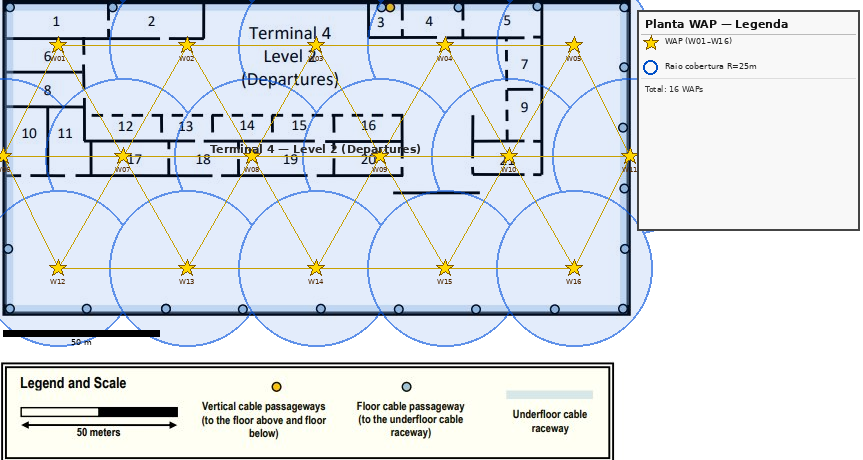

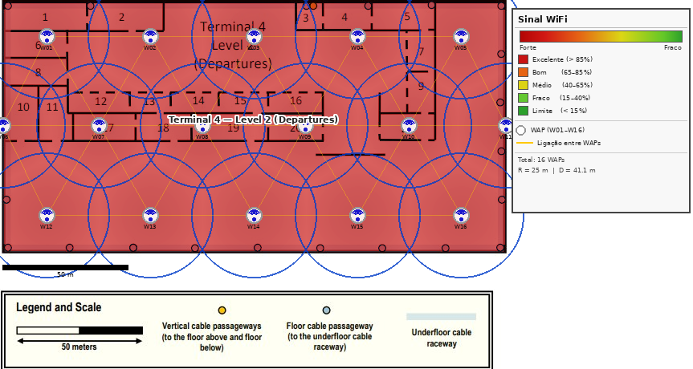

---

### 3.6 Plantas Esquemáticas das Salas — Level 2

#### Sala 1 — 39 postos (78 tomadas)

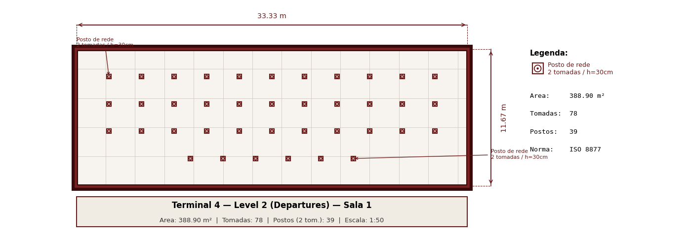

**Explicação:** A Sala 1 tem uma área de 388,90 m² e deve ser equipada com o número standard de tomadas de rede. Sendo a maior sala do piso, exige uma distribuição especialmente cuidada para garantir cobertura total sem zonas mortas.

**Justificação:** Foram alocadas 78 tomadas de rede na Sala 1, resultando em 39 postos duplos (cada posto com 2 tomadas). Esta alocação baseia-se numa densidade de 0,20 tomadas por m², cumprindo o standard mínimo recomendado (1 tomada dupla a cada 10 m²). Esta configuração responde às necessidades operacionais actuais e antecipa futuras expansões sem requerer alterações significativas na infraestrutura existente.

---

#### Sala 2 — 35 postos (70 tomadas)

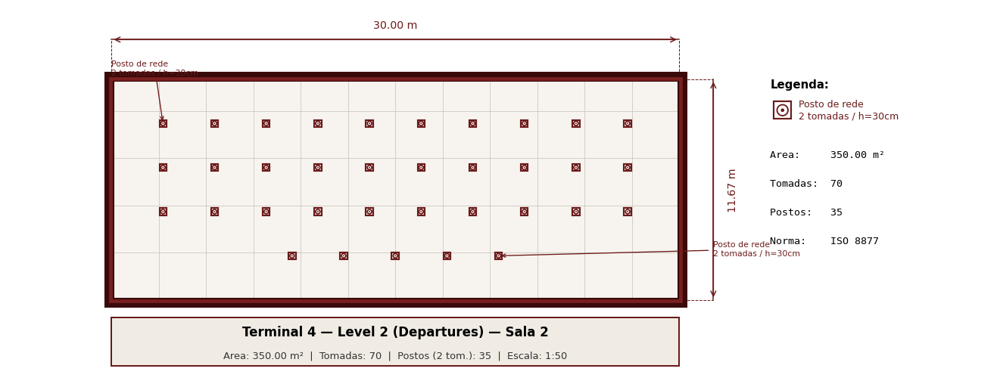

**Explicação:** A Sala 2 tem uma área de 350,00 m² e deve ser equipada com o número standard de tomadas de rede. A sala exige uma distribuição estruturada e uniforme das tomadas de rede, de modo a garantir que todos os utilizadores tenham acesso fiável e de baixa latência à infraestrutura de rede.

**Justificação:** Foram alocadas 70 tomadas de rede na Sala 2, resultando em 35 postos duplos (cada posto com 2 tomadas). Esta alocação baseia-se numa densidade de 0,20 tomadas por m², cumprindo o standard mínimo recomendado (1 tomada dupla a cada 10 m²). Esta configuração responde às necessidades operacionais actuais e antecipa futuras expansões sem requerer alterações significativas na infraestrutura existente.

---

#### Sala 4 — 19 postos (38 tomadas)

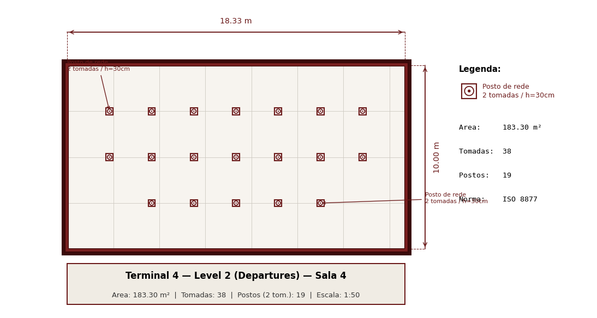

**Explicação:** A Sala 4 tem uma área de 183,30 m² e deve ser equipada com o número standard de tomadas de rede, garantindo conectividade fiável a todos os utilizadores.

**Justificação:** Foram alocadas 38 tomadas de rede na Sala 4, resultando em 19 postos duplos (arredondamento para cima). Esta alocação baseia-se numa densidade de 0,20 tomadas por m², cumprindo o standard mínimo recomendado (1 tomada dupla a cada 10 m²). Esta configuração responde às necessidades operacionais actuais e antecipa futuras expansões sem requerer alterações significativas na infraestrutura existente.

---

#### Sala 5 — 25 postos (50 tomadas)

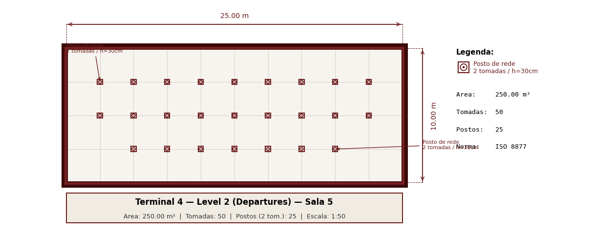

**Explicação:** A Sala 5 tem uma área de 250,00 m² e deve ser equipada com o número standard de tomadas de rede. A sala exige uma distribuição estruturada e uniforme das tomadas de rede, de modo a garantir que todos os utilizadores tenham acesso fiável e de baixa latência à infraestrutura de rede.

**Justificação:** Foram alocadas 50 tomadas de rede na Sala 5, resultando em 25 postos duplos (cada posto com 2 tomadas). Esta alocação baseia-se numa densidade de 0,20 tomadas por m², cumprindo o standard mínimo recomendado (1 tomada dupla a cada 10 m²). Esta configuração responde às necessidades operacionais actuais e antecipa futuras expansões sem requerer alterações significativas na infraestrutura existente.

---

#### Sala 7 — 15 postos (30 tomadas)

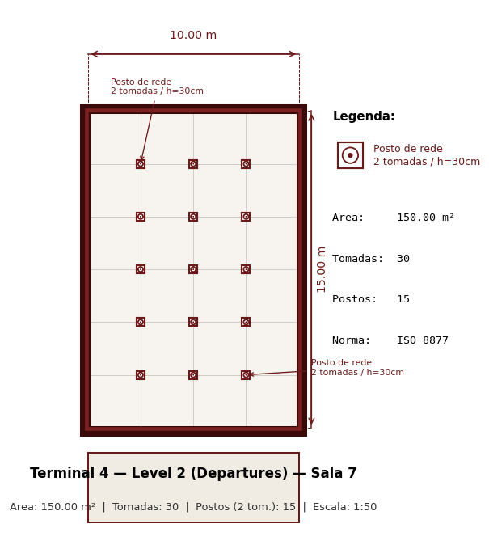

**Explicação:** A Sala 7 tem uma área de 150,00 m² com proporções distintas (10,00 × 15,00 m). A grelha adapta-se ao rácio da sala para manter espaçamento equilibrado nos dois eixos.

**Justificação:** Foram alocadas 30 tomadas de rede na Sala 7, resultando em 15 postos duplos. Esta alocação baseia-se numa densidade de 0,20 tomadas por m², cumprindo o standard mínimo recomendado (1 tomada dupla a cada 10 m²). Esta configuração responde às necessidades operacionais actuais e antecipa futuras expansões sem requerer alterações significativas na infraestrutura existente.

---

#### Sala 9 — 15 postos (30 tomadas)

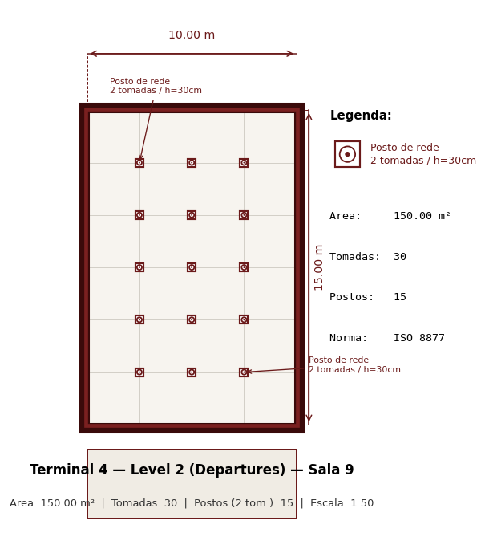

**Explicação:** A Sala 9 tem uma área de 150,00 m² e deve ser equipada com o número standard de tomadas de rede, garantindo conectividade fiável a todos os utilizadores.

**Justificação:** Foram alocadas 30 tomadas de rede na Sala 9, resultando em 15 postos duplos. Esta alocação baseia-se numa densidade de 0,20 tomadas por m², cumprindo o standard mínimo recomendado (1 tomada dupla a cada 10 m²). Esta configuração responde às necessidades operacionais actuais e antecipa futuras expansões sem requerer alterações significativas na infraestrutura existente.

---

#### Sala 12 — 16 postos (32 tomadas)

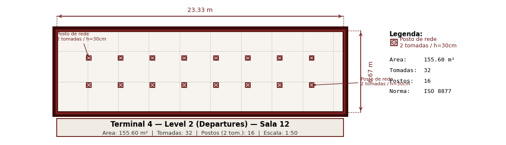

**Explicação:** A Sala 12 tem uma área de 155,60 m² com proporção estreita (23,33 × 6,67 m). A grelha ajusta-se a esta geometria, resultando em mais colunas do que linhas para cobrir adequadamente o comprimento da sala.

**Justificação:** Foram alocadas 32 tomadas de rede na Sala 12, resultando em 16 postos duplos. Esta alocação baseia-se numa densidade de 0,20 tomadas por m², cumprindo o standard mínimo recomendado (1 tomada dupla a cada 10 m²). Esta configuração responde às necessidades operacionais actuais e antecipa futuras expansões sem requerer alterações significativas na infraestrutura existente.

---

#### Sala 13 — 10 postos (20 tomadas)

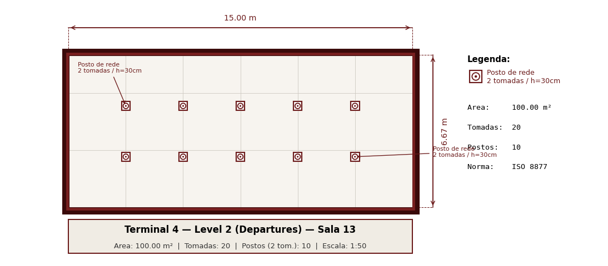

**Explicação:** A Sala 13 tem uma área de 100,00 m² e deve ser equipada com o número standard de tomadas de rede, garantindo conectividade fiável a todos os utilizadores.

**Justificação:** Foram alocadas 20 tomadas de rede na Sala 13, resultando em 10 postos duplos em grelha 5×2. Esta alocação baseia-se numa densidade de 0,20 tomadas por m², cumprindo o standard mínimo recomendado (1 tomada dupla a cada 10 m²). Esta configuração responde às necessidades operacionais actuais e antecipa futuras expansões sem requerer alterações significativas na infraestrutura existente.

---

#### Sala 14 — 13 postos (26 tomadas)

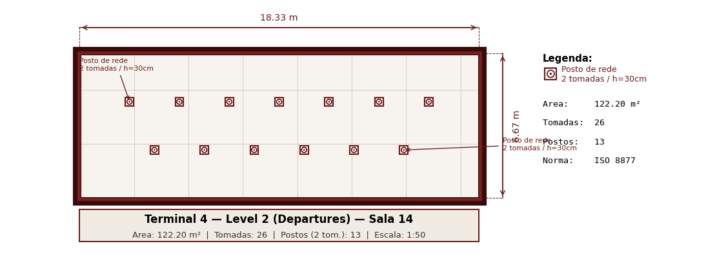

**Explicação:** A Sala 14 tem uma área de 122,20 m² e deve ser equipada com o número standard de tomadas de rede, garantindo conectividade fiável a todos os utilizadores.

**Justificação:** Foram alocadas 26 tomadas de rede na Sala 14, resultando em 13 postos duplos (arredondamento para cima). Esta alocação baseia-se numa densidade de 0,20 tomadas por m², cumprindo o standard mínimo recomendado (1 tomada dupla a cada 10 m²). Esta configuração responde às necessidades operacionais actuais e antecipa futuras expansões sem requerer alterações significativas na infraestrutura existente.

---

#### Sala 15 — 13 postos (26 tomadas)

**Explicação:** A Sala 15 tem uma área de 122,20 m² e deve ser equipada com o número standard de tomadas de rede, garantindo conectividade fiável a todos os utilizadores.

**Justificação:** Foram alocadas 26 tomadas de rede na Sala 15, resultando em 13 postos duplos (arredondamento para cima). Esta alocação baseia-se numa densidade de 0,20 tomadas por m², cumprindo o standard mínimo recomendado (1 tomada dupla a cada 10 m²). Esta configuração responde às necessidades operacionais actuais e antecipa futuras expansões sem requerer alterações significativas na infraestrutura existente.

---

#### Sala 16 — 15 postos (30 tomadas)

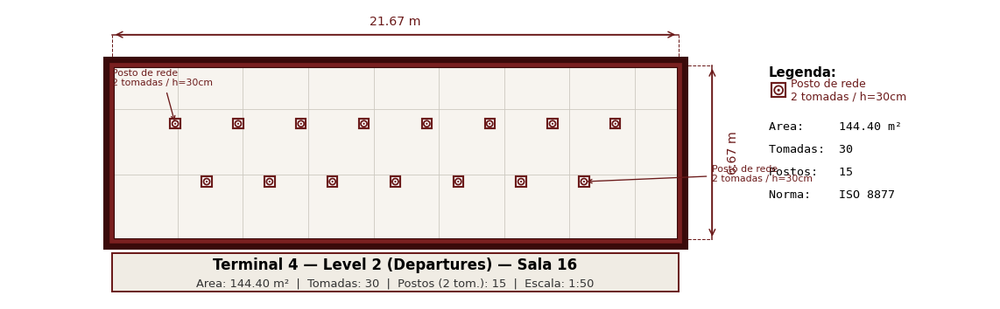

**Explicação:** A Sala 16 tem uma área de 144,40 m² e deve ser equipada com o número standard de tomadas de rede, garantindo conectividade fiável a todos os utilizadores.

**Justificação:** Foram alocadas 30 tomadas de rede na Sala 16, resultando em 15 postos duplos em grelha 5×3. Esta alocação baseia-se numa densidade de 0,20 tomadas por m², cumprindo o standard mínimo recomendado (1 tomada dupla a cada 10 m²). Esta configuração responde às necessidades operacionais actuais e antecipa futuras expansões sem requerer alterações significativas na infraestrutura existente.

---

#### Sala 17 — 24 postos (48 tomadas)

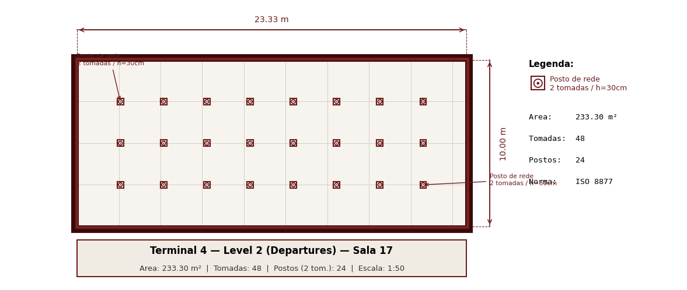

**Explicação:** A Sala 17 tem uma área de 233,30 m² e deve ser equipada com o número standard de tomadas de rede. A sala exige uma distribuição estruturada e uniforme das tomadas de rede, de modo a garantir que todos os utilizadores tenham acesso fiável e de baixa latência à infraestrutura de rede.

**Justificação:** Foram alocadas 48 tomadas de rede na Sala 17, resultando em 24 postos duplos em grelha 6×4. Esta alocação baseia-se numa densidade de 0,20 tomadas por m², cumprindo o standard mínimo recomendado (1 tomada dupla a cada 10 m²). Esta configuração responde às necessidades operacionais actuais e antecipa futuras expansões sem requerer alterações significativas na infraestrutura existente.

---

#### Sala 18 — 22 postos (44 tomadas)

**Explicação:** A Sala 18 tem uma área de 216,70 m² e deve ser equipada com o número standard de tomadas de rede, garantindo conectividade fiável e uniforme.

**Justificação:** Foram alocadas 44 tomadas de rede na Sala 18, resultando em 22 postos duplos. Esta alocação baseia-se numa densidade de 0,20 tomadas por m², cumprindo o standard mínimo recomendado (1 tomada dupla a cada 10 m²). Esta configuração responde às necessidades operacionais actuais e antecipa futuras expansões sem requerer alterações significativas na infraestrutura existente.

---

#### Sala 19 — 30 postos (60 tomadas)

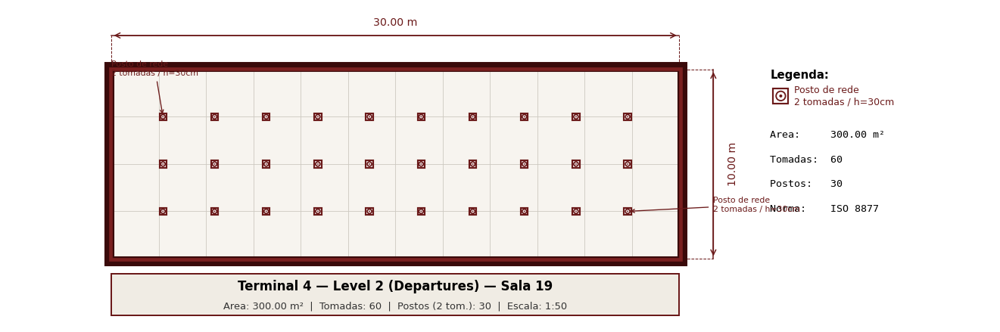

**Explicação:** A Sala 19 tem uma área de 300,00 m² e deve ser equipada com o número standard de tomadas de rede. A sala exige uma distribuição estruturada e uniforme das tomadas de rede, de modo a garantir que todos os utilizadores tenham acesso fiável e de baixa latência à infraestrutura de rede.

**Justificação:** Foram alocadas 60 tomadas de rede na Sala 19, resultando em 30 postos duplos em grelha 6×5. Esta alocação baseia-se numa densidade de 0,20 tomadas por m², cumprindo o standard mínimo recomendado (1 tomada dupla a cada 10 m²). Esta configuração responde às necessidades operacionais actuais e antecipa futuras expansões sem requerer alterações significativas na infraestrutura existente.

---

#### Sala 20 — 22 postos (44 tomadas)

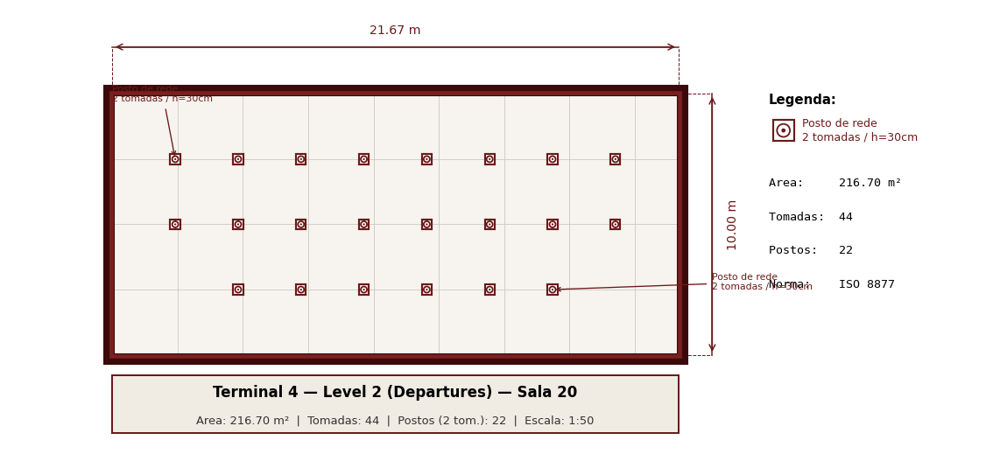

**Explicação:** A Sala 20 tem uma área de 216,70 m² e deve ser equipada com o número standard de tomadas de rede, garantindo conectividade fiável e uniforme.

**Justificação:** Foram alocadas 44 tomadas de rede na Sala 20, resultando em 22 postos duplos. Esta alocação baseia-se numa densidade de 0,20 tomadas por m², cumprindo o standard mínimo recomendado (1 tomada dupla a cada 10 m²). Esta configuração responde às necessidades operacionais actuais e antecipa futuras expansões sem requerer alterações significativas na infraestrutura existente.

---

#### Sala 21 — 22 postos (44 tomadas)

**Explicação:** A Sala 21 tem uma área de 216,70 m² e deve ser equipada com o número standard de tomadas de rede, garantindo conectividade fiável a todos os utilizadores.

**Justificação:** Foram alocadas 44 tomadas de rede na Sala 21, resultando em 22 postos duplos. Esta alocação baseia-se numa densidade de 0,20 tomadas por m², cumprindo o standard mínimo recomendado (1 tomada dupla a cada 10 m²). Esta configuração responde às necessidades operacionais actuais e antecipa futuras expansões sem requerer alterações significativas na infraestrutura existente.

---

### 3.7 Planta de Cablagem — Level 2

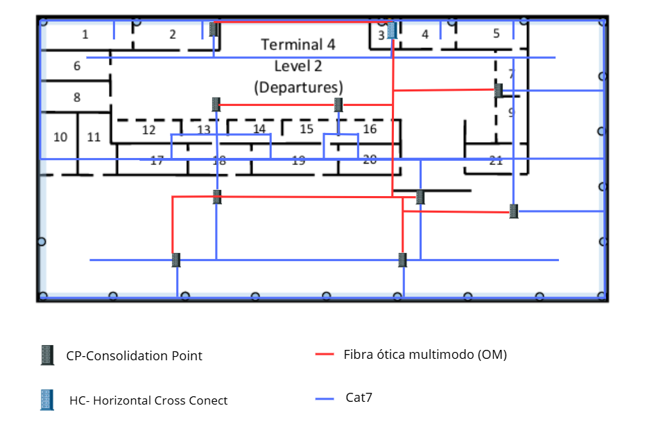

---

### 3.8 Cross-Connects Deployment — Level 2

Foi instalado **1 Horizontal Cross-Connect (HC)** para servir o piso, garantindo o cumprimento dos limites normativos de 90 metros para o comprimento real do cabo. O HC encontra-se na Sala 3, a única sala designada para hardware de rede neste piso e detentora da única passagem vertical. Este piso não possui Intermediate Cross-Connect próprio, uma vez que pertence ao mesmo terminal que o Level 0. O HC liga-se ao IC do Level 0, localizado na Sala 4, através de cabo de fibra ótica multimodo, descendo 15 metros pela passagem vertical da Sala 3 até à vala técnica subterrânea.

Para assegurar que toda a área fosse coberta e que os limites de distância fossem respeitados, foram instalados **nove Consolidation Points (CPs)** distribuídos pelo piso. A grande dispersão das salas, a existência de tomadas externas em duas paredes e as distâncias ao HC tornaram necessário um maior número de CPs neste piso face ao Level 0. Cada CP é ligado ao HC via fibra ótica multimodo através do teto falso, e serve as tomadas das salas, os WAPs e as tomadas externas da sua zona de influência. A distribuição dos CPs é a seguinte: **CP1** serve as Salas 1 e 2 e os WAPs da zona superior esquerda, sendo ligado ao HC por cabo Cat7 S/FTP pelo *underfloor raceway* da parede superior; **CP2** serve as Salas 12, 13 e 14; **CP3** serve as Salas 15 e 16; **CP4** serve as Salas 7 e 9 e as tomadas externas da parede direita; **CP5** serve as Salas 17, 18 e 19; **CP6** serve as Salas 20 e 21; **CP7** serve os WAPs da zona central inferior; **CP8** serve as tomadas externas da parede inferior esquerda; **CP9** serve as tomadas externas da parede inferior direita. O HC serve diretamente as Salas 4 e 5 e os WAPs da zona central superior.

Para a implementação do Subsistema de Cablagem 1 (cablagem horizontal), foram definidos caminhos de cabos que utilizam o *underfloor raceway* para ligar o HC ao CP1 ao longo da parede superior. Todos os restantes CPs são alcançados a partir do HC através do espaço acima do teto falso, em fibra ótica multimodo, descendo por calhas até ao ponto de instalação de cada CP. Os cabos Cat7 S/FTP percorrem depois do CP até às tomadas de cada sala e até a cada WAP através das condutas visíveis na planta. As tomadas externas da parede direita são servidas pelo CP4 através do *underfloor raceway* perimetral, percorrendo o canto superior direito e descendo ao longo dos 100 m da parede direita. As tomadas externas da parede inferior são servidas pelos CPs 8 e 9, que percorrem o *underfloor raceway* inferior para os dois lados a partir do fundo do piso. As salas 3, 6, 8, 10 e 11 não possuem tomadas de dados, sendo a Sala 3 o único espaço técnico deste piso.

---

## 4. Inventário de Hardware — Terminal 4

### 4.1 Legenda das Plantas de Cablagem

| Símbolo            | Cor      | Significado                                     |
| ------------------- | -------- | ----------------------------------------------- |
| Retângulo azul     | Azul     | HC — Horizontal Cross-Connect                  |
| Retângulo vermelho | Vermelho | IC — Intermediate Cross-Connect                |
| Retângulo preto    | Preto    | CP — Consolidation Point                       |
| Linha azul          | Azul     | Cabo Cat7 S/FTP                                 |
| Linha vermelha      | Vermelho | Fibra ótica multimodo OM4 (HC→CPs + backbone) |

---

### 4.2 Resumo Global do Inventário

| Item                              | Quantidade |
| --------------------------------- | :---------: |
| HC (Horizontal Cross-Connect)     |      2      |
| IC (Intermediate Cross-Connect)   |      1      |
| CP (Consolidation Point)          |     14     |
| Tomadas ISO 8877                  |    1 292    |
| Patch Panels 24P                  |     66     |
| WAPs                              |     32     |
| Cabo Cat7 S/FTP (+ 15% margem)    | ≈ 33 063 m |
| Fibra Ótica OM4 (redundante ×2) | ≈ 2 350 m |
