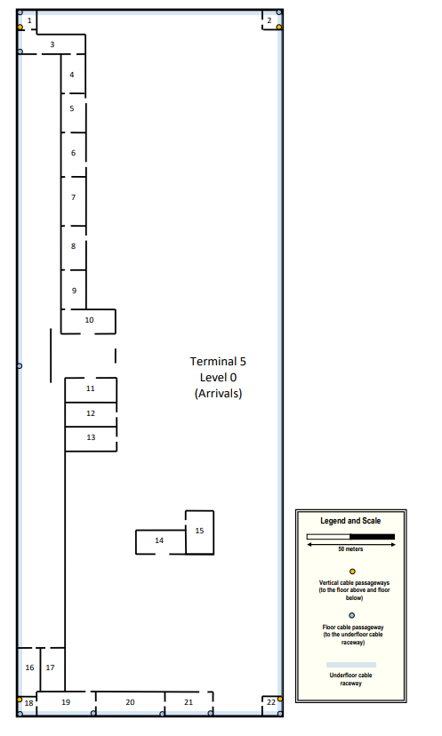
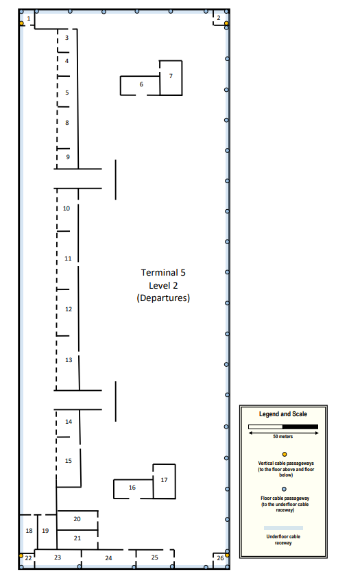

# RCOMP 2025–2026 — Project 1 — Sprint 1
**Membro:** 1240835

---

## 1. Visão Geral do Terminal 5

| Parâmetro | Detalhe |
|-----------|---------|
| Dimensão | 400 × 150 metros |
| Pisos | 2 (Level 0 e Level 2) |
| Cobertura | WiFi em ambos os pisos |
| Ligação exterior | Vala técnica subterrânea (underground passageway) |

---

## 2. Level 0 — Arrivals (Chegadas)

### 2.1 Características do Piso

- 4 passagens verticais que permitem a passagem de cabos entre pisos e ligam ao *campus Backbone*
- Ligação à vala técnica subterrânea — distância vertical entre o Level 0 e o ponto de ligação: **3 metros**
- Altura do piso: **5 metros** (do chão ao teto real)
- Teto falso a **4 metros do chão**, com espaço de **1 metro** entre teto falso e teto real — ideal para instalar *cable raceways* e *wireless access-points*
- **Salas COM tomadas**: 3, 4, 5, 6, 7, 8, 9, 10, 11, 14, 15, 19, 20, 21
- **Salas SEM tomadas:** 1, 2, 12, 13, 16, 17, 18, 22
- **Salas para Hardware de Rede (TC/Enclosure):** 1, 12, 18, 22 — alojam armários de telecomunicações (IC/HC), patch panels, switches e protectores
- **Tomadas de parede externas:** ao longo da parede direita e parede inferior — **1 tomada a cada 5 metros**

---

### 2.2 Dimensões das Salas — Level 0

| Sala | Largura (cm) | Comp. (cm) | Largura (m) | Comp. (m) | Área (m²) | Tomadas |
|------|:------------:|:----------:|:-----------:|:---------:|:---------:|:-------:|
| 1  | 0,8  | 0,8  | 13,30 | 13,30 | 176,89 | — *(hardware)* |
| 2  | 0,8  | 0,8  | 13,30 | 13,30 | 176,89 | — |
| 3  | 2,6  | 0,8  | 43,30 | 13,30 | 575,89 | 115 |
| 4  | 0,9  | 1,35 | 15,00 | 22,50 | 337,50 | 68 |
| 5  | 0,9  | 1,35 | 15,00 | 22,50 | 337,50 | 68 |
| 6  | 0,9  | 1,5  | 15,00 | 25,00 | 375,00 | 75 |
| 7  | 0,9  | 1,7  | 15,00 | 28,30 | 424,50 | 85 |
| 8  | 0,9  | 1,5  | 15,00 | 25,00 | 375,00 | 75 |
| 9  | 0,9  | 1,35 | 15,00 | 22,50 | 337,50 | 68 |
| 10 | 1,85 | 0,85 | 30,80 | 14,20 | 437,36 | 87 |
| 11 | 1,75 | 0,85 | 29,20 | 14,20 | 414,64 | 83 |
| 12 | 1,75 | 0,85 | 29,20 | 14,20 | 414,64 | — *(hardware)* |
| 13 | 1,75 | 0,85 | 29,20 | 14,20 | 414,64 | — |
| 14 | 1,7  | 0,8  | 28,30 | 13,30 | 376,39 | 75 |
| 15 | 0,95 | 1,5  | 15,80 | 25,00 | 395,00 | 79 |
| 16 | 0,8  | 1,65 | 13,30 | 27,50 | 359,50 | — |
| 17 | 0,85 | 1,5  | 14,20 | 25,00 | 355,00 | — |
| 18 | 0,7  | 0,7  | 11,70 | 11,70 | 136,89 | — *(hardware)* |
| 19 | 2,0  | 0,8  | 33,30 | 13,30 | 442,89 | 89 |
| 20 | 2,3  | 0,8  | 38,30 | 13,30 | 509,39 | 102 |
| 21 | 1,6  | 0,8  | 26,70 | 13,30 | 355,11 | 71 |
| 22 | 0,7  | 0,7  | 11,70 | 11,70 | 136,89 | — *(hardware)* |

---

### 2.3 Cálculo de Tomadas — Paredes Internas

**Fórmula aplicada:** `Nº Tomadas = (Área ÷ 10) × 2`

| Sala | Área (m²) | Tomadas | Postos (÷2, arred. cima) |
|------|:---------:|:-------:|:------------------------:|
| Sala 3  | 575,89   | 115   | 58 |
| Sala 4  | 337,50   | 68    | 34 |
| Sala 5  | 337,50   | 68    | 34 |
| Sala 6  | 375,00   | 75    | 38 |
| Sala 7  | 424,50   | 85    | 43 |
| Sala 8  | 375,00   | 75    | 38 |
| Sala 9  | 337,50   | 68    | 34 |
| Sala 10 | 437,36   | 87    | 44 |
| Sala 11 | 414,64   | 83    | 42 |
| Sala 14 | 376,39   | 75    | 38 |
| Sala 15 | 395,00   | 79    | 40 |
| Sala 19 | 442,89   | 89    | 45 |
| Sala 20 | 509,39   | 102   | 51 |
| Sala 21 | 355,11   | 71    | 36 |
| **Total** | **5.193,67** | **1.040** | **525** |

---

### 2.4 Tomadas para Pontos de Acesso Wireless (WAP)

> Cada ponto de acesso wireless requer uma tomada de rede dedicada.

#### Cenário Prático — Diâmetro 50 m

| Parâmetro | Valor |
|-----------|:-----:|
| Raio do WAP | 25 m |
| Área por WAP | 1.963 m² |
| Área total | 60.000 m² |
| **Nº de WAPs necessários** | **≈ 31 WAPs** |
| **Tomadas necessárias** | **31** |

#### Cenário Real

> A colocação de um ponto de acesso por sala justifica-se porque obstáculos sólidos, como paredes e colunas, bloqueiam e atenuam significativamente os sinais de micro-ondas, reduzindo o alcance prático e exigindo a segmentação em células pequenas para garantir a eficiência e a cobertura total da rede. Daí justifica-se a não utilização do valor calculado no cenário prático.
 

> Uma vez que cada ponto de acesso wireless necessita de uma tomada, serão necessárias mais 14 tomadas, uma para cada WAP, que estará situada no teto falso para que possa haver maximização da cobertura e propagação de sinal, e diminuir a quantidade de obstáculos, não havendo necessidade de colocar pilares para a ligação das tomadas.

---

### 2.6 Plantas Esquemáticas — Level 0

### Planta Global do Terminal 5 Level 0

---

#### Sala 3

**Explicação:** A Sala 3 tem uma área de 575,89 m² e deve ser equipada com o número standard de tomadas de rede. A sala exige uma distribuição estruturada e uniforme das tomadas de rede, de modo a garantir que todos os utilizadores tenham acesso fiável e de baixa latência à infraestrutura de rede.

**Justificação:** Foram alocadas 115 tomadas de rede na Sala 3, resultando em 58 postos duplos (cada posto com 2 tomadas). Esta alocação baseia-se numa densidade de 0,20 tomadas por m², cumprindo o standard mínimo recomendado para espaços de trabalho de alta densidade (1 tomada dupla a cada 10 m² ou 1 posto de duas tomadas a cada 10 m²). Os 58 postos estão dispostos numa grelha com espaçamento aproximado entre postos de ~3,0 m, assegurando que todos os postos de trabalho na sala tenham acesso a um posto de rede num raio máximo de 5 metros de cabo. Esta configuração responde às necessidades operacionais actuais e antecipa futuras expansões sem requerer alterações significativas na infraestrutura existente.

---

#### Sala 4

**Explicação:** A Sala 4 tem uma área de 337,50 m² e devem ser equipadas com o número standard de tomadas de rede. A sua disposição conjunta permite uma gestão eficiente da cablagem.

**Justificação:** Foram alocadas 68 tomadas de rede na Sala 4, resultando em 34 postos duplos (cada posto com 2 tomadas). Esta alocação baseia-se numa densidade de 0,20 tomadas por m², cumprindo o standard mínimo recomendado. Os 34 postos estão dispostos numa grelha com espaçamento aproximado entre postos de ~3,5 m, assegurando que todos os postos de trabalho na sala tenham acesso a um posto de rede num raio máximo de 5 metros de cabo. Esta configuração responde às necessidades operacionais atuais e antecipa futuras expansões sem requerer alterações significativas na infraestrutura existente.

---
#### Sala 5 

**Explicação:** A Sala 5 tem uma área de 337,50 m² e devem ser equipadas com o número standard de tomadas de rede. A sua disposição conjunta permite uma gestão eficiente da cablagem.

**Justificação:** Foram alocadas 68 tomadas de rede na Sala 5, resultando em 34 postos duplos (cada posto com 2 tomadas). Esta alocação baseia-se numa densidade de 0,20 tomadas por m², cumprindo o standard mínimo recomendado. Os 34 postos estão dispostos numa grelha com espaçamento aproximado entre postos de ~3,5 m, assegurando que todos os postos de trabalho na sala tenham acesso a um posto de rede num raio máximo de 5 metros de cabo. Esta configuração responde às necessidades operacionais actuais e antecipa futuras expansões sem requerer alterações significativas na infraestrutura existente.

---

#### Sala 6 

**Explicação:** A Sala 6 tem uma área de 375,00 m² e devem ser equipadas com o número standard de tomadas de rede. A sua disposição simétrica facilita uma distribuição uniforme da infraestrutura.

**Justificação:** Foram alocadas 75 tomadas de rede na Sala 6, resultando em 38 postos duplos (cada posto com 2 tomadas). Esta alocação baseia-se numa densidade de 0,20 tomadas por m², cumprindo o standard mínimo recomendado. Os 38 postos estão dispostos numa grelha com espaçamento aproximado entre postos de ~3,0 m, assegurando que todos os postos de trabalho na sala tenham acesso a um posto de rede num raio máximo de 5 metros de cabo. Esta configuração responde às necessidades operacionais actuais e antecipa futuras expansões sem requerer alterações significativas na infraestrutura existente.

---

#### Sala 7

**Explicação:** A Sala 7 tem uma área de 424,50 m² e deve ser equipada com o número standard de tomadas de rede. A sala exige uma distribuição estruturada e uniforme das tomadas de rede, de modo a garantir que todos os utilizadores tenham acesso fiável e de baixa latência à infraestrutura de rede.

**Justificação:** Foram alocadas 85 tomadas de rede na Sala 7, resultando em 43 postos duplos (cada posto com 2 tomadas). Esta alocação baseia-se numa densidade de 0,20 tomadas por m², cumprindo o standard mínimo recomendado. Os 43 postos estão dispostos numa grelha com espaçamento aproximado entre postos de ~3,0 m, assegurando que todos os postos de trabalho na sala tenham acesso a um posto de rede num raio máximo de 5 metros de cabo. Esta configuração responde às necessidades operacionais actuais e antecipa futuras expansões sem requerer alterações significativas na infraestrutura existente.

---
#### Sala 8

**Explicação:** A Sala 8 têm cada uma uma área de 375,00 m² e devem ser equipadas com o número standard de tomadas de rede. A sua disposição simétrica facilita uma distribuição uniforme da infraestrutura.

**Justificação:** Foram alocadas 75 tomadas de rede na Sala 8, resultando em 38 postos duplos (cada posto com 2 tomadas). Esta alocação baseia-se numa densidade de 0,20 tomadas por m², cumprindo o standard mínimo recomendado. Os 38 postos estão dispostos numa grelha com espaçamento aproximado entre postos de ~3,0 m, assegurando que todos os postos de trabalho na sala tenham acesso a um posto de rede num raio máximo de 5 metros de cabo. Esta configuração responde às necessidades operacionais actuais e antecipa futuras expansões sem requerer alterações significativas na infraestrutura existente.

---

#### Sala 9

**Explicação:** A Sala 9 tem uma área de 337,50 m² e devem ser equipadas com o número standard de tomadas de rede. A sua disposição conjunta permite uma gestão eficiente da cablagem.

**Justificação:** Foram alocadas 68 tomadas de rede na sala 9, resultando em 34 postos duplos (cada posto com 2 tomadas). Esta alocação baseia-se numa densidade de 0,20 tomadas por m², cumprindo o standard mínimo recomendado. Os 34 postos estão dispostos numa grelha com espaçamento aproximado entre postos de ~3,5 m, assegurando que todos os postos de trabalho na sala tenham acesso a um posto de rede num raio máximo de 5 metros de cabo. Esta configuração responde às necessidades operacionais actuais e antecipa futuras expansões sem requerer alterações significativas na infraestrutura existente.

---

#### Sala 10

**Explicação:** A Sala 10 tem uma área de 437,36 m² e deve ser equipada com o número standard de tomadas de rede. A sala exige uma distribuição estruturada e uniforme das tomadas de rede, de modo a garantir que todos os utilizadores tenham acesso fiável e de baixa latência à infraestrutura de rede.

**Justificação:** Foram alocadas 87 tomadas de rede na Sala 10, resultando em 44 postos duplos (cada posto com 2 tomadas). Esta alocação baseia-se numa densidade de 0,20 tomadas por m², cumprindo o standard mínimo recomendado. Os 44 postos estão dispostos numa grelha com espaçamento aproximado entre postos de ~3,0 m, assegurando que todos os postos de trabalho na sala tenham acesso a um posto de rede num raio máximo de 5 metros de cabo. Esta configuração responde às necessidades operacionais actuais e antecipa futuras expansões sem requerer alterações significativas na infraestrutura existente.

---

#### Sala 11

**Explicação:** A Sala 11 tem uma área de 414,64 m² e deve ser equipada com o número standard de tomadas de rede. A sala exige uma distribuição estruturada e uniforme das tomadas de rede, de modo a garantir que todos os utilizadores tenham acesso fiável e de baixa latência à infraestrutura de rede.

**Justificação:** Foram alocadas 83 tomadas de rede na Sala 11, resultando em 42 postos duplos (cada posto com 2 tomadas). Esta alocação baseia-se numa densidade de 0,20 tomadas por m², cumprindo o standard mínimo recomendado. Os 42 postos estão dispostos numa grelha com espaçamento aproximado entre postos de ~3,0 m, assegurando que todos os postos de trabalho na sala tenham acesso a um posto de rede num raio máximo de 5 metros de cabo. Esta configuração responde às necessidades operacionais actuais e antecipa futuras expansões sem requerer alterações significativas na infraestrutura existente.

---

#### Sala 14

**Explicação:** A Sala 14 tem uma área de 376,39 m² e deve ser equipada com o número standard de tomadas de rede. A sala exige uma distribuição estruturada e uniforme das tomadas de rede, de modo a garantir que todos os utilizadores tenham acesso fiável e de baixa latência à infraestrutura de rede.

**Justificação:** Foram alocadas 75 tomadas de rede na Sala 14, resultando em 38 postos duplos (cada posto com 2 tomadas). Esta alocação baseia-se numa densidade de 0,20 tomadas por m², cumprindo o standard mínimo recomendado. Os 38 postos estão dispostos numa grelha com espaçamento aproximado entre postos de ~3,0 m, assegurando que todos os postos de trabalho na sala tenham acesso a um posto de rede num raio máximo de 5 metros de cabo. Esta configuração responde às necessidades operacionais actuais e antecipa futuras expansões sem requerer alterações significativas na infraestrutura existente.

---

#### Sala 15

**Explicação:** A Sala 15 tem uma área de 395,00 m² e deve ser equipada com o número standard de tomadas de rede. A sala exige uma distribuição estruturada e uniforme das tomadas de rede, de modo a garantir que todos os utilizadores tenham acesso fiável e de baixa latência à infraestrutura de rede.

**Justificação:** Foram alocadas 79 tomadas de rede na Sala 15, resultando em 40 postos duplos (cada posto com 2 tomadas). Esta alocação baseia-se numa densidade de 0,20 tomadas por m², cumprindo o standard mínimo recomendado. Os 40 postos estão dispostos numa grelha com espaçamento aproximado entre postos de ~3,0 m, assegurando que todos os postos de trabalho na sala tenham acesso a um posto de rede num raio máximo de 5 metros de cabo. Esta configuração responde às necessidades operacionais actuais e antecipa futuras expansões sem requerer alterações significativas na infraestrutura existente.

---

#### Sala 19

**Explicação:** A Sala 19 tem uma área de 442,89 m² e deve ser equipada com o número standard de tomadas de rede. A sala exige uma distribuição estruturada e uniforme das tomadas de rede, de modo a garantir que todos os utilizadores tenham acesso fiável e de baixa latência à infraestrutura de rede.

**Justificação:** Foram alocadas 89 tomadas de rede na Sala 19, resultando em 45 postos duplos (cada posto com 2 tomadas). Esta alocação baseia-se numa densidade de 0,20 tomadas por m², cumprindo o standard mínimo recomendado. Os 45 postos estão dispostos numa grelha com espaçamento aproximado entre postos de ~3,0 m, assegurando que todos os postos de trabalho na sala tenham acesso a um posto de rede num raio máximo de 5 metros de cabo. Esta configuração responde às necessidades operacionais actuais e antecipa futuras expansões sem requerer alterações significativas na infraestrutura existente.

---

#### Sala 20

**Explicação:** A Sala 20 tem uma área de 509,39 m² e deve ser equipada com o número standard de tomadas de rede. A sua dimensão considerável exige uma distribuição especialmente cuidada para garantir cobertura total sem zonas mortas.

**Justificação:** Foram alocadas 102 tomadas de rede na Sala 20, resultando em 51 postos duplos (cada posto com 2 tomadas). Esta alocação baseia-se numa densidade de 0,20 tomadas por m², cumprindo o standard mínimo recomendado. Os 51 postos estão dispostos numa grelha com espaçamento aproximado entre postos de ~3,0 m, assegurando que todos os postos de trabalho na sala tenham acesso a um posto de rede num raio máximo de 5 metros de cabo. Esta configuração responde às necessidades operacionais actuais e antecipa futuras expansões sem requerer alterações significativas na infraestrutura existente.

---

#### Sala 21

**Explicação:** A Sala 21 tem uma área de 355,11 m² e deve ser equipada com o número standard de tomadas de rede. A sala exige uma distribuição estruturada e uniforme das tomadas de rede, de modo a garantir que todos os utilizadores tenham acesso fiável e de baixa latência à infraestrutura de rede.

**Justificação:** Foram alocadas 71 tomadas de rede na Sala 21, resultando em 36 postos duplos (cada posto com 2 tomadas). Esta alocação baseia-se numa densidade de 0,20 tomadas por m², cumprindo o standard mínimo recomendado. Os 36 postos estão dispostos numa grelha com espaçamento aproximado entre postos de ~3,5 m, assegurando que todos os postos de trabalho na sala tenham acesso a um posto de rede num raio máximo de 5 metros de cabo. Esta configuração responde às necessidades operacionais actuais e antecipa futuras expansões sem requerer alterações significativas na infraestrutura existente.

---

### 2.7 Cross-Connects Deployment

>Foram instalados quatro Horizontal Cross-connects (HC) para servir o piso, garantindo o cumprimento dos limites normativos de 90 metros para o comprimento real do cabo e de 80 metros para a distância em linha reta entre o repartidor e as tomadas. Para assegurar que toda a área fosse coberta, houve a necessidade de instalar armários de telecomunicações (TE) em salas não dedicadas exclusivamente a telecomunicações, uma vez que as salas exclusivas existentes não permitiam o posicionamento central necessário para respeitar os limites de distância em todo o piso.
Adicionalmente, foi instalado neste piso o Intermediate Cross-connect (IC) para atuar como o ponto central de distribuição do edifício, localizado na sala 22 (canto inferior direito), partilhando o espaço com o HC que serve essa zona. Este repartidor liga-se a todos os Horizontal Cross-connects (HC) através do Subsistema de Cablagem 2 (backbone de edifício). Para as ligações, foram definidos caminhos de cabos (pathways) que percorrem tetos falsos e pavimentos sobrelevados, utilizando cabos de fibra ótica multimodo para assegurar a performance e a escalabilidade da rede. Os HC estão interligados ao IC pelas passagens técnicas sob o pavimento.
Para a implementação do Subsistema de Cablagem 1 (cablagem horizontal), foram instalados 13 Consolidation Points (CP) distribuídos pelo piso, servindo de ponto de consolidação intermédio entre os HC e as tomadas. Cada CP é ligado ao respetivo HC via cabo CAT7, e serve as tomadas das salas, os pontos de acesso sem fios (WAP). A distribuição dos CP é a seguinte: um CP serve a sala 3; outro serve as salas 4 e 5; outro serve as salas 6 e 7; o próximo serve a sala 8; um serve as salas 9 e 10; um serve a sala 11; o seguinte serve as salas 14 e 15; o último serve as salas 20 e 21; os restants servem as filas de WAP. As salas 2, 12, 13, 16 e 17 não possuem tomadas, sendo que as salas 1, 2, 18 e 22 albergam os HC (cantos inferiores e superiores).
Para a implementação do Subsistema de Cablagem 1 (cablagem horizontal), foram definidos caminhos de cabos (pathways) que utilizam passagens técnicas sob o pavimento para ligar a maioria das salas aos respetivos Consolidation Points (CP) e Horizontal Cross-connects (HC).

### 2.8 Hardware Inventory

#### Total Outlets Summary

| Category | Outlets |
|---|---|
| Internal room outlets | 1 040 |
| WAP outlets | 50 |
| **GRAND TOTAL** | **1 090** |

#### Cable Lengths

| Cable Type                                            | Total Length |
|-------------------------------------------------------|--------------|
| CAD7A copper cable (horizontal cabling — Subsystem 1) | 43 414,9 m   |
| Multimode optical fibre OM (backbone — Subsystem 2)   | 1 705,0 m    |

#### Consolidation Points (CP)

> 13 CPs installed. Each CP is connected to its HC via CAD7A. Rule: 1 patch panel (24-port) per 24 outlets served (rounded up).

| CP | Rooms / Zone Served         | Outlets  | PP 24p | Connected HC |
|---|-----------------------------|----------|---|--------------|
| CP1  | Room 3                      | 115      | 5  | HC1          |
| CP2  | Rooms 4 + 5 (2nd line WAP)  | 139      | 6  | HC1          |
| CP3  | Rooms 6 + 7 (3rd line WAP)  | 165      | 7  | HC1          |
| CP4  | Room 8 (4th line WAP)       | 79       | 4  | HC1          |
| CP5  | Rooms 9 + 10 (4th line WAP) | 160      | 7  | HC1          |
| CP6  | Room 11                     | 83       | 4  | HC4          |
| CP7  | Rooms 14 + 15               | 154      | 7  | HC4          |
| CP8  | Rooms 20 + 21               | 173      | 11 | HC4          |
| CP9  | WAPs (6th line)             | 4        | 1  | HC1          |
| CP10 | WAPs (7th line)             | 5        | 1  | HC3          |
| CP11 | WAPs (8th line)             | 4        | 1  | HC3          |
| CP12 | WAPs (9th line)             | 5        | 1  | HC3          |
| CP13 | WAPs (10th line)            | 4        | 1  | HC3          |
| **TOTAL** | —                           | **1090** | **55** | —            |

---

#### Total Patch Panel Summary

| Equipment                             | Quantity |
|---------------------------------------|---|
| Patch panels CAD7A 24-port (at CPs)   | 55  |
| Patch panels CAD7A 24-port (at HC/IC) | 53  |
| Patch panels fibre 24-port LC (HC/IC) | 5   |
| **TOTAL patch panels**                | **113** |

---

####  Complete Hardware Summary - Level 0

| Hardware Item                        | Quantity   |
|--------------------------------------|------------|
| CAD7A copper cable                   | 43 414,9 m |
| Multimode optical fibre OM           | 1 705,0 m  |
| Network outlets ISO 8877 — internal  | 1 040      |
| Network outlets ISO 8877 — WAP       | 50         |
| **Network outlets ISO 8877 — TOTAL** | **1 090**  |
| Wireless Access Points (WAP)         | 50         |
| Consolidation Points (CP)            | 13         |
| Horizontal Cross-connects (HC)       | 4          |
| Intermediate Cross-connect (IC)      | 1          |
| Patch panels CAD7A 24-port           | 113        |
| Patch panels fibre 24-port LC        | 5          |
---

## 3. Level 2 — Departures (Partidas)

### 3.1 Características do Piso

- 4 passagens verticais entre pisos e ligação ao *campus Backbone*
- Ligação à vala técnica subterrânea — distância vertical entre o Level 2 e o ponto de ligação: **15 metros**
- Altura do piso: **5 metros** (do chão ao teto real)
- Teto falso a **4 metros do chão**, com espaço de **1 metro** entre teto falso e teto real — ideal para *cable raceways* e *wireless access-points*
- Duas rotas horizontais disponíveis: subterrânea (*underfloor*) e aérea (acima do teto falso)

> **Salas COM tomadas:** 3, 4, 5, 6, 7, 8, 9, 10, 11, 12, 13, 14, 15, 16, 17, 23, 24, 25
>
> **Salas SEM tomadas:** 1, 2, 18, 19, 20, 21, 22, 26
>
> **Salas para Hardware de Rede (TC/Enclosure):** 1, 2, 22, 26 — alojam armários de telecomunicações (IC/HC), patch panels, switches e protectores
>
> **Tomadas de parede externas:** ao longo da parede direita e parede superior — **1 tomada a cada 5 metros**

---

### 3.2 Dimensões das Salas — Level 2

| Sala | Largura (cm) | Comp. (cm) | Largura (m) | Comp. (m) | Área (m²) | Tomadas |
|------|:------------:|:----------:|:-----------:|:---------:|:---------:|:-------:|
| 1  | 0,7  | 0,7  | 11,67 | 11,67 | 136,19 | — *(hardware)* |
| 2  | 0,7  | 0,7  | 11,67 | 11,67 | 136,19 | — *(hardware)* |
| 3  | 0,85 | 1,0  | 14,17 | 16,67 | 236,19 | 47 |
| 4  | 0,85 | 1,0  | 14,17 | 16,67 | 236,19 | 47 |
| 5  | 0,85 | 1,3  | 14,17 | 21,67 | 307,06 | 61 |
| 6  | 1,7  | 0,8  | 28,33 | 13,33 | 377,64 | 76 |
| 7  | 0,95 | 1,5  | 15,83 | 25,00 | 395,75 | 79 |
| 8  | 0,85 | 1,8  | 14,17 | 30,00 | 425,10 | 85 |
| 9  | 0,9  | 0,9  | 15,00 | 15,00 | 225,00 | 45 |
| 10 | 0,9  | 1,85 | 15,00 | 30,83 | 462,45 | 92 |
| 11 | 0,9  | 2,5  | 15,00 | 41,67 | 625,05 | 125 |
| 12 | 0,95 | 2,05 | 15,83 | 34,17 | 540,89 | 108 |
| 13 | 1,0  | 2,35 | 16,67 | 39,17 | 652,99 | 131 |
| 14 | 1,0  | 1,2  | 16,67 | 20,00 | 333,40 | 67 |
| 15 | 1,0  | 2,2  | 16,67 | 36,67 | 611,29 | 122 |
| 16 | 1,2  | 0,8  | 20,00 | 13,33 | 266,60 | 53 |
| 17 | 0,95 | 1,5  | 15,83 | 25,00 | 395,75 | 79 |
| 18 | 0,8  | 1,7  | 13,33 | 28,33 | 377,69 | — |
| 19 | 0,8  | 1,5  | 13,33 | 25,00 | 333,25 | — |
| 20 | 1,8  | 0,85 | 30,00 | 14,17 | 425,10 | — |
| 21 | 1,8  | 0,85 | 30,00 | 14,17 | 425,10 | — |
| 22 | 0,7  | 0,7  | 11,67 | 11,67 | 136,19 | — *(hardware)* |
| 23 | 2,0  | 0,85 | 33,33 | 14,17 | 472,27 | 94 |
| 24 | 2,35 | 0,85 | 39,17 | 14,17 | 555,09 | 111 |
| 25 | 1,15 | 0,85 | 19,17 | 14,17 | 271,59 | 54 |
| 26 | 0,7  | 0,7  | 11,67 | 11,67 | 136,19 | — *(hardware)* |

---

### 3.3 Cálculo de Tomadas — Paredes Internas

**Fórmula aplicada:** `Nº Tomadas = (Área ÷ 10) × 2`

| Sala | Área (m²) | Tomadas | Postos (÷2, arred. cima) |
|------|:---------:|:-------:|:------------------------:|
| Sala 3  | 236,19  | 47  | 24 |
| Sala 4  | 236,19  | 47  | 24 |
| Sala 5  | 307,06  | 61  | 31 |
| Sala 6  | 377,64  | 76  | 38 |
| Sala 7  | 395,75  | 79  | 40 |
| Sala 8  | 425,10  | 85  | 43 |
| Sala 9  | 225,00  | 45  | 23 |
| Sala 10 | 462,45  | 92  | 46 |
| Sala 11 | 625,05  | 125 | 63 |
| Sala 12 | 540,89  | 108 | 54 |
| Sala 13 | 652,99  | 131 | 66 |
| Sala 14 | 333,40  | 67  | 34 |
| Sala 15 | 611,29  | 122 | 61 |
| Sala 16 | 266,60  | 53  | 27 |
| Sala 17 | 395,75  | 79  | 40 |
| Sala 23 | 472,27  | 94  | 47 |
| Sala 24 | 555,09  | 111 | 56 |
| Sala 25 | 271,59  | 54  | 27 |
| **Total** | **7.170,30** | **1.476** | **744** |

---

### 3.5 Tomadas para Pontos de Acesso Wireless (WAP)

> Cada ponto de acesso wireless requer uma tomada de rede dedicada.

#### Cenário Teórico — Raio 30 m

| Parâmetro | Valor |
|-----------|:-----:|
| Raio do WAP | 30 m |
| Área por WAP | 2.827 m² |
| Área total | 60.000 m² |
| **Nº de WAPs necessários** | **≈ 22 WAPs** |
| **Tomadas necessárias** | **22** |

#### Cenário Prático — Diâmetro 50 m

| Parâmetro | Valor |
|-----------|:-----:|
| Raio do WAP | 25 m |
| Área por WAP | 1.963 m² |
| Área total | 60.000 m² |
| **Nº de WAPs necessários** | **≈ 31 WAPs** |
| **Tomadas necessárias** | **31** |

---

### 3.6 Plantas Esquemáticas — Level 2

### Planta Global do Terminal 5 Level 2

---

#### Sala 3

**Explicação:** A Sala 3 tem uma área de 236,19 m² e deve ser equipada com o número standard de tomadas de rede. A sala exige uma distribuição estruturada e uniforme das tomadas de rede, de modo a garantir que todos os utilizadores tenham acesso fiável e de baixa latência à infraestrutura de rede.

**Justificação:** Foram alocadas 47 tomadas de rede na Sala 3, resultando em 24 postos duplos (cada posto com 2 tomadas) e 1 tomada adicional. Esta alocação baseia-se numa densidade de 0,20 tomadas por m², cumprindo o standard mínimo recomendado para espaços de trabalho de alta densidade (1 tomada dupla a cada 10 m² ou 1 posto de duas tomadas a cada 10 m²). Os postos estão dispostos numa grelha de 4 linhas (3 × 12 + 1 × 11), com espaçamento aproximado entre postos de ~3,5 m, assegurando que todos os postos de trabalho na sala tenham acesso a um posto de rede num raio máximo de 5 metros de cabo. Esta configuração responde às necessidades operacionais actuais e antecipa futuras expansões sem requerer alterações significativas na infraestrutura existente.

---

#### Sala 4

**Explicação:** A Sala 4 tem uma área de 236,19 m² e deve ser equipada com o número standard de tomadas de rede. A sala exige uma distribuição estruturada e uniforme das tomadas de rede, de modo a garantir que todos os utilizadores tenham acesso fiável e de baixa latência à infraestrutura de rede.

**Justificação:** Foram alocadas 47 tomadas de rede na Sala 4, resultando em 24 postos duplos (cada posto com 2 tomadas) e 1 tomada adicional. Esta alocação baseia-se numa densidade de 0,20 tomadas por m², cumprindo o standard mínimo recomendado para espaços de trabalho de alta densidade (1 tomada dupla a cada 10 m² ou 1 posto de duas tomadas a cada 10 m²). Os postos estão dispostos numa grelha de 4 linhas (3 × 12 + 1 × 11), com espaçamento aproximado entre postos de ~3,5 m, assegurando que todos os postos de trabalho na sala tenham acesso a um posto de rede num raio máximo de 5 metros de cabo. Esta configuração responde às necessidades operacionais actuais e antecipa futuras expansões sem requerer alterações significativas na infraestrutura existente.

---

#### Sala 5

**Explicação:** A Sala 5 tem uma área de 307,06 m² e deve ser equipada com o número standard de tomadas de rede. A sala exige uma distribuição estruturada e uniforme das tomadas de rede, de modo a garantir que todos os utilizadores tenham acesso fiável e de baixa latência à infraestrutura de rede.

**Justificação:** Foram alocadas 61 tomadas de rede na Sala 5, resultando em 31 postos duplos (cada posto com 2 tomadas). Esta alocação baseia-se numa densidade de 0,20 tomadas por m², cumprindo o standard mínimo recomendado para espaços de trabalho de alta densidade (1 tomada dupla a cada 10 m² ou 1 posto de duas tomadas a cada 10 m²). Os 31 postos estão dispostos numa grelha com espaçamento aproximado entre postos de ~3,5 m, assegurando que todos os postos de trabalho na sala tenham acesso a um posto de rede num raio máximo de 5 metros de cabo. Esta configuração responde às necessidades operacionais actuais e antecipa futuras expansões sem requerer alterações significativas na infraestrutura existente.

---

#### Sala 6

**Explicação:** A Sala 6 tem uma área de 377,64 m² e deve ser equipada com o número standard de tomadas de rede. A sala exige uma distribuição estruturada e uniforme das tomadas de rede, de modo a garantir que todos os utilizadores tenham acesso fiável e de baixa latência à infraestrutura de rede.

**Justificação:** Foram alocadas 76 tomadas de rede na Sala 6, resultando em 38 postos duplos (cada posto com 2 tomadas). Esta alocação baseia-se numa densidade de 0,20 tomadas por m², cumprindo o standard mínimo recomendado. Os 38 postos estão dispostos numa grelha com espaçamento aproximado entre postos de ~3,0 m, assegurando que todos os postos de trabalho na sala tenham acesso a um posto de rede num raio máximo de 5 metros de cabo. Esta configuração responde às necessidades operacionais actuais e antecipa futuras expansões sem requerer alterações significativas na infraestrutura existente.

---

#### Sala 7

**Explicação:** A Sala 7 tem uma área de 395,75 m² e deve ser equipada com o número standard de tomadas de rede. A sala exige uma distribuição estruturada e uniforme das tomadas de rede, de modo a garantir que todos os utilizadores tenham acesso fiável e de baixa latência à infraestrutura de rede.

**Justificação:** Foram alocadas 79 tomadas de rede na Sala 7, resultando em 40 postos duplos (cada posto com 2 tomadas) e 1 tomada adicional. Esta alocação baseia-se numa densidade de 0,20 tomadas por m², cumprindo o standard mínimo recomendado para espaços de trabalho de alta densidade (1 tomada dupla a cada 10 m² ou 1 posto de duas tomadas a cada 10 m²). Os postos estão dispostos numa grelha de 4 linhas (3 × 20 + 1 × 19), com espaçamento aproximado entre postos de ~3,5 m, assegurando que todos os postos de trabalho na sala tenham acesso a um posto de rede num raio máximo de 5 metros de cabo. Esta configuração responde às necessidades operacionais actuais e antecipa futuras expansões sem requerer alterações significativas na infraestrutura existente.

---

#### Sala 8

**Explicação:** A Sala 8 tem uma área de 425,10 m² e deve ser equipada com o número standard de tomadas de rede. A sala exige uma distribuição estruturada e uniforme das tomadas de rede, de modo a garantir que todos os utilizadores tenham acesso fiável e de baixa latência à infraestrutura de rede.

**Justificação:** Foram alocadas 85 tomadas de rede na Sala 8, resultando em 43 postos duplos (cada posto com 2 tomadas). Esta alocação baseia-se numa densidade de 0,20 tomadas por m², cumprindo o standard mínimo recomendado. Os 43 postos estão dispostos numa grelha com espaçamento aproximado entre postos de ~3,0 m, assegurando que todos os postos de trabalho na sala tenham acesso a um posto de rede num raio máximo de 5 metros de cabo. Esta configuração responde às necessidades operacionais actuais e antecipa futuras expansões sem requerer alterações significativas na infraestrutura existente.

---

#### Sala 9

**Explicação:** A Sala 9 tem uma área de 225,00 m² e deve ser equipada com o número standard de tomadas de rede. A sala exige uma distribuição estruturada e uniforme das tomadas de rede, de modo a garantir que todos os utilizadores tenham acesso fiável e de baixa latência à infraestrutura de rede.

**Justificação:** Foram alocadas 45 tomadas de rede na Sala 9, resultando em 23 postos duplos (cada posto com 2 tomadas). Esta alocação baseia-se numa densidade de 0,20 tomadas por m², cumprindo o standard mínimo recomendado. Os 23 postos estão dispostos numa grelha com espaçamento aproximado entre postos de ~3,5 m, assegurando que todos os postos de trabalho na sala tenham acesso a um posto de rede num raio máximo de 5 metros de cabo. Esta configuração responde às necessidades operacionais actuais e antecipa futuras expansões sem requerer alterações significativas na infraestrutura existente.

---

#### Sala 10

**Explicação:** A Sala 10 tem uma área de 462,45 m² e deve ser equipada com o número standard de tomadas de rede. A sala exige uma distribuição estruturada e uniforme das tomadas de rede, de modo a garantir que todos os utilizadores tenham acesso fiável e de baixa latência à infraestrutura de rede.

**Justificação:** Foram alocadas 92 tomadas de rede na Sala 10, resultando em 46 postos duplos (cada posto com 2 tomadas). Esta alocação baseia-se numa densidade de 0,20 tomadas por m², cumprindo o standard mínimo recomendado. Os 46 postos estão dispostos numa grelha com espaçamento aproximado entre postos de ~3,0 m, assegurando que todos os postos de trabalho na sala tenham acesso a um posto de rede num raio máximo de 5 metros de cabo. Esta configuração responde às necessidades operacionais actuais e antecipa futuras expansões sem requerer alterações significativas na infraestrutura existente.

---

#### Sala 11

**Explicação:** A Sala 11 tem uma área de 625,05 m² e deve ser equipada com o número standard de tomadas de rede. A sua dimensão considerável exige uma distribuição especialmente cuidada para garantir cobertura total sem zonas mortas.

**Justificação:** Foram alocadas 125 tomadas de rede na Sala 11, resultando em 63 postos duplos (cada posto com 2 tomadas). Esta alocação baseia-se numa densidade de 0,20 tomadas por m², cumprindo o standard mínimo recomendado. Os 63 postos estão dispostos numa grelha com espaçamento aproximado entre postos de ~2,5 m, assegurando que todos os postos de trabalho na sala tenham acesso a um posto de rede num raio máximo de 5 metros de cabo. Esta configuração responde às necessidades operacionais actuais e antecipa futuras expansões sem requerer alterações significativas na infraestrutura existente.

---

#### Sala 12

**Explicação:** A Sala 12 tem uma área de 540,89 m² e deve ser equipada com o número standard de tomadas de rede. A sua dimensão exige uma distribuição cuidada para garantir cobertura total.

**Justificação:** Foram alocadas 108 tomadas de rede na Sala 12, resultando em 54 postos duplos (cada posto com 2 tomadas). Esta alocação baseia-se numa densidade de 0,20 tomadas por m², cumprindo o standard mínimo recomendado. Os 54 postos estão dispostos numa grelha com espaçamento aproximado entre postos de ~2,5 m, assegurando que todos os postos de trabalho na sala tenham acesso a um posto de rede num raio máximo de 5 metros de cabo. Esta configuração responde às necessidades operacionais actuais e antecipa futuras expansões sem requerer alterações significativas na infraestrutura existente.

---

#### Sala 13

**Explicação:** A Sala 13 tem uma área de 652,99 m² e deve ser equipada com o número standard de tomadas de rede. É a maior sala do piso e a sua dimensão exige uma distribuição especialmente cuidada para garantir cobertura total sem zonas mortas.

**Justificação:** Foram alocadas 131 tomadas de rede na Sala 13, resultando em 66 postos duplos (cada posto com 2 tomadas). Esta alocação baseia-se numa densidade de 0,20 tomadas por m², cumprindo o standard mínimo recomendado. Os 66 postos estão dispostos numa grelha com espaçamento aproximado entre postos de ~2,5 m, assegurando que todos os postos de trabalho na sala tenham acesso a um posto de rede num raio máximo de 5 metros de cabo. Esta configuração responde às necessidades operacionais actuais e antecipa futuras expansões sem requerer alterações significativas na infraestrutura existente.

---

#### Sala 14

**Explicação:** A Sala 14 tem uma área de 333,40 m² e deve ser equipada com o número standard de tomadas de rede. A sala exige uma distribuição estruturada e uniforme das tomadas de rede, de modo a garantir que todos os utilizadores tenham acesso fiável e de baixa latência à infraestrutura de rede.

**Justificação:** Foram alocadas 67 tomadas de rede na Sala 14, resultando em 34 postos duplos (cada posto com 2 tomadas). Esta alocação baseia-se numa densidade de 0,20 tomadas por m², cumprindo o standard mínimo recomendado. Os 34 postos estão dispostos numa grelha com espaçamento aproximado entre postos de ~3,5 m, assegurando que todos os postos de trabalho na sala tenham acesso a um posto de rede num raio máximo de 5 metros de cabo. Esta configuração responde às necessidades operacionais actuais e antecipa futuras expansões sem requerer alterações significativas na infraestrutura existente.

---

#### Sala 15

**Explicação:** A Sala 15 tem uma área de 611,29 m² e deve ser equipada com o número standard de tomadas de rede. A sua dimensão exige uma distribuição cuidada para garantir cobertura total.

**Justificação:** Foram alocadas 122 tomadas de rede na Sala 15, resultando em 61 postos duplos (cada posto com 2 tomadas). Esta alocação baseia-se numa densidade de 0,20 tomadas por m², cumprindo o standard mínimo recomendado. Os 61 postos estão dispostos numa grelha com espaçamento aproximado entre postos de ~2,5 m, assegurando que todos os postos de trabalho na sala tenham acesso a um posto de rede num raio máximo de 5 metros de cabo. Esta configuração responde às necessidades operacionais actuais e antecipa futuras expansões sem requerer alterações significativas na infraestrutura existente.

---

#### Sala 16

**Explicação:** A Sala 16 tem uma área de 266,60 m² e deve ser equipada com o número standard de tomadas de rede. A sala exige uma distribuição estruturada e uniforme das tomadas de rede, de modo a garantir que todos os utilizadores tenham acesso fiável e de baixa latência à infraestrutura de rede.

**Justificação:** Foram alocadas 53 tomadas de rede na Sala 16, resultando em 27 postos duplos (cada posto com 2 tomadas). Esta alocação baseia-se numa densidade de 0,20 tomadas por m², cumprindo o standard mínimo recomendado. Os 27 postos estão dispostos numa grelha com espaçamento aproximado entre postos de ~3,5 m, assegurando que todos os postos de trabalho na sala tenham acesso a um posto de rede num raio máximo de 5 metros de cabo. Esta configuração responde às necessidades operacionais actuais e antecipa futuras expansões sem requerer alterações significativas na infraestrutura existente.

---

#### Sala 17

**Explicação:** A Sala 17 tem uma área de 395,75 m² e deve ser equipada com o número standard de tomadas de rede. A sala exige uma distribuição estruturada e uniforme das tomadas de rede, de modo a garantir que todos os utilizadores tenham acesso fiável e de baixa latência à infraestrutura de rede.

**Justificação:** Foram alocadas 79 tomadas de rede na Sala 17, resultando em 40 postos duplos (cada posto com 2 tomadas) e 1 tomada adicional. Esta alocação baseia-se numa densidade de 0,20 tomadas por m², cumprindo o standard mínimo recomendado para espaços de trabalho de alta densidade (1 tomada dupla a cada 10 m² ou 1 posto de duas tomadas a cada 10 m²). Os postos estão dispostos numa grelha de 4 linhas (3 × 20 + 1 × 19), com espaçamento aproximado entre postos de ~3,5 m, assegurando que todos os postos de trabalho na sala tenham acesso a um posto de rede num raio máximo de 5 metros de cabo. Esta configuração responde às necessidades operacionais actuais e antecipa futuras expansões sem requerer alterações significativas na infraestrutura existente.

---

#### Sala 23

**Explicação:** A Sala 23 tem uma área de 472,27 m² e deve ser equipada com o número standard de tomadas de rede. A sala exige uma distribuição estruturada e uniforme das tomadas de rede, de modo a garantir que todos os utilizadores tenham acesso fiável e de baixa latência à infraestrutura de rede.

**Justificação:** Foram alocadas 94 tomadas de rede na Sala 23, resultando em 47 postos duplos (cada posto com 2 tomadas). Esta alocação baseia-se numa densidade de 0,20 tomadas por m², cumprindo o standard mínimo recomendado. Os 47 postos estão dispostos numa grelha com espaçamento aproximado entre postos de ~3,0 m, assegurando que todos os postos de trabalho na sala tenham acesso a um posto de rede num raio máximo de 5 metros de cabo. Esta configuração responde às necessidades operacionais actuais e antecipa futuras expansões sem requerer alterações significativas na infraestrutura existente.

---

#### Sala 24

**Explicação:** A Sala 24 tem uma área de 555,09 m² e deve ser equipada com o número standard de tomadas de rede. A sua dimensão exige uma distribuição cuidada para garantir cobertura total.

**Justificação:** Foram alocadas 111 tomadas de rede na Sala 24, resultando em 56 postos duplos (cada posto com 2 tomadas). Esta alocação baseia-se numa densidade de 0,20 tomadas por m², cumprindo o standard mínimo recomendado. Os 56 postos estão dispostos numa grelha com espaçamento aproximado entre postos de ~2,5 m, assegurando que todos os postos de trabalho na sala tenham acesso a um posto de rede num raio máximo de 5 metros de cabo. Esta configuração responde às necessidades operacionais actuais e antecipa futuras expansões sem requerer alterações significativas na infraestrutura existente.

---

#### Sala 25

**Explicação:** A Sala 25 tem uma área de 271,59 m² e deve ser equipada com o número standard de tomadas de rede. A sala exige uma distribuição estruturada e uniforme das tomadas de rede, de modo a garantir que todos os utilizadores tenham acesso fiável e de baixa latência à infraestrutura de rede.

**Justificação:** Foram alocadas 54 tomadas de rede na Sala 25, resultando em 27 postos duplos (cada posto com 2 tomadas). Esta alocação baseia-se numa densidade de 0,20 tomadas por m², cumprindo o standard mínimo recomendado. Os 27 postos estão dispostos numa grelha com espaçamento aproximado entre postos de ~3,5 m, assegurando que todos os postos de trabalho na sala tenham acesso a um posto de rede num raio máximo de 5 metros de cabo. Esta configuração responde às necessidades operacionais actuais e antecipa futuras expansões sem requerer alterações significativas na infraestrutura existente.

---

### 2.7 Cross-Connects Deployment

>Foram instalados quatro Horizontal Cross-connects (HC) para servir o piso, garantindo o cumprimento dos limites normativos de 90 metros para o comprimento real do cabo e de 80 metros para a distância em linha reta entre o repartidor e as tomadas. Para assegurar que toda a área fosse coberta, houve a necessidade de instalar armários de telecomunicações (TE) em salas não dedicadas exclusivamente a telecomunicações, uma vez que as salas exclusivas existentes não permitiam o posicionamento central necessário para respeitar os limites de distância em todo o piso.
Adicionalmente, foi instalado neste piso o Intermediate Cross-connect (IC) para atuar como o ponto central de distribuição do edifício, localizado na sala 26 (canto inferior direito), partilhando o espaço com o HC que serve essa zona. Este repartidor liga-se a todos os Horizontal Cross-connects (HC) através do Subsistema de Cablagem 2 (backbone de edifício). Para as ligações, foram definidos caminhos de cabos (pathways) que percorrem tetos falsos e pavimentos sobrelevados, utilizando cabos de fibra ótica multimodo para assegurar a performance e a escalabilidade da rede. Os HC estão interligados ao IC pelas passagens técnicas sob o pavimento.
Para a implementação do Subsistema de Cablagem 1 (cablagem horizontal), foram instalados 19 Consolidation Points (CP) distribuídos pelo piso, servindo de ponto de consolidação intermédio entre os HC e as tomadas. Cada CP é ligado ao respetivo HC via cabo CAT7, e serve as tomadas das salas, os pontos de acesso sem fios (WAP). A distribuição dos CP é a seguinte: um CP serve as sala 3, 4 e 5; outro serve as salas 6 e 7 ; outro serve as salas 8 e 9; o próximo serve a sala 10; um serve a sala 11; os próximo serve a sala 12; o seguinte serve a sala 13; os próximo doi serve as salas 14 e 15; o seguinte serve as salas 16 e 17; o último serve as salas 24 e 25; os restantes CP servem as filas de WAP. As salas 18, 19, 20 e 21 não possuem tomadas, sendo que as salas 1, 2, 22 e 26 albergam os HC (cantos inferiores e superiores).
Para a implementação do Subsistema de Cablagem 1 (cablagem horizontal), foram definidos caminhos de cabos (pathways) que utilizam passagens técnicas sob o pavimento para ligar a maioria das salas aos respetivos Consolidation Points (CP) e Horizontal Cross-connects (HC).

---

### Hardware Inventory
#### Total Outlets Summary

| Category | Outlets   |
|---|-----------|
| Internal room outlets | 1 476     |
| WAP outlets | 50        |
| **GRAND TOTAL** | **1 526** |

#### Cable Lengths
| Cable Type                                            | Total Length |
|-------------------------------------------------------|--------------|
| CAD7A copper cable (horizontal cabling — Subsystem 1) | 58 366,47 m  |
| Multimode optical fibre OM (backbone — Subsystem 2)   | 2 013,33 m   |

#### Consolidation Points (CP)

> 19 CPs installed. Each CP is connected to its HC via CAD7A. Rule: 1 patch panel (24-port) per 24 outlets served (rounded up).

| CP | Rooms / Zone Served | Outlets   | PP 24p | Connected HC |
|---|----------------|-----------|--------|--------------|
| CP1  | Rooms 3 + 4 + 5 | 155       | 7      | HC1          |
| CP2  | Rooms 6 + 7    | 155       | 7      | HC2          |
| CP3  | Rooms 8 + 9    | 130       | 6      | HC2          |
| CP4  | Room 10        | 92        | 4      | HC2          |
| CP5  | Room 11        | 125       | 6      | HC2          |
| CP6  | Room 12        | 108       | 5      | HC4          |
| CP7  | Room 13        | 131       | 6      | HC4          |
| CP8  | Rooms 14 + 15  | 189       | 8      | HC4          |
| CP9  | Rooms 16 + 17  | 132       | 6      | HC4          |
| CP10 | Rooms 23       | 94        | 4      | HC3          |
| CP11 | Room  24 + 25  | 165       | 7      | HC4          |
| CP12 | WAPs  2nd Line | 4         | 1      | HC2          |
| CP13 | WAPs 3rd Line  | 5         | 1      | HC2          |
| CP14 | WAPs 4th Line  | 4         | 1      | HC2          |
| CP15 | WAPs 5th line  | 5         | 1      | HC2          |
| CP16 | WAPs 6th line  | 4         | 1      | HC4          |
| CP17 | WAPs 7th line  | 5         | 1      | HC4          |
| CP18 | WAPs 8th line  | 4         | 1      | HC4          |
| CP19 | WAPs 9th line  | 5         | 1      | HC4          |
| CP19 | WAPs 10th line | 4         | 1      | HC4          |
| **TOTAL** | —              | **1 526** | **75** | —            |

---

#### Total Patch Panel Summary

| Equipment                             | Quantity |
|---------------------------------------|----------|
| Patch panels CAD7A 24-port (at CPs)   | 75       |
| Patch panels CAD7A 24-port (at HC/IC) | 65       |
| Patch panels fibre 24-port LC (HC/IC) | 4        |
| **TOTAL patch panels**                | **144**  |

---

#### Telecommunication Enclosures

> Sizing rule: 1U per patch panel + 1U cable management per PP + 1U switch. Apply 50% growth margin. Round up to nearest commercial size (6U, 9U, 12U, 15U, 18U, 24U, 42U).

| Location | CAD7A PPs |Switch | Raw U | With 50% | Enclosure |
|---|-----------|---|---|---|---|
| HC1 (room 1)   | 20        | 1U | 41U | 62U | 2 × 42U rack       |
| HC2 (room 2)   | 3         | 1U | 7U  | 11U | 12U wall enclosure  |
| HC3 (room 22)  | 20        | 1U | 41U | 62U | 2 × 42U rack       |
| IC  (room 26)  | 26        | 1U | 53U | 80U | 2 × 42U rack       |

---

#### Complete Hardware Summary - Level 2

| Hardware Item                         | Quantity    |
|---------------------------------------|-------------|
| CAD7A copper cable                    | 58 366,47 m |
| Multimode optical fibre OM            | 2 013,33 m  |
| Network outlets ISO 8877 — internal   | 1 476       |
| Network outlets ISO 8877 — WAP        | 50          |
| **Network outlets ISO 8877 — TOTAL**  | **1 507**   |
| Wireless Access Points (WAP)          | 50          |
| Consolidation Points (CP)             | 19          |
| Horizontal Cross-connects (HC)        | 4           |
| Intermediate Cross-connect (IC)       | 1           |
| Patch panels CAD7A 24-port            | 144         |
| Patch panels fibre 24-port LC (HC/IC) | 4   |

---
### Hardware Inventory — Terminal 5 (Total)

| Hardware Item                        | Level 0     | Level 2      | **Total T5**    |
|--------------------------------------|-------------|--------------|-----------------|
| CAT7A copper cable                   | 43 414,9 m  | 58 366,47 m  | **101 781,37 m** |
| Multimode optical fibre OM           | 1 705,0 m   | 2 013,33 m   | **3 718,33 m**  |
| Network outlets ISO 8877 — internal  | 1 040       | 1 476        | **2 516**       |
| Network outlets ISO 8877 — WAP       | 50          | 50           | **100**         |
| **Network outlets ISO 8877 — TOTAL** | **1 090**   | **1 526**    | **2 616**       |
| Wireless Access Points (WAP)         | 50          | 50           | **100**         |
| Consolidation Points (CP)            | 13          | 19           | **32**          |
| Horizontal Cross-connects (HC)       | 4           | 4            | **8**           |
| Intermediate Cross-connect (IC)      | 1           | 1            | **2**           |
| Patch panels CAD7A 24-port           | 113         | 144          | **257**         |
| Patch panels fibre 24-port LC        | 5           | 4            | **9**           |

---

*RCOMP 2025–2026 — Project 1 — Sprint 1 — Membro 1240835*
