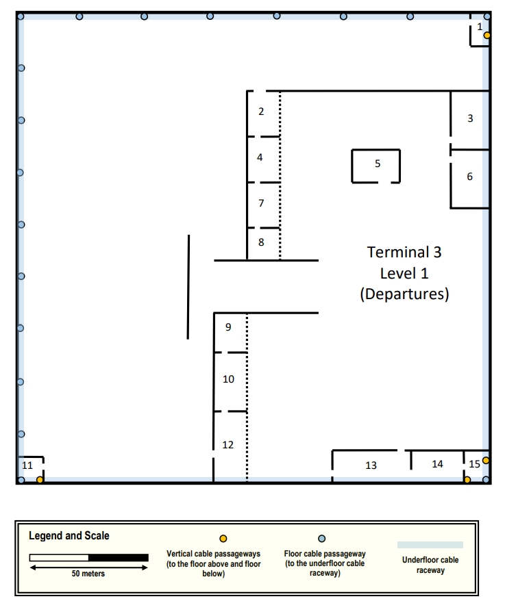
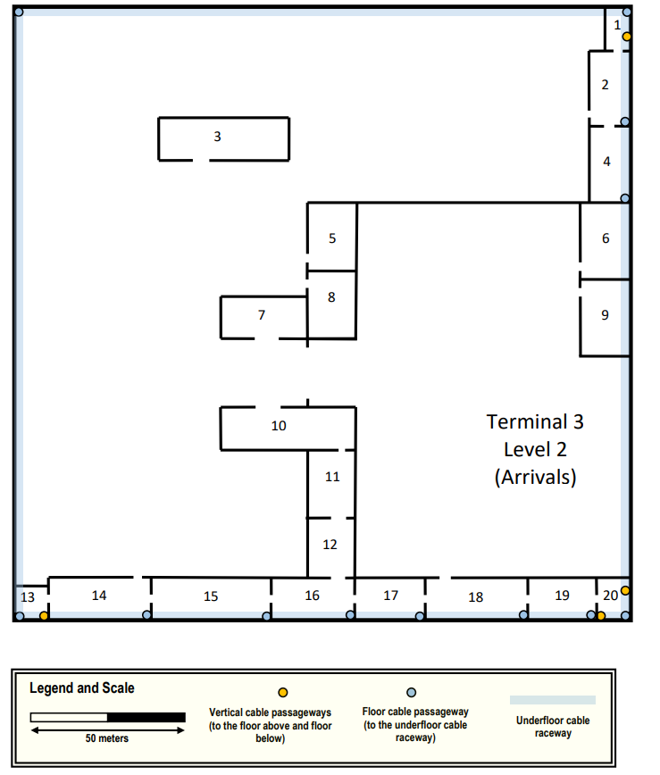

RCOMP 2025-2026 Project 1 - Sprint 1 - Member 1240850 folder
===========================================
 

## 1. Visão geral do Terminal 3 ## 

- Dimensão de 200x200 metros
- 5 pisos contudo apenas irão ser abordados 2, ambos abrangidos por cobertura WiFi ( Rede sem Fios)
---
## 2. Nivel 1-Departures (Partidas) 

### 2.1 Caacterísticas do Piso

- 4 passagens verticais que permitem a passagem de cabos entre pisos (especificamente para o nivel 2) e que ligam este mesmo piso ao *campus Backbone*
- As passagens verticais tem ainda ligação ao piso inferior através da  vala técnica subterrânea (underground passageway), usada para conectar todos os terminais.  A distância vertical entre o Level 1 e o ponto de ligação a essa vala exterior é de 10 metros
- Existe uma galeria técnica subterrânea, permitindo puxar cabos pelo subterraneo
- O andar tem 5 metros.
- Existe um teto falso que esta a 4 metros do chão e a 1 metro do teto real, totalizando assim os 5 metros.
- Esse 1 metro de espaço entre o teto falso e o teto real é perfeito para instalar cable raceways e wireless access-points.
> **Salas com Tomadas:** 2, 4, 5, 7, 8, 9, 10, 12, 13, 14.
>
> **Salas sem tomadas:**  1, 3, 6, 11, 15
>
> **Salas para Hardware de Rede (Telecommunications Room/Enclosure):**  1, 11 e 15. estas salas são salas técnicas para infraestrutura de rede (telecommunications room). Podem conter racks, patch panels, switches
>
> **Tomadas de Parede (Wall Outlets):** Ao longo da parede externa do lado esquerodo da planta e  ao longo da parede externa da parte superior da planta
>
> Nessas paredes externas, as tomadas devem ser colocadas a cada 5 metros.

#### Planta nivel 1 ####


### 2.2 Dimensões retiradas a partir da escala em metros ####

| Sala | Comp. (cm) | Larg. (cm) | Comp. (m) | Larg. (m) | Área (m²) | Nº Tomadas |
|------|------------|------------|-----------|-----------|-----------|------------|
| 1    | 0.9        | 0.5        | 15        | 8.33      | 124.95    | hardware   |
| 2    | 1.1        | 0.8        | 18.33     | 13.33     | 244.34    | 50         |
| 3    | 1.5        | 1.0        | 25        | 16.67     | 416.75    | -          |
| 4    | 1.1        | 0.8        | 18.33     | 13.33     | 244.34    | 50         |
| 5    | 1.2        | 0.8        | 20        | 13.33     | 266.60    | 54         |
| 6    | 1.5        | 1.0        | 25        | 16.67     | 416.75    | -          |
| 7    | 1.1        | 0.8        | 18.33     | 13.33     | 244.34    | 50         |
| 8    | 0.8        | 0.8        | 13.33     | 13.33     | 177.69    | 36         |
| 9    | 1.0        | 0.8        | 16.67     | 13.33     | 222.21    | 46         |
| 10   | 1.5        | 0.8        | 25        | 13.33     | 333.25    | 68         |
| 11   | 0.7        | 0.7        | 11.7      | 11.7      | 136.89    | hardware   |
| 12   | 1.8        | 0.8        | 30        | 13.33     | 399.90    | 80         |
| 13   | 2.0        | 0.8        | 33.33     | 13.33     | 444.29    | 90          |
| 14   | 1.3        | 0.8        | 21.7      | 13.33     | 289.26    | 58         |
| 15   | 0.8        | 0.7        | 13.33     | 11.7      | 155.96    | hardware   |

---
### 2.3 Cálculo de Tomadas — Paredes Internas

**Fórmula aplicada:** `Nº Tomadas = (Área ÷ 10) × 2`

| Sala       | Área (m²) | Tomadas | Postos (:2, arred. cima) |
|------------|-----------|---------|--------------------------|
| Sala 2     | 244.34    | 50      | 25                       |
| Sala 4     | 244.34    | 50      | 25                       |
| Sala 5     | 266.60    | 54      | 26                       |
| Sala 7     | 244.34    | 50      | 25                       |
| Sala 8     | 177.69    | 36      | 18                       |
| Sala 9     | 222.21    | 46      | 23                       |
| Sala 10    | 333.25    | 68      | 34                       |
| Sala 12    | 399.90    | 80      | 40                       |
| Sala 13    | 444.29    | 90      | 45                       |
| Sala 14    | 289.26    | 58      | 29                       |
| **Total**  | -         | **582** | **291**                  |

---

### 2.4 Cálculo de Tomadas — Paredes Externas

**Fórmula aplicada:**

```
Nº Tomadas por parede = floor(comprimento / 5) + 1

Parede esquerda  (200 m): floor(200 / 5) + 1 = 40 + 1 = 41 tomadas
Parede superior (200 m): floor(200 / 5) + 1 = 40 + 1 = 41 tomadas
```

| Parede                  | Tomadas |
|-------------------------|:-------:|
| Parede esquerda (200 m) |   41    |
| Parede superior (200 m) |   41    |
| **Total**               | **82**  |


### 2.5 Tomadas para Pontos de Acesso Wireless (WAP)

> Cada ponto de acesso wireless requer uma tomada de rede dedicada.


#### Cenário Prático — Diâmetro 50 m

| Parâmetro |    Valor     |
|-----------|:------------:|
| Raio do WAP |     25 m     |
| Área por WAP |   1.963 m²   |
| Área total |  40 000 m²   |
| **Nº de WAPs necessários** | ** 21 WAPs** |
| **Tomadas necessárias** |    **21**    |

---

#### Cenário real, considerando paredes

> A distribuição dos Wireless Access Points (WAP) foi efetuada de forma uniforme para assegurar a cobertura total da rede sem fios (WLAN) em todo o piso, respeitando os limites de alcance das células (BSS)
. De modo a minimizar a interferência entre canais adjacentes e otimizar a performance da rede, garantiu-se que a sobreposição entre as áreas de cobertura de WAPs vizinhos não excedesse os 15%


> Uma vez que cada ponto de acesso wireless necessita de uma tomada, serão necessárias mais 30 tomadas, uma para cada WPA, que estará situada no teto falso para que possa haver maximização da cobertura e propagação de sinal, e diminuir a quantidade de obstaculos, não havendo necessidade dde colocar pilares para a ligação das tomadas.

---

###  2.6 Plantas Esquemáticas — Nível 1


#### Sala 2


**Explicação:** A Sala 2 tem uma área de 244.34m² e deve ser equipada com o número standard de tomadas de rede. A sala exige uma distribuição estruturada e uniforme das tomadas de rede, de modo a garantir que todos os utilizadores tenham acesso fiável e de baixa latência à infraestrutura de rede.

**Justificação:** Foram alocadas 50 tomadas de rede na Sala 2, resultando em 25 postos duplos (cada posto com 2 tomadas). Esta alocação baseia-se numa densidade de 0,20 tomadas por m², cumprindo o standard mínimo recomendado para espaços de trabalho de alta densidade (1 tomada dupla a cada 10 m² ou 1 posto de duas tomadas a cada 10 m²). Esta configuração responde às necessidades operacionais actuais e antecipa futuras expansões sem requerer alterações significativas na infraestrutura existente.

---

#### Sala 4


**Explicação:** A Sala 4 tem uma área de 244,34 m² e deve ser equipada com o número standard de tomadas de rede. A sala exige uma distribuição estruturada e uniforme das tomadas de rede, de modo a garantir que todos os utilizadores tenham acesso fiável e de baixa latência à infraestrutura de rede.

**Justificação:** Foram alocadas 50 tomadas de rede na Sala 2, resultando em 25 postos duplos (cada posto com 2 tomadas). Esta alocação baseia-se numa densidade de 0,20 tomadas por m², cumprindo o standard mínimo recomendado para espaços de trabalho de alta densidade (1 tomada dupla a cada 10 m² ou 1 posto de duas tomadas a cada 10 m²). Esta configuração responde às necessidades operacionais actuais e antecipa futuras expansões sem requerer alterações significativas na infraestrutura existente.

---

#### Sala 5


**Explicação:** A Sala 5 tem uma área de 266,60 m² e deve ser equipada com o número standard de tomadas de rede. A sala exige uma distribuição estruturada e uniforme das tomadas de rede, de modo a garantir que todos os utilizadores tenham acesso fiável e de baixa latência à infraestrutura de rede.

**Justificação:** Foram alocadas 54 tomadas de rede na Sala 5, resultando em 26 postos duplos (cada posto com 2 tomadas). Esta alocação baseia-se numa densidade de 0,20 tomadas por m², cumprindo o standard mínimo recomendado para espaços de trabalho de alta densidade (1 tomada dupla a cada 10 m² ou 1 posto de duas tomadas a cada 10 m²). Esta configuração responde às necessidades operacionais actuais e antecipa futuras expansões sem requerer alterações significativas na infraestrutura existente.

---

#### Sala 7


**Explicação:** A Sala 7 tem uma área de 244,34 m² e deve ser equipada com o número standard de tomadas de rede. A sala exige uma distribuição estruturada e uniforme das tomadas de rede, de modo a garantir que todos os utilizadores tenham acesso fiável e de baixa latência à infraestrutura de rede.

**Justificação:** Foram alocadas 50 tomadas de rede na Sala 7, resultando em 25 postos duplos (cada posto com 2 tomadas). Esta alocação baseia-se numa densidade de 0,20 tomadas por m², cumprindo o standard mínimo recomendado para espaços de trabalho de alta densidade (1 tomada dupla a cada 10 m² ou 1 posto de duas tomadas a cada 10 m²).  Esta configuração responde às necessidades operacionais actuais e antecipa futuras expansões sem requerer alterações significativas na infraestrutura existente.

---

#### Sala 8


**Explicação:** A Sala 8 tem uma área de 177,69 m² e deve ser equipada com o número standard de tomadas de rede. A sala exige uma distribuição estruturada e uniforme das tomadas de rede, de modo a garantir que todos os utilizadores tenham acesso fiável e de baixa latência à infraestrutura de rede.

**Justificação:** Foram alocadas 36 tomadas de rede na Sala 8, resultando em 18 postos duplos (cada posto com 2 tomadas). Esta alocação baseia-se numa densidade de 0,20 tomadas por m², cumprindo o standard mínimo recomendado para espaços de trabalho de alta densidade (1 tomada dupla a cada 10 m² ou 1 posto de duas tomadas a cada 10 m²).  Esta configuração responde às necessidades operacionais actuais e antecipa futuras expansões sem requerer alterações significativas na infraestrutura existente.

---

#### Sala 9


**Explicação:** A Sala 9 tem uma área de 222,21 m² e deve ser equipada com o número standard de tomadas de rede. A sala exige uma distribuição estruturada e uniforme das tomadas de rede, de modo a garantir que todos os utilizadores tenham acesso fiável e de baixa latência à infraestrutura de rede.

**Justificação:** Foram alocadas 46 tomadas de rede na Sala 9, resultando em 23 postos duplos (cada posto com 2 tomadas). Esta alocação baseia-se numa densidade de 0,20 tomadas por m², cumprindo o standard mínimo recomendado para espaços de trabalho de alta densidade (1 tomada dupla a cada 10 m² ou 1 posto de duas tomadas a cada 10 m²).  Esta configuração responde às necessidades operacionais actuais e antecipa futuras expansões sem requerer alterações significativas na infraestrutura existente.

---

#### Sala 10


**Explicação:** A Sala 10 tem uma área de 333,25 m² e deve ser equipada com o número standard de tomadas de rede. A sala exige uma distribuição estruturada e uniforme das tomadas de rede, de modo a garantir que todos os utilizadores tenham acesso fiável e de baixa latência à infraestrutura de rede.

**Justificação:** Foram alocadas 68 tomadas de rede na Sala 10, resultando em 34 postos duplos (cada posto com 2 tomadas). Esta alocação baseia-se numa densidade de 0,20 tomadas por m², cumprindo o standard mínimo recomendado para espaços de trabalho de alta densidade (1 tomada dupla a cada 10 m² ou 1 posto de duas tomadas a cada 10 m²).  Esta configuração responde às necessidades operacionais actuais e antecipa futuras expansões sem requerer alterações significativas na infraestrutura existente.

#### Sala 12


**Explicação:** A Sala 12 tem uma área de 399,90 m² e deve ser equipada com o número standard de tomadas de rede. A sala exige uma distribuição estruturada e uniforme das tomadas de rede, de modo a garantir que todos os utilizadores tenham acesso fiável e de baixa latência à infraestrutura de rede.

**Justificação:** Foram alocadas 80 tomadas de rede na Sala 12, resultando em 40 postos duplos (cada posto com 2 tomadas). Esta alocação baseia-se numa densidade de 0,20 tomadas por m², cumprindo o standard mínimo recomendado para espaços de trabalho de alta densidade (1 tomada dupla a cada 10 m² ou 1 posto de duas tomadas a cada 10 m²).  Esta configuração responde às necessidades operacionais actuais e antecipa futuras expansões sem requerer alterações significativas na infraestrutura existente.


#### Sala 13


**Explicação:** A Sala 13 tem uma área de 444,29 m² e deve ser equipada com o número standard de tomadas de rede. A sala exige uma distribuição estruturada e uniforme das tomadas de rede, de modo a garantir que todos os utilizadores tenham acesso fiável e de baixa latência à infraestrutura de rede.

**Justificação:** Foram alocadas 90 tomadas de rede na Sala 13, resultando em 45 postos duplos (cada posto com 2 tomadas). Esta alocação baseia-se numa densidade de 0,20 tomadas por m², cumprindo o standard mínimo recomendado para espaços de trabalho de alta densidade (1 tomada dupla a cada 10 m² ou 1 posto de duas tomadas a cada 10 m²).  Esta configuração responde às necessidades operacionais actuais e antecipa futuras expansões sem requerer alterações significativas na infraestrutura existente.

#### Sala 14


**Explicação:** A Sala 14 tem uma área de 289,26 m² e deve ser equipada com o número standard de tomadas de rede. A sala exige uma distribuição estruturada e uniforme das tomadas de rede, de modo a garantir que todos os utilizadores tenham acesso fiável e de baixa latência à infraestrutura de rede.

**Justificação:** Foram alocadas 58 tomadas de rede na Sala 14, resultando em 29 postos duplos (cada posto com 2 tomadas). Esta alocação baseia-se numa densidade de 0,20 tomadas por m², cumprindo o standard mínimo recomendado para espaços de trabalho de alta densidade (1 tomada dupla a cada 10 m² ou 1 posto de duas tomadas a cada 10 m²).  Esta configuração responde às necessidades operacionais actuais e antecipa futuras expansões sem requerer alterações significativas na infraestrutura existente.

---

### 2.7 Cross-Connects Deployment


>Foram instalados três Horizontal Cross-connects (HC) para servir o piso, garantindo o cumprimento dos limites normativos de 90 metros para o comprimento real do cabo e de 80 metros para a distância em linha reta entre o repartidor e as tomadas. Para assegurar que toda a área fosse coberta, houve a necessidade de instalar armários de telecomunicações (TE) em salas não dedicadas exclusivamente a telecomunicações, uma vez que as salas exclusivas existentes não permitiam o posicionamento central necessário para respeitar os limites de distância em todo o piso.
Adicionalmente, foi instalado neste piso o Intermediate Cross-connect (IC) para atuar como o ponto central de distribuição do edifício, localizado na sala 11 (canto inferior esquerdo), partilhando o espaço com o HC que serve essa zona. Este repartidor liga-se a todos os Horizontal Cross-connects (HC) através do Subsistema de Cablagem 2 (backbone de edifício). Para as ligações, foram definidos caminhos de cabos (pathways) que percorrem tetos falsos e pavimentos sobrelevados, utilizando cabos de fibra ótica multimodo para assegurar a performance e a escalabilidade da rede. Os HC estão interligados ao IC pelas passagens técnicas sob o pavimento.
Para a implementação do Subsistema de Cablagem 1 (cablagem horizontal), foram instalados 8 Consolidation Points (CP) distribuídos pelo piso, servindo de ponto de consolidação intermédio entre os HC e as tomadas. Cada CP é ligado ao respetivo HC via cabo CAT7, e serve as tomadas das salas e os pontos de acesso sem fios (WAP). A distribuição dos CP é a seguinte: um CP serve as salas 2,4 e 5; outro serve as salas 7,8 e 9; outro serve as salas 10 e 12;  os restants servem as filas de WAP. As salas 1, 3, 6, 11, 15 não possuem tomadas, sendo que as salas 1, 11 e 15 albergam os HC.
Para a implementação do Subsistema de Cablagem 1 (cablagem horizontal), foram definidos caminhos de cabos (pathways) que utilizam passagens técnicas sob o pavimento para ligar a maioria das salas aos respetivos Consolidation Points (CP) e Horizontal Cross-connects (HC).

### 2.8 Hardware Inventory

#### Total Outlets Summary

| Category              | Outlets |
|-----------------------|---------|
| Internal room outlets | 586     |
| WAP outlets           | 30      |
| **GRAND TOTAL**       | **616** |

#### Cable Lengths

| Cable Type                                            | Total Length |
|-------------------------------------------------------|--------------|
| CAD7A copper cable (horizontal cabling — Subsystem 1) | 28 486,7 m   |
| Multimode optical fibre OM (backbone — Subsystem 2)   | 4272,72 m    |

#### Consolidation Points (CP)

> 8 CPs installed. Each CP is connected to its HC via CAD7A. Rule: 1 patch panel (24-port) per 24 outlets served (rounded up).

| CP        | Rooms / Zone Served                      | Outlets | PP 24p | Connected HC |
|-----------|------------------------------------------|---------|--------|--------------|
| CP1       | 1st line wap                             | 3       | 1      | HC1          |
| CP2       | 2nd line WAP                             | 3       | 1      | HC1          |
| CP3       | Rooms 2 + 4 + 5 (2nd line WAP)           | 156     | 7      | HC1          |
| CP4       | 3rd line wap                             | 3       | 1      | HC1          |
| CP5       | Room 7+8+9 (4th line WAP)                | 134     | 6      | HC2          |
| CP6       | 4th line wap                             | 4       | 1      | HC1          |
| CP7       | Rooms 10 + 12 + (5th and 6th line wap)   | 151     | 7      | HC3          |
| CP8       | 5th line wap                             | 2       | 1      | HC4          |
| **TOTAL** | —                                        | **456** | **25** | —            |


---

#### Patch Panels per HC / IC

| Location      | CPs Served             | CAT7A PP (24p) | Fibre PP (24p) |
|---------------|------------------------|----------------|----------------|
| HC1 (room 1)  | CP1, CP2, CP3, CP4,CP6 | 8              | 1              |
| HC2 (room 1)  | CP5                    | 6              | 1              |
| HC3 (room 11) | CP7                    | 7              | 1              |
| HC4 (room 15) | CP8                    | 7              | 1              |
| IC  (room 11) | ALL                    | 0              | 1              |
| **TOTAL**     | —                      | **38**         | **5**          |

#### Total Patch Panel Summary

| Equipment                             | Quantity |
|---------------------------------------|----------|
| Patch panels CAD7A 24-port (at CPs)   | 25       |
| Patch panels CAD7A 24-port (at HC/IC) | 38       |
| Patch panels fibre 24-port LC (HC/IC) | 5        |
| **TOTAL patch panels**                | **68**   |

---

#### 5. Telecommunication Enclosures

> Sizing rule: 1U per patch panel + 1U cable management per PP + 1U switch. Apply 50% growth margin. Round up to nearest commercial size (6U, 9U, 12U, 15U, 18U, 24U, 42U).

#### 5. Telecommunication Enclosures

> Sizing rule: 1U per patch panel + 1U cable management per PP + 1U switch. Apply 50% growth margin. Round up to nearest commercial size (6U, 9U, 12U, 15U, 18U, 24U, 42U).

| Location      | CAD7A PPs | Fibre PPs | Switch | Raw U | With 50% | Enclosure          |
|---------------|-----------|-----------|--------|-------|----------|--------------------|
| HC1 (room 1)  | 8         | 1         | 1U     | 19U   | 29U      | 42U rack           |
| HC2 (room 1)  | 6         | 1         | 1U     | 15U   | 23U      | 24U enclosure      |
| HC3 (room 11) | 7         | 1         | 1U     | 17U   | 26U      | 42U rack           |
| HC4 (room 15) | 7         | 1         | 1U     | 17U   | 26U      | 42U rack           |
| IC  (room 11) | 0         | 1         | 1U     | 3U    | 5U       | 6U wall enclosure  |

---

#### 6. Complete Hardware Summary

| Hardware Item                        | Quantity   |
|--------------------------------------|------------|
| CAD7A copper cable                   | 28 486,7 m |
| Multimode optical fibre OM           | 4 272,2 m  |
| Network outlets ISO 8877 — internal  | 586        |
| Network outlets ISO 8877 — WAP       | 30         |
| **Network outlets ISO 8877 — TOTAL** | ** 596 **  |
| Wireless Access Points (WAP)         | 30         |
| Consolidation Points (CP)            | 8          |
| Horizontal Cross-connects (HC)       | 4          |
| Intermediate Cross-connect (IC)      | 1          |
| Patch panels CAD7A 24-port           | 35         |
| Patch panels fibre 24-port LC        | 4          |
| Telecommunication enclosures 42U     | 3          |
| Telecommunication enclosures 24U     | 1          |
| Telecommunication enclosures 6U      | 1          |


---
##  3. Nível 2 —  Arrivals (Chegadas)

### 3.1 Características do Piso

- 4 passagens verticais que permitem a passagem de cabos entre pisos e ligam este piso ao backbone do campus através da vala técnica externa.
- Tem ligação direta à vala técnica subterrânea (underground passageway) que conecta todos os terminais
- A distância vertical entre o Level 4 e o ponto de ligação a essa vala exterior é de 16 metros.
- Do Level 1 à vala são 10m, e do Level 2 à vala são 16m. Portanto, a distância vertical entre o Level 1 e o Level 2 é de 6 metros.
- Existe uma galeria técnica subterrânea (horizontal)
- Existe um espaço acima do teto falso, comm 1 metro entre o teto falso e o teto real.
- Tal como no Level 1, tem duas opções de rotas horizontais: subterrânea (underfloor) e aérea (acima do teto falso).
> **Salas com Tomadas:** 2, 4, 5, 7, 10, 11, 12, 14, 15, 16, 17, 18, 19.
>
> **Salas sem Tomadas:** 1, 6, 8, 9, 13,20.
>
> **Salas para Hardware de Rede (Telecommunications Room/Enclosure):**  1, 13 e 20.

#### Planta nivel 2 ####



---
### 3.2 Dimensões retiradas a partir da escala em metros ####

| Sala | Comp. (cm) | Larg. (cm) | Comp. (m) | Larg. (m) | Área (m²) | Nº Tomadas |
|------|------------|------------|-----------|-----------|-----------|-----------|
| 1    | 0.9        | 0.5        | 15.0      | 8.33      | 124.95    | hardware  |
| 2    | 1.5        | 0.8        | 25.0      | 13.33     | 333.25    | 67        |
| 3    | 2.5        | 0.8        | 41.67     | 13.33     | 555.46    | 111       |
| 4    | 1.5        | 0.8        | 25.0      | 13.33     | 333.25    | 67        |
| 5    | 1.3        | 1.0        | 21.67     | 16.67     | 361.24    | -         |
| 6    | 1.5        | 1.0        | 25.0      | 16.67     | 416.75    | -         |
| 7    | 1.7        | 0.8        | 28.33     | 13.33     | 377.64    | 76        |
| 8    | 1.3        | 1.0        | 21.67     | 16.67     | 361.24    | -         |
| 9    | 1.5        | 1.0        | 25.0      | 16.67     | 416.75    | -         |
| 10   | 2.6        | 0.9        | 43.33     | 15.0      | 649.95    | 130       |
| 11   | 1.3        | 1.0        | 21.67     | 16.67     | 361.24    | 72        |
| 12   | 1.2        | 1.0        | 20.0      | 16.67     | 333.40    | 67        |
| 13   | 0.7        | 0.7        | 11.67     | 11.67     | 136.19    | hardware  |
| 14   | 2.0        | 0.9        | 33.33     | 15.0      | 499.95    | 100       |
| 15   | 2.4        | 0.9        | 40.0      | 15.0      | 600.00    | 120       |
| 16   | 1.6        | 0.9        | 26.67     | 15.0      | 400.05    | 80        |
| 17   | 1.4        | 0.9        | 23.33     | 15.0      | 349.95    | 70        |
| 18   | 2.0        | 0.9        | 33.33     | 15.0      | 499.95    | 100       |
| 19   | 1.4        | 0.9        | 23.33     | 15.0      | 349.95    | 70        |
| 20   | 0.9        | 0.7        | 15.0      | 11.67     | 175.05    | hardware  |

---

### 3.3 Cálculo de Tomadas — Paredes Internas

**Fórmula aplicada:** `Nº Tomadas = (Área ÷ 10) × 2`

| Sala | Área (m²) | Nº Tomadas | Postos |
|------|-----------|------------|--------|
| 2    | 333.25    | 67         | 34     |
| 3    | 555.46    | 111        | 56     |
| 4    | 333.25    | 67         | 34     |
| 7    | 377.64    | 76         | 38     |
| 10   | 649.95    | 130        | 65     |
| 11   | 361.24    | 72         | 36     |
| 12   | 333.40    | 67         | 34     |
| 14   | 499.95    | 100        | 50     |
| 15   | 600.00    | 120        | 60     |
| 16   | 400.05    | 80         | 40     |
| 17   | 349.95    | 70         | 35     |
| 18   | 499.95    | 100        | 50     |
| 19   | 349.95    | 70         | 35     |

---
###  3.4 Tomadas para Pontos de Acesso Wireless (WAP)

> Cada ponto de acesso wireless requer uma tomada de rede dedicada.


#### Cenário Prático — Diâmetro 50 m

| Parâmetro |    Valor   |
|-----------|:----------:|
| Raio do WAP |    25 m    |
| Área por WAP |  1.963 m²  |
| Área total | 40.000 m²  |
| **Nº de WAPs necessários** | **21WAPs** |
| **Tomadas necessárias** |   **21**   |

---

#### Cenário real, considerando paredes

> A distribuição dos Wireless Access Points (WAP) foi efetuada de forma uniforme para assegurar a cobertura total da rede sem fios (WLAN) em todo o piso, respeitando os limites de alcance das células (BSS)
. De modo a minimizar a interferência entre canais adjacentes e otimizar a performance da rede, garantiu-se que a sobreposição entre as áreas de cobertura de WAPs vizinhos não excedesse os 15%


> Uma vez que cada ponto de acesso wireless necessita de uma tomada, serão necessárias mais 30 tomadas, uma para cada WPA, que estará situada no teto falso para que possa haver maximização da cobertura e propagação de sinal, e diminuir a quantidade de obstaculos, não havendo necessidade dde colocar pilares para a ligação das tomadas.


### 3.5  Plantas Esquemáticas — Nível 2

---
# Sala 2


**Explicação:** A Sala 2 tem uma área de 333.25m² e deve ser equipada com o número standard de tomadas de rede. A sala exige uma distribuição estruturada e uniforme das tomadas de rede, de modo a garantir que todos os utilizadores tenham acesso fiável e de baixa latência à infraestrutura de rede.

**Justificação:** Foram alocadas 67 tomadas de rede na Sala 2, resultando em 34 postos duplos (cada posto com 2 tomadas). Esta alocação baseia-se numa densidade de 0,20 tomadas por m², cumprindo o standard mínimo recomendado para espaços de trabalho de alta densidade (1 tomada dupla a cada 10 m² ou 1 posto de duas tomadas a cada 10 m²). Esta configuração responde às necessidades operacionais actuais e antecipa futuras expansões sem requerer alterações significativas na infraestrutura existente.

# Sala 3


**Explicação:** A Sala 3 tem uma área de 555.46m² e deve ser equipada com o número standard de tomadas de rede. A sala exige uma distribuição estruturada e uniforme das tomadas de rede, de modo a garantir que todos os utilizadores tenham acesso fiável e de baixa latência à infraestrutura de rede.

**Justificação:** Foram alocadas 111 tomadas de rede na Sala 3, resultando em 56 postos duplos (cada posto com 2 tomadas). Esta alocação baseia-se numa densidade de 0,20 tomadas por m², cumprindo o standard mínimo recomendado para espaços de trabalho de alta densidade (1 tomada dupla a cada 10 m² ou 1 posto de duas tomadas a cada 10 m²). Esta configuração responde às necessidades operacionais actuais e antecipa futuras expansões sem requerer alterações significativas na infraestrutura existente.

# Sala 4


**Explicação:** A Sala 4 tem uma área de 333.25m² e deve ser equipada com o número standard de tomadas de rede. A sala exige uma distribuição estruturada e uniforme das tomadas de rede, de modo a garantir que todos os utilizadores tenham acesso fiável e de baixa latência à infraestrutura de rede.

**Justificação:** Foram alocadas 67 tomadas de rede na Sala 4, resultando em 34 postos duplos (cada posto com 2 tomadas). Esta alocação baseia-se numa densidade de 0,20 tomadas por m², cumprindo o standard mínimo recomendado para espaços de trabalho de alta densidade (1 tomada dupla a cada 10 m² ou 1 posto de duas tomadas a cada 10 m²). Esta configuração responde às necessidades operacionais actuais e antecipa futuras expansões sem requerer alterações significativas na infraestrutura existente.

# Sala 7


**Explicação:** A Sala 7 tem uma área de 377.64m² e deve ser equipada com o número standard de tomadas de rede. A sala exige uma distribuição estruturada e uniforme das tomadas de rede, de modo a garantir que todos os utilizadores tenham acesso fiável e de baixa latência à infraestrutura de rede.

**Justificação:** Foram alocadas 76 tomadas de rede na Sala 7, resultando em 38 postos duplos (cada posto com 2 tomadas). Esta alocação baseia-se numa densidade de 0,20 tomadas por m², cumprindo o standard mínimo recomendado para espaços de trabalho de alta densidade (1 tomada dupla a cada 10 m² ou 1 posto de duas tomadas a cada 10 m²). Esta configuração responde às necessidades operacionais actuais e antecipa futuras expansões sem requerer alterações significativas na infraestrutura existente.

# Sala 10


**Explicação:** A Sala 10 tem uma área de 649.95m² e deve ser equipada com o número standard de tomadas de rede. A sala exige uma distribuição estruturada e uniforme das tomadas de rede, de modo a garantir que todos os utilizadores tenham acesso fiável e de baixa latência à infraestrutura de rede.

**Justificação:** Foram alocadas 130 tomadas de rede na Sala 10, resultando em 65 postos duplos (cada posto com 2 tomadas). Esta alocação baseia-se numa densidade de 0,20 tomadas por m², cumprindo o standard mínimo recomendado para espaços de trabalho de alta densidade (1 tomada dupla a cada 10 m² ou 1 posto de duas tomadas a cada 10 m²). Esta configuração responde às necessidades operacionais actuais e antecipa futuras expansões sem requerer alterações significativas na infraestrutura existente.

# Sala 11


**Explicação:** A Sala 11 tem uma área de 361.24m² e deve ser equipada com o número standard de tomadas de rede. A sala exige uma distribuição estruturada e uniforme das tomadas de rede, de modo a garantir que todos os utilizadores tenham acesso fiável e de baixa latência à infraestrutura de rede.

**Justificação:** Foram alocadas 72 tomadas de rede na Sala 11, resultando em 36 postos duplos (cada posto com 2 tomadas). Esta alocação baseia-se numa densidade de 0,20 tomadas por m², cumprindo o standard mínimo recomendado para espaços de trabalho de alta densidade (1 tomada dupla a cada 10 m² ou 1 posto de duas tomadas a cada 10 m²). Esta configuração responde às necessidades operacionais actuais e antecipa futuras expansões sem requerer alterações significativas na infraestrutura existente.

# Sala 12


**Explicação:** A Sala 12 tem uma área de 333.40m² e deve ser equipada com o número standard de tomadas de rede. A sala exige uma distribuição estruturada e uniforme das tomadas de rede, de modo a garantir que todos os utilizadores tenham acesso fiável e de baixa latência à infraestrutura de rede.

**Justificação:** Foram alocadas 67 tomadas de rede na Sala 12, resultando em 34 postos duplos (cada posto com 2 tomadas). Esta alocação baseia-se numa densidade de 0,20 tomadas por m², cumprindo o standard mínimo recomendado para espaços de trabalho de alta densidade (1 tomada dupla a cada 10 m² ou 1 posto de duas tomadas a cada 10 m²). Esta configuração responde às necessidades operacionais actuais e antecipa futuras expansões sem requerer alterações significativas na infraestrutura existente.

# Sala 14


**Explicação:** A Sala 14 tem uma área de 499.95m² e deve ser equipada com o número standard de tomadas de rede. A sala exige uma distribuição estruturada e uniforme das tomadas de rede, de modo a garantir que todos os utilizadores tenham acesso fiável e de baixa latência à infraestrutura de rede.

**Justificação:** Foram alocadas 100 tomadas de rede na Sala 14, resultando em 50 postos duplos (cada posto com 2 tomadas). Esta alocação baseia-se numa densidade de 0,20 tomadas por m², cumprindo o standard mínimo recomendado para espaços de trabalho de alta densidade (1 tomada dupla a cada 10 m² ou 1 posto de duas tomadas a cada 10 m²). Esta configuração responde às necessidades operacionais actuais e antecipa futuras expansões sem requerer alterações significativas na infraestrutura existente.

# Sala 15


**Explicação:** A Sala 15 tem uma área de 600.00m² e deve ser equipada com o número standard de tomadas de rede. A sala exige uma distribuição estruturada e uniforme das tomadas de rede, de modo a garantir que todos os utilizadores tenham acesso fiável e de baixa latência à infraestrutura de rede.

**Justificação:** Foram alocadas 120 tomadas de rede na Sala 15, resultando em 60 postos duplos (cada posto com 2 tomadas). Esta alocação baseia-se numa densidade de 0,20 tomadas por m², cumprindo o standard mínimo recomendado para espaços de trabalho de alta densidade (1 tomada dupla a cada 10 m² ou 1 posto de duas tomadas a cada 10 m²). Esta configuração responde às necessidades operacionais actuais e antecipa futuras expansões sem requerer alterações significativas na infraestrutura existente.

# Sala 16


**Explicação:** A Sala 16 tem uma área de 400.05m² e deve ser equipada com o número standard de tomadas de rede. A sala exige uma distribuição estruturada e uniforme das tomadas de rede, de modo a garantir que todos os utilizadores tenham acesso fiável e de baixa latência à infraestrutura de rede.

**Justificação:** Foram alocadas 80 tomadas de rede na Sala 16, resultando em 40 postos duplos (cada posto com 2 tomadas). Esta alocação baseia-se numa densidade de 0,20 tomadas por m², cumprindo o standard mínimo recomendado para espaços de trabalho de alta densidade (1 tomada dupla a cada 10 m² ou 1 posto de duas tomadas a cada 10 m²). Esta configuração responde às necessidades operacionais actuais e antecipa futuras expansões sem requerer alterações significativas na infraestrutura existente.

# Sala 17


**Explicação:** A Sala 17 tem uma área de 349.95m² e deve ser equipada com o número standard de tomadas de rede. A sala exige uma distribuição estruturada e uniforme das tomadas de rede, de modo a garantir que todos os utilizadores tenham acesso fiável e de baixa latência à infraestrutura de rede.

**Justificação:** Foram alocadas 70 tomadas de rede na Sala 17, resultando em 35 postos duplos (cada posto com 2 tomadas). Esta alocação baseia-se numa densidade de 0,20 tomadas por m², cumprindo o standard mínimo recomendado para espaços de trabalho de alta densidade (1 tomada dupla a cada 10 m² ou 1 posto de duas tomadas a cada 10 m²). Esta configuração responde às necessidades operacionais actuais e antecipa futuras expansões sem requerer alterações significativas na infraestrutura existente.

# Sala 18


**Explicação:** A Sala 18 tem uma área de 499.95m² e deve ser equipada com o número standard de tomadas de rede. A sala exige uma distribuição estruturada e uniforme das tomadas de rede, de modo a garantir que todos os utilizadores tenham acesso fiável e de baixa latência à infraestrutura de rede.

**Justificação:** Foram alocadas 100 tomadas de rede na Sala 18, resultando em 50 postos duplos (cada posto com 2 tomadas). Esta alocação baseia-se numa densidade de 0,20 tomadas por m², cumprindo o standard mínimo recomendado para espaços de trabalho de alta densidade (1 tomada dupla a cada 10 m² ou 1 posto de duas tomadas a cada 10 m²). Esta configuração responde às necessidades operacionais actuais e antecipa futuras expansões sem requerer alterações significativas na infraestrutura existente.

# Sala 19


**Explicação:** A Sala 19 tem uma área de 349.95m² e deve ser equipada com o número standard de tomadas de rede. A sala exige uma distribuição estruturada e uniforme das tomadas de rede, de modo a garantir que todos os utilizadores tenham acesso fiável e de baixa latência à infraestrutura de rede.

**Justificação:** Foram alocadas 70 tomadas de rede na Sala 19, resultando em 35 postos duplos (cada posto com 2 tomadas). Esta alocação baseia-se numa densidade de 0,20 tomadas por m², cumprindo o standard mínimo recomendado para espaços de trabalho de alta densidade (1 tomada dupla a cada 10 m² ou 1 posto de duas tomadas a cada 10 m²). Esta configuração responde às necessidades operacionais actuais e antecipa futuras expansões sem requerer alterações significativas na infraestrutura existente.

---

### 3.3 Cross-Connects Deployment


>Foram instalados quatro Horizontal Cross-connects (HC) para servir o piso, garantindo o cumprimento dos limites normativos de 90 metros para o comprimento real do cabo e de 80 metros para a distância em linha reta entre o repartidor e as tomadas. Para assegurar que toda a área fosse coberta, houve a necessidade de instalar armários de telecomunicações (TE) em salas não dedicadas exclusivamente a telecomunicações, uma vez que as salas exclusivas existentes não permitiam o posicionamento central necessário para respeitar os limites de distância em todo o piso.
Adicionalmente, foi instalado neste piso o Intermediate Cross-connect (IC) para atuar como o ponto central de distribuição do edifício, localizado na sala 11 (canto inferior esquerdo), partilhando o espaço com o HC que serve essa zona. Este repartidor liga-se a todos os Horizontal Cross-connects (HC) através do Subsistema de Cablagem 2 (backbone de edifício). Para as ligações, foram definidos caminhos de cabos (pathways) que percorrem tetos falsos e pavimentos sobrelevados, utilizando cabos de fibra ótica multimodo para assegurar a performance e a escalabilidade da rede. Os HC estão interligados ao IC pelas passagens técnicas sob o pavimento.
Para a implementação do Subsistema de Cablagem 1 (cablagem horizontal), foram instalados 12 Consolidation Points (CP) distribuídos pelo piso, servindo de ponto de consolidação intermédio entre os HC e as tomadas. Cada CP é ligado ao respetivo HC via cabo CAT7, e serve as tomadas das salas, os pontos de acesso sem fios (WAP). 
Para a implementação do Subsistema de Cablagem 1 (cablagem horizontal), foram definidos caminhos de cabos (pathways) que utilizam passagens técnicas sob o pavimento para ligar a maioria das salas aos respetivos Consolidation Points (CP) e Horizontal Cross-connects (HC).

### 3.7 Hardware Inventory

#### Total Outlets Summary

| Category | Outlets   |
|---|-----------|
| Internal room outlets | 1 130     |
| WAP outlets | 30        |
| **GRAND TOTAL** | **1 160** |

#### Cable Lengths

| Cable Type                                            | Total Length |
|-------------------------------------------------------|--------------|
| CAD7A copper cable (horizontal cabling — Subsystem 1) | 48 891,8 m   |
| Multimode optical fibre OM (backbone — Subsystem 2)   | 5141,14 m    |

#### Consolidation Points (CP)

> 13 CPs installed. Each CP is connected to its HC via CAD7A. Rule: 1 patch panel (24-port) per 24 outlets served (rounded up).

| CP         | Rooms / Zone Served          | Outlets | PP 24p | Connected HC |
|------------|------------------------------|---------|--------|--------------|
| CP1        | 1st line wap                 | 2       | 1      | HC1          |
| CP2        | Rooms 3  (2nd line WAP)      | 113     | 5      | HC1          |
| CP3        | 2nd                          | 2       | 1      | HC1          |
| CP4        | Room 7 (3rd line WAP)        | 78      | 4      | HC1          |
| CP5        | 3rd line WAP                 | 2       | 1      | HC1          |
| CP6        | 4th line WAP                 | 3       | 1      | HC2          |
| CP7        | Rooms 14 + 15                | 2       | 1      | HC2          |
| CP8        | Rooms 11(5th line WAP)       | 74      | 4      | HC2          |
| CP9        | Rooms 10 (5th line WAP)      | 133     | 6      | HC2          |
| CP10       | Rooms 15 WAPs (6th line WAP) | 82      | 4      | HC2          |
| CP11       | Rooms 16 WAPs                | 80      | 4      | HC2          |
| CP12       | Rooms 17 WAPs (6th line)     | 73      | 4      | HC2          |
| **TOTAL**  | —                            | **664** | **36** | —            |


---

#### Patch Panels per HC / IC

| Location      | CPs Served         | CAT7A PP (24p) | Fibre PP (24p) |
|---------------|--------------------|----------------|----------------|
| HC1 (room 1)  | CP1, CP2, CP3,cp5  | 5              | 1              |
| HC2 (room 1)  | CP4                | 4              | 1              |
| HC3 (room 13) | CP6, CP7,CP10,CP11 | 7              | 1              |
| HC4 (room 13) | CP12               | 4              | 1              |
| HC5 (room 20) | CP8                | 4              | 1              |
| HC6 (room 20) | CP9                | 6              | 1              |
| **TOTAL**     | —                  | **30**         | **6**          |

#### Total Patch Panel Summary

| Equipment                             | Quantity |
|---------------------------------------|----------|
| Patch panels CAD7A 24-port (at CPs)   | 36       |
| Patch panels CAD7A 24-port (at HC/IC) | 30       |
| Patch panels fibre 24-port LC (HC/IC) | 6        |
| **TOTAL patch panels**                | **72**   |

---

#### 5. Telecommunication Enclosures

> Sizing rule: 1U per patch panel + 1U cable management per PP + 1U switch. Apply 50% growth margin. Round up to nearest commercial size (6U, 9U, 12U, 15U, 18U, 24U, 42U).

| Location      | CAD7A PPs | Fibre PPs | Switch | Raw U | With 50% | Enclosure         |
|---------------|-----------|-----------|--------|-------|----------|-------------------|
| HC1 (room 1)  | 5         | 1         | 1U     | 13U   | 20U      | 24U enclosure     |
| HC2 (room 1)  | 4         | 1         | 1U     | 11U   | 17U      | 18U enclosure     |
| HC3 (room 13) | 7         | 1         | 1U     | 17U   | 26U      | 42U rack          |
| HC4 (room 13) | 4         | 1         | 1U     | 11U   | 17U      | 18U enclosure     |
| HC5 (room 20) | 4         | 1         | 1U     | 11U   | 17U      | 18U enclosure     |
| HC6 (room 20) | 6         | 1         | 1U     | 15U   | 23U      | 24U enclosure     |


---

#### 6. Complete Hardware Summary

| Hardware Item                        | Quantity   |
|--------------------------------------|------------|
| CAD7A copper cable                   | 48 891,8 m |
| Multimode optical fibre OM           | 5141,14 m  |
| Network outlets ISO 8877 — internal  | 1 130      |
| Network outlets ISO 8877 — WAP       | 30         |
| **Network outlets ISO 8877 — TOTAL** | **1 160**  |
| Wireless Access Points (WAP)         | 30         |
| Consolidation Points (CP)            | 12         |
| Horizontal Cross-connects (HC)       | 6          |
| Intermediate Cross-connect (IC)      | 0          |
| Patch panels CAD7A 24-port           | 66         |
| Patch panels fibre 24-port LC        | 6          |
| Telecommunication enclosures 42U     | 1          |
| Telecommunication enclosures 24U     | 2          |
| Telecommunication enclosures 18U     | 3          |


### 7 Global Summary

### Hardware Inventory — Terminal 3 (Total)

| Hardware Item                        | Level 1     | Level 2     | **Total T3**    |
|--------------------------------------|-------------|-------------|-----------------|
| CAT7A copper cable                   | 28 486,7 m  | 48 891,8 m  | **77 378,5 m**  |
| Multimode optical fibre OM           | 4 272,2 m   | 5 141,14 m  | **9 413,34 m**  |
| Network outlets ISO 8877 — internal  | 586         | 1 130       | **1 716**       |
| Network outlets ISO 8877 — WAP       | 30          | 30          | **60**          |
| **Network outlets ISO 8877 — TOTAL** | **616**     | **1 160**   | **1 776**       |
| Wireless Access Points (WAP)         | 30          | 30          | **60**          |
| Consolidation Points (CP)            | 8           | 12          | **20**          |
| Horizontal Cross-connects (HC)       | 4           | 6           | **10**          |
| Intermediate Cross-connect (IC)      | 1           | 0           | **1**           |
| Patch panels CAT7A 24-port           | 63          | 66          | **129**         |
| Patch panels fibre 24-port LC        | 5           | 6           | **11**          |
