# RCOMP 2025–2026 — Project 1 — Sprint 1
**Membro:** 1240868

---

## Índice

- [1. Visão Geral do Terminal 2](#1-visão-geral-do-terminal-2)
- [2. Nível 1 — Arrivals](#2-nível-1--arrivals-chegadas)
    - [2.1 Características do Piso](#21-características-do-piso)
    - [2.2 Dimensões das Salas](#22-dimensões-das-salas--nível-1)
    - [2.3 Cálculo de Tomadas — Paredes Internas](#23-cálculo-de-tomadas--paredes-internas)
    - [2.4 Cálculo de Tomadas — Paredes Externas](#24-cálculo-de-tomadas--paredes-externas)
    - [2.5 Tomadas para WAPs](#25-tomadas-para-pontos-de-acesso-wireless-wap)
    - [2.6 Plantas Esquemáticas](#26-plantas-esquemáticas--nível-1)
    - [2.7 Cross-Connects Deployment](#27-cross-connects-deployment)
    - [2.8 Inventário CAT7 — Nível 1](#28-inventário-cat7--nível-1)
    - [2.9 Inventário Fibra Óptica — Nível 1](#29-inventário-fibra-óptica--nível-1)
    - [2.10 Inventário de Hardware — Nível 1](#210-inventário-de-hardware--nível-1)
- [3. Nível 4 — Departures](#3-nível-4--departures-partidas)
    - [3.1 Características do Piso](#31-características-do-piso)
    - [3.2 Dimensões das Salas](#32-dimensões-das-salas--nível-4)
    - [3.3 Cálculo de Tomadas — Paredes Internas](#33-cálculo-de-tomadas--paredes-internas)
    - [3.4 Cálculo de Tomadas — Paredes Externas](#34-cálculo-de-tomadas--paredes-externas)
    - [3.5 Tomadas para WAPs](#35-tomadas-para-pontos-de-acesso-wireless-wap)
    - [3.6 Plantas Esquemáticas](#36-plantas-esquemáticas--nível-4)
    - [3.7 Cross-Connects Deployment](#37-cross-connects-deployment)
    - [3.8 Inventário CAT7 — Nível 4](#38-inventário-cat7--nível-4)
    - [3.9 Inventário Fibra Óptica — Nível 4](#39-inventário-fibra-óptica--nível-4)
    - [3.10 Inventário de Hardware — Nível 4](#310-inventário-de-hardware--nível-4)
- [4. Campus Backbone](#4-campus-backbone)
- [5. Inventário Final — Terminal 2](#5-inventário-final--terminal-2)

---

## 1. Visão Geral do Terminal 2

| Parâmetro | Detalhe |
|-----------|---------|
| Dimensão | 200 × 200 metros |
| Pisos | 2 (Nível 1 e Nível 4) |
| Cobertura | WiFi em ambos os pisos |
| Ligação exterior | Vala técnica subterrânea (underground passageway) |
| Norma aplicada | ISO 8877 |

---

## 2. Nível 1 — Arrivals (Chegadas)

### Planta Global do Terminal 2 Nível 1

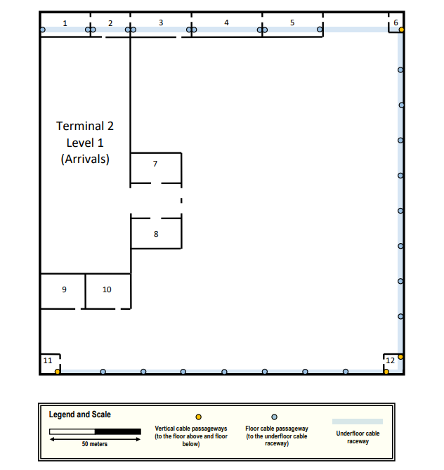

---

### 2.1 Características do Piso

- 4 passagens verticais que permitem a passagem de cabos entre pisos e ligam ao *campus Backbone*
- Ligação à vala técnica subterrânea — distância vertical entre o Level 1 e o ponto de ligação: **10 metros**
- Altura do piso: **4 metros** (do chão ao teto falso)
- Espaço entre teto falso e teto real: **1 metro** — ideal para instalar *cable raceways* e *wireless access-points*
- Existem duas rotas horizontais disponíveis: subterrânea (*underfloor*) e aérea (acima do teto falso)

> **Salas COM tomadas:** 1, 2, 3, 4, 5, 7, 8
>
> **Salas SEM tomadas:** 6, 9, 10, 11, 12
>
> **Salas para Hardware de Rede (TC/Enclosure):** 6, 11 e 12 — alojam armários de telecomunicações (IC/HC), patch panels, switches e protectores
>
> **Tomadas de parede externas:** ao longo da parede direita e parede inferior — **1 tomada a cada 5 metros**

---

### 2.2 Dimensões das Salas — Nível 1

| Sala    | Largura (cm) | Comp. (cm) | Largura (m) | Comp. (m) | Área (m²) | Tomadas |
|---------|:------------:|:----------:|:-----------:|:---------:|:---------:|:-------:|
| Sala 1  | 1,6 | 0,7 | 26,67 | 11,67 | 311,11 | 62 |
| Sala 2  | 1,2 | 0,7 | 20,00 | 11,67 | 233,33 | 47 |
| Sala 3  | 1,9 | 0,7 | 31,67 | 11,67 | 369,44 | 74 |
| Sala 4  | 2,2 | 0,7 | 36,67 | 11,67 | 427,78 | 86 |
| Sala 5  | 1,9 | 0,7 | 31,67 | 11,67 | 369,44 | 74 |
| Sala 6  | 0,4 | 0,6 | 6,67  | 10,00 | 66,67  | — *(hardware)* |
| Sala 7  | 1,6 | 0,9 | 26,67 | 15,00 | 400,00 | 80 |
| Sala 8  | 1,6 | 0,9 | 26,67 | 15,00 | 400,00 | 80 |
| Sala 9  | 1,4 | 1,1 | 23,33 | 18,33 | 427,78 | — |
| Sala 10 | 1,4 | 1,1 | 23,33 | 18,33 | 427,78 | — |
| Sala 11 | 0,6 | 0,6 | 10,00 | 10,00 | 100,00 | — *(hardware)* |
| Sala 12 | 0,6 | 0,6 | 10,00 | 10,00 | 100,00 | — *(hardware)* |

---

### 2.3 Cálculo de Tomadas — Paredes Internas

**Fórmula aplicada:** `Nº Tomadas = (Área ÷ 10) × 2`

| Sala   | Área (m²) | Tomadas | Postos (÷2, arred. cima) |
|--------|:---------:|:-------:|:------------------------:|
| Sala 1 | 311,11 | 62 | 31 |
| Sala 2 | 233,33 | 47 | 24 |
| Sala 3 | 369,44 | 74 | 37 |
| Sala 4 | 427,78 | 86 | 43 |
| Sala 5 | 369,44 | 74 | 37 |
| Sala 7 | 400,00 | 80 | 40 |
| Sala 8 | 400,00 | 80 | 40 |

---

### 2.4 Cálculo de Tomadas — Paredes Externas

**Fórmula aplicada:**

As paredes externas com tomadas não correspondem à dimensão total do terminal (200 m), uma vez que as salas de hardware nos cantos (salas 6, 11 e 12) ocupam parte dessas paredes e não têm tomadas. O comprimento útil efetivo de cada parede, medido na planta à escala (3 cm = 50 m), é de **10,4 cm**, correspondendo a **173,33 metros**.

```
Nº Tomadas por parede = floor(comprimento útil / 5) + 1
                      = floor(173,33 / 5) + 1
                      = 34 + 1
                      = 35 tomadas
```

| Parede | Tomadas |
|--------|:-------:|
| Parede direita | 35 |
| Parede inferior | 35 |
| **Total** | **70** |

---

### 2.5 Tomadas para Pontos de Acesso Wireless (WAP)

> Cada ponto de acesso wireless requer uma tomada de rede dedicada.

#### Cenário Prático — Diâmetro 50 m

| Parâmetro | Valor |
|-----------|:-----:|
| Raio do WAP | 25 m |
| Área por WAP | 1.963 m² |
| Área total | 40.000 m² |
| **Nº de WAPs necessários** | **≈ 25 WAPs** |
| **Tomadas necessárias** | **25** |

#### Cenário real, considerando paredes

> A distribuição dos Wireless Access Points (WAP) foi efetuada de forma uniforme para assegurar a cobertura total da rede sem fios (WLAN) em todo o piso, respeitando os limites de alcance das células (BSS). De modo a minimizar a interferência entre canais adjacentes e otimizar a performance da rede, garantiu-se que a sobreposição entre as áreas de cobertura de WAPs vizinhos não excedesse os 15%.

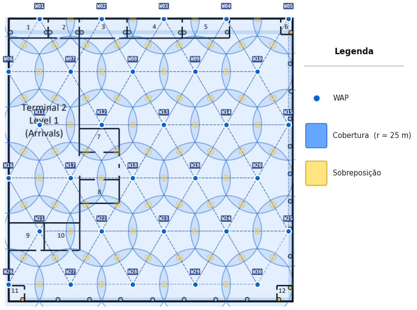

> Uma vez que cada ponto de acesso wireless necessita de uma tomada, serão necessárias mais 30 tomadas, uma para cada WAP, que estará situada no teto falso para que possa haver maximização da cobertura e propagação de sinal, e diminuir a quantidade de obstáculos, não havendo necessidade de colocar pilares para a ligação das tomadas.

---

### 2.6 Plantas Esquemáticas — Nível 1

#### Sala 1


**Explicação:** A Sala 1 tem uma área de 311,11 m² e deve ser equipada com o número standard de tomadas de rede. A sala exige uma distribuição estruturada e uniforme das tomadas de rede, de modo a garantir que todos os utilizadores tenham acesso fiável e de baixa latência à infraestrutura de rede.

**Justificação:** Foram alocadas 62 tomadas de rede na Sala 1, resultando em 31 postos duplos (cada posto com 2 tomadas). Esta alocação baseia-se numa densidade de 0,20 tomadas por m², cumprindo o standard mínimo recomendado para espaços de trabalho de alta densidade (1 tomada dupla a cada 10 m²). Esta configuração responde às necessidades operacionais actuais e antecipa futuras expansões sem requerer alterações significativas na infraestrutura existente.

---

#### Sala 2

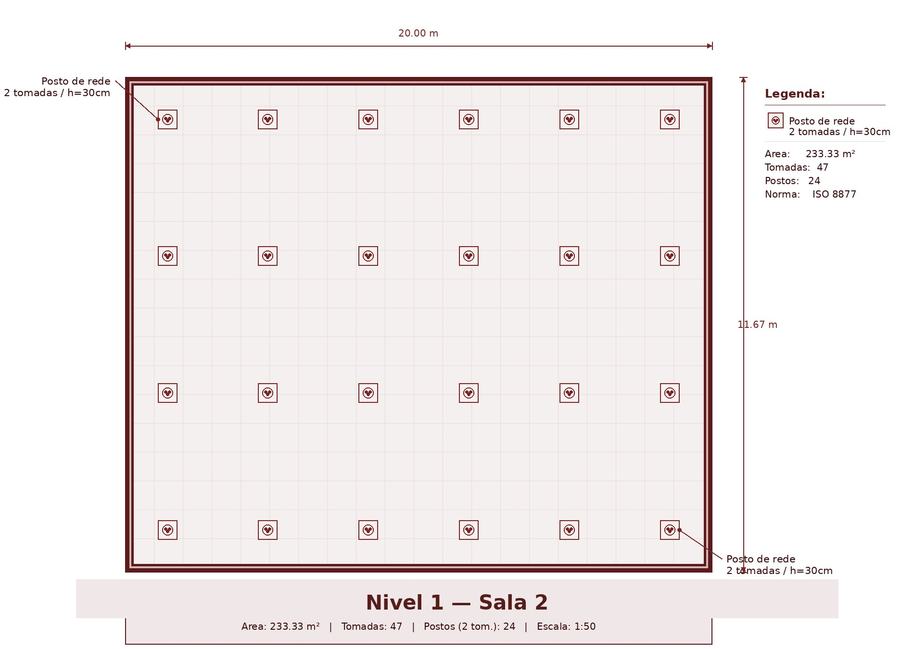

**Explicação:** A Sala 2 tem uma área de 233,33 m² e deve ser equipada com o número standard de tomadas de rede. A sala exige uma distribuição estruturada e uniforme das tomadas de rede, de modo a garantir que todos os utilizadores tenham acesso fiável e de baixa latência à infraestrutura de rede.

**Justificação:** Foram alocadas 47 tomadas de rede na Sala 2, resultando em 24 postos duplos (cada posto com 2 tomadas). Esta alocação baseia-se numa densidade de 0,20 tomadas por m², cumprindo o standard mínimo recomendado para espaços de trabalho de alta densidade (1 tomada dupla a cada 10 m²). Esta configuração responde às necessidades operacionais actuais e antecipa futuras expansões sem requerer alterações significativas na infraestrutura existente.

---

#### Sala 3


**Explicação:** A Sala 3 tem uma área de 369,44 m² e deve ser equipada com o número standard de tomadas de rede. A sala exige uma distribuição estruturada e uniforme das tomadas de rede, de modo a garantir que todos os utilizadores tenham acesso fiável e de baixa latência à infraestrutura de rede.

**Justificação:** Foram alocadas 74 tomadas de rede na Sala 3, resultando em 37 postos duplos (cada posto com 2 tomadas). Esta alocação baseia-se numa densidade de 0,20 tomadas por m², cumprindo o standard mínimo recomendado para espaços de trabalho de alta densidade (1 tomada dupla a cada 10 m²). Esta configuração responde às necessidades operacionais actuais e antecipa futuras expansões sem requerer alterações significativas na infraestrutura existente.

---

#### Sala 4

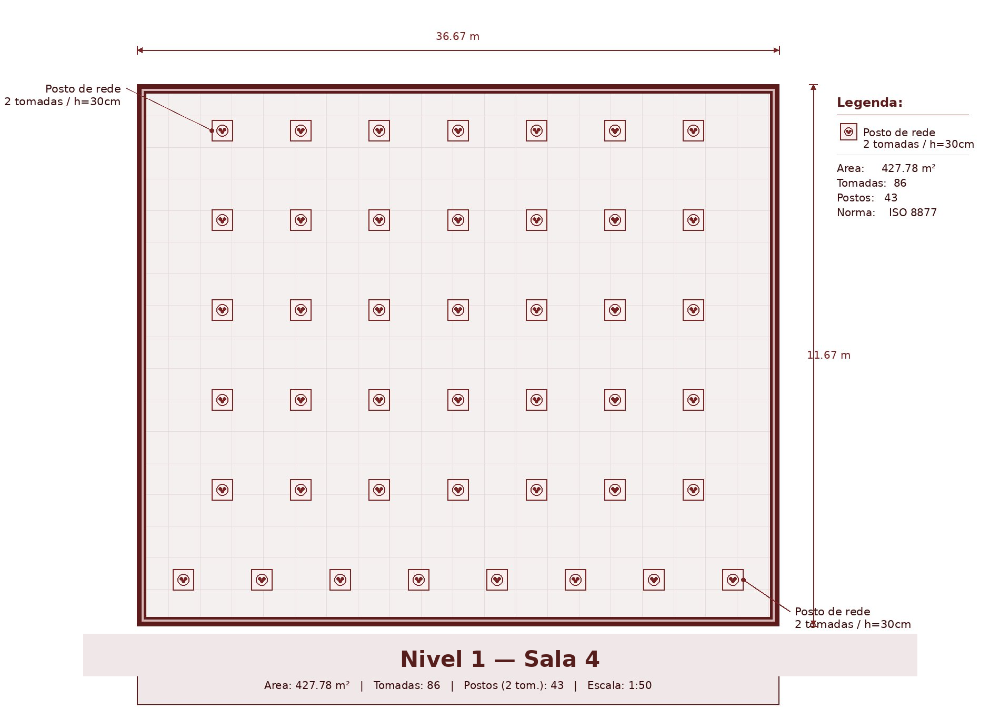

**Explicação:** A Sala 4 tem uma área de 427,78 m² e deve ser equipada com o número standard de tomadas de rede. A sala exige uma distribuição estruturada e uniforme das tomadas de rede, de modo a garantir que todos os utilizadores tenham acesso fiável e de baixa latência à infraestrutura de rede.

**Justificação:** Foram alocadas 86 tomadas de rede na Sala 4, resultando em 43 postos duplos (cada posto com 2 tomadas). Esta alocação baseia-se numa densidade de 0,20 tomadas por m², cumprindo o standard mínimo recomendado para espaços de trabalho de alta densidade (1 tomada dupla a cada 10 m²). Esta configuração responde às necessidades operacionais actuais e antecipa futuras expansões sem requerer alterações significativas na infraestrutura existente.

---

#### Sala 5


**Explicação:** A Sala 5 tem uma área de 369,44 m² e deve ser equipada com o número standard de tomadas de rede. A sala exige uma distribuição estruturada e uniforme das tomadas de rede, de modo a garantir que todos os utilizadores tenham acesso fiável e de baixa latência à infraestrutura de rede.

**Justificação:** Foram alocadas 74 tomadas de rede na Sala 5, resultando em 37 postos duplos (cada posto com 2 tomadas). Esta alocação baseia-se numa densidade de 0,20 tomadas por m², cumprindo o standard mínimo recomendado para espaços de trabalho de alta densidade (1 tomada dupla a cada 10 m²). Esta configuração responde às necessidades operacionais actuais e antecipa futuras expansões sem requerer alterações significativas na infraestrutura existente.

---

#### Sala 7


**Explicação:** A Sala 7 tem uma área de 400,00 m² e deve ser equipada com o número standard de tomadas de rede. A sala exige uma distribuição estruturada e uniforme das tomadas de rede, de modo a garantir que todos os utilizadores tenham acesso fiável e de baixa latência à infraestrutura de rede.

**Justificação:** Foram alocadas 80 tomadas de rede na Sala 7, resultando em 40 postos duplos (cada posto com 2 tomadas). Esta alocação baseia-se numa densidade de 0,20 tomadas por m², cumprindo o standard mínimo recomendado para espaços de trabalho de alta densidade (1 tomada dupla a cada 10 m²). Esta configuração responde às necessidades operacionais actuais e antecipa futuras expansões sem requerer alterações significativas na infraestrutura existente.

---

#### Sala 8


**Explicação:** A Sala 8 tem uma área de 400,00 m² e deve ser equipada com o número standard de tomadas de rede. A sala exige uma distribuição estruturada e uniforme das tomadas de rede, de modo a garantir que todos os utilizadores tenham acesso fiável e de baixa latência à infraestrutura de rede.

**Justificação:** Foram alocadas 80 tomadas de rede na Sala 8, resultando em 40 postos duplos (cada posto com 2 tomadas). Esta alocação baseia-se numa densidade de 0,20 tomadas por m², cumprindo o standard mínimo recomendado para espaços de trabalho de alta densidade (1 tomada dupla a cada 10 m²). Esta configuração responde às necessidades operacionais actuais e antecipa futuras expansões sem requerer alterações significativas na infraestrutura existente.

---

### 2.7 Cross-Connects Deployment

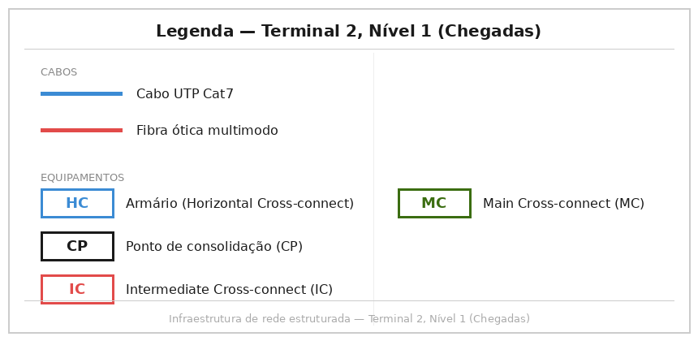
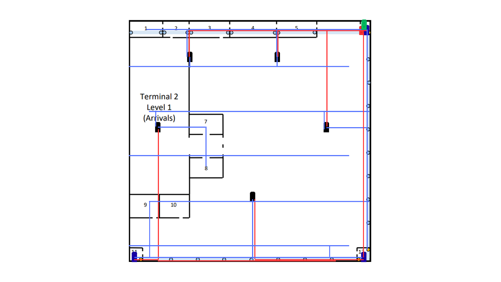

> Foram instalados três Horizontal Cross-connects (HC) para servir o piso, garantindo o cumprimento dos limites normativos de 90 metros para o comprimento real do cabo e de 80 metros para a distância em linha reta entre o repartidor e as tomadas. Para assegurar que toda a área fosse coberta, houve a necessidade de instalar armários de telecomunicações (TE) em salas não dedicadas exclusivamente a telecomunicações, uma vez que as salas exclusivas existentes não permitiam o posicionamento central necessário para respeitar os limites de distância em todo o piso.
>
> Adicionalmente, foi instalado neste piso o Intermediate Cross-connect (IC) para atuar como o ponto central de distribuição do edifício, localizado na sala 6 (canto superior direito), partilhando o espaço com o HC que serve essa zona. Este repartidor liga-se a todos os Horizontal Cross-connects (HC) através do Subsistema de Cablagem 2 (backbone de edifício). Para as ligações, foram definidos caminhos de cabos (pathways) que percorrem tetos falsos e pavimentos sobrelevados, utilizando cabos de fibra ótica multimodo para assegurar a performance e a escalabilidade da rede. O HC localizado na sala 11 (canto inferior esquerdo) é interligado ao IC através do teto falso, enquanto os restantes HC utilizam passagens técnicas sob o pavimento.
>
> Para a implementação do Subsistema de Cablagem 1 (cablagem horizontal), foram instalados seis Consolidation Points (CP) distribuídos pelo piso, servindo de ponto de consolidação intermédio entre os HC e as tomadas. Cada CP é ligado ao respetivo HC via cabo CAT6A, e serve as tomadas das salas, os pontos de acesso sem fios (WAP) e as tomadas nas paredes externas (parede direita e inferior) da sua zona de influência. A distribuição dos CP é a seguinte: um CP serve as salas 1, 2 e 3; outro serve as salas 4 e 5; outro serve as salas 7 e 8; os restantes três CP servem as tomadas centrais e WAP das paredes externas e zonas comuns; Todos os HC servem as tomadas das paredes externas próximas a eles (a uma distância máxima de 80 metros). As salas 9, 10, 11 e 12 não possuem tomadas, sendo que as salas 11 e 12 albergam os HC dos cantos inferiores e as salas 9 e 10 constituem espaços técnicos de apoio.
>
> Para a implementação do Subsistema de Cablagem 1 (cablagem horizontal), foram definidos caminhos de cabos (pathways) que utilizam passagens técnicas sob o pavimento para ligar a maioria das salas aos respetivos Consolidation Points (CP) e Horizontal Cross-connects (HC). Como exceção, os cabos das salas 7 e 8 seguem percursos através do teto falso, descendo até ao chão sempre por calhas. As tomadas localizadas nas paredes externas do edifício são igualmente servidas por infraestruturas sob o chão até cada CP ou HC respetivo.


> Embora as normas estipulem que a área máxima coberta por um Horizontal Cross-connect (HC) deve ser inferior a 1000 m², o dimensionamento deste projeto foi otimizado com base na densidade real de tomadas e na área efetiva a cablar
Uma vez que nem todas as zonas do piso requerem conectividade, não foi necessária a instalação teórica de 40 HCs, optando-se por uma estrutura mais centralizada que respeita os limites de distância regulamentares

---

### 2.8 Inventário CAT7 — Nível 1

#### Salas Internas — 503 cabos

| Sala | CP Destino | Dist. ao CP | Nº Cabos | Total (m) |
|------|-----------|-------------|----------|-----------|
| Sala 1 | CP1 (salas 1,2,3) | 58,3 m | 62 | 3 614,6 m |
| Sala 2 | CP1 (salas 1,2,3) | 33,3 m | 47 | 1 565,1 m |
| Sala 3 | CP1 (salas 1,2,3) | 45,0 m | 74 | 3 330,0 m |
| Sala 4 | CP2 (salas 4,5) | 41,7 m | 86 | 3 586,2 m |
| Sala 5 | CP2 (salas 4,5) | 43,3 m | 74 | 3 204,2 m |
| Sala 7 | CP3 (salas 7,8) | 28,3 m | 80 | 2 264,0 m |
| Sala 8 | CP3 (salas 7,8) | 78,3 m | 80 | 6 264,0 m |
| **Subtotal** | | | **503** | **23 828,1 m** |

#### Paredes Externas — 70 cabos

##### Parede Inferior

| Zona | HC / CP Destino | Dist. | Nº Cabos | Total (m) |
|------|----------------|-------|----------|-----------|
| Zona esq. (0–80 m) | HC sala 11 (canto inf esq) | variável 0→80 m | 17 | 680,0 m |
| Zona centro | CP central | 33,3 m | 2 | 66,7 m |
| Zona dir. (91,7–171,7 m) | HC sala 12 (canto inf dir) | variável 0→76,7 m | 16 | 626,7 m |
| **Subtotal** | | | **35** | **1 373,3 m** |

##### Parede Direita

| Zona | HC / CP Destino | Dist. | Nº Cabos | Total (m) |
|------|----------------|-------|----------|-----------|
| Zona topo (0–80 m) | HC sala 6 (canto sup dir) | variável 0→80 m | 17 | 680,0 m |
| Zona centro | CP direito | 33,3 m | 2 | 66,7 m |
| Zona base (91,7–171,7 m) | HC sala 12 (canto inf dir) | variável 0→76,7 m | 16 | 626,7 m |
| **Subtotal** | | | **35** | **1 373,3 m** |

#### WAPs — 30 cabos

| WAP | CP Destino | Dist. (m) | WAP | CP Destino | Dist. (m) |
|-----|-----------|-----------|-----|-----------|-----------|
| W01 | CP1 | 41,1 | W16 | CP6 | 68,5 |
| W02 | CP1 | 47,9 | W17 | CP6 | 54,8 |
| W03 | CP1 | 27,4 | W18 | CP3 | 49,3 |
| W04 | CP2 | 24,7 | W19 | CP6 | 34,2 |
| W05 | CP2 | 11,0 | W20 | CP6 | 13,7 |
| W06 | CP3 | 34,2 | W21 | CP4 | 26,0 |
| W07 | CP1 | 11,0 | W22 | CP3 | 37,0 |
| W08 | CP1 | 27,4 | W23 | CP5 | 27,4 |
| W09 | CP1 | 27,4 | W24 | CP5 | 20,5 |
| W10 | CP2 | 27,4 | W25 | CP5 | 20,5 |
| W11 | CP3 | 20,5 | W26 | CP4 | 47,9 |
| W12 | CP3 | 20,5 | W27 | CP5 | 34,2 |
| W13 | CP1 | 16,4 | W28 | CP5 | 34,2 |
| W14 | CP1 | 41,1 | W29 | CP5 | 34,2 |
| W15 | CP2 | 41,1 | W30 | CP5 | 47,9 |
| **Subtotal** | | | | | **969,4 m** |

#### Total CAT7 — Nível 1

| Categoria | Nº Cabos | Total sem folga | Com 15% folga |
|-----------|----------|----------------|---------------|
| Salas internas | 503 | 23 828,1 m | 27 402,3 m |
| Paredes externas | 70 | 2 746,7 m | 3 158,7 m |
| WAPs | 30 | 969,4 m | 1 114,8 m |
| **TOTAL NÍVEL 1** | **603** | **27 544,2 m** | **31 675,8 m** |

---

### 2.9 Inventário Fibra Óptica — Nível 1

| CP / HC | Distância estimada (m) | Com 15% folga | Redundância (×2) |
|---------|----------------------|---------------|-----------------|
| Superior Esquerdo | 171,6 m | 197,3 m | 394,6 m |
| Superior Direito | 94,3 m | 108,4 m | 216,8 m |
| Central Esquerdo | 109,7 m | 126,2 m | 252,4 m |
| Central Direito | 129,1 m | 148,5 m | 297,0 m |
| Inferior | 141,9 m | 163,2 m | 326,4 m |
| HC Superior | 1,0 m | 1,2 m | 2,4 m |
| HC Inferior Esquerdo | 400,0 m | 460,0 m | 920,0 m |
| HC Inferior Direito | 200,0 m | 230,0 m | 460,0 m |
| **Total** | **1 247,6 m** | **1 434,8 m** | **2 869,6 m** |

> **Nota de redundância:** a fibra óptica backbone é multiplicada por 2 para garantir um cabo de reserva em cada ligação, assegurando continuidade de serviço em caso de falha.

---

### 2.10 Inventário de Hardware — Nível 1

| Item | Quantidade |
|------|:----------:|
| Patch Panels 24 portas | 33 |
| Patch Cords | 1 238 |
| Switches | 4 |
| WAPs | 30 |
| Cabos de cobre CAT7 | 603 |
| Cabos de fibra óptica | 16 |

---

## 3. Nível 4 — Departures (Partidas)

### Planta Global do Terminal 2 Nível 4

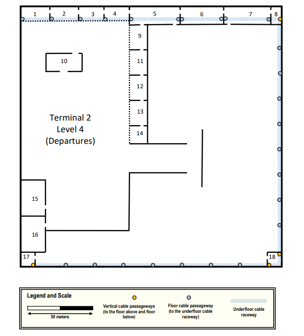

---

### 3.1 Características do Piso

- 4 passagens verticais entre pisos e ligação ao *campus Backbone*
- Ligação à vala técnica subterrânea — distância vertical entre o Level 4 e o ponto de ligação: **25 metros**
- Distância vertical entre Level 1 e Level 4: **35 metros** (10 m + 25 m à vala, com a vala como referência comum)
- Espaço entre teto falso e teto real: **1 metro** — ideal para *cable raceways* e *wireless access-points*
- Duas rotas horizontais disponíveis: subterrânea (*underfloor*) e aérea (acima do teto falso)

> **Salas COM tomadas:** 1, 2, 3, 4, 5, 6, 7, 9, 10, 11, 12, 13, 14
>
> **Salas SEM tomadas:** 8, 17 e 18 *(salas destinadas a hardware de rede)*
>
> **Tomadas de parede externas:** ao longo da parede direita e parede inferior — **1 tomada a cada 5 metros**

---

### 3.2 Dimensões das Salas — Nível 4

| Sala    | Largura (cm) | Comp. (cm) | Largura (m) | Comp. (m) | Área (m²) |
|---------|:------------:|:----------:|:-----------:|:---------:|:---------:|
| Sala 1  | 1,2 | 0,6 | 20,00 | 10,00 | 200,00 |
| Sala 2  | 1,2 | 0,6 | 20,00 | 10,00 | 200,00 |
| Sala 3  | 1,1 | 0,6 | 18,33 | 10,00 | 183,33 |
| Sala 4  | 1,1 | 0,6 | 18,33 | 10,00 | 183,33 |
| Sala 5  | 2,2 | 0,7 | 36,67 | 11,67 | 427,78 |
| Sala 6  | 1,9 | 0,7 | 31,67 | 11,67 | 369,44 |
| Sala 7  | 2,1 | 0,7 | 35,00 | 11,67 | 408,33 |
| Sala 8  | 0,4 | 0,7 | 6,67  | 11,67 | 77,78  |
| Sala 9  | 0,7 | 1,0 | 11,67 | 16,67 | 194,44 |
| Sala 10 | 1,6 | 0,7 | 26,67 | 11,67 | 311,11 |
| Sala 11 | 0,7 | 1,1 | 11,67 | 18,33 | 213,89 |
| Sala 12 | 0,7 | 1,1 | 11,67 | 18,33 | 213,89 |
| Sala 13 | 0,7 | 1,1 | 11,67 | 18,33 | 213,89 |
| Sala 14 | 0,7 | 0,6 | 11,67 | 10,00 | 116,67 |
| Sala 15 | 1,0 | 1,5 | 16,67 | 25,00 | 416,67 |
| Sala 16 | 1,0 | 1,5 | 16,67 | 25,00 | 416,67 |
| Sala 17 | 0,6 | 0,6 | 10,00 | 10,00 | 100,00 |
| Sala 18 | 0,6 | 0,6 | 10,00 | 10,00 | 100,00 |

---

### 3.3 Cálculo de Tomadas — Paredes Internas

**Fórmula aplicada:** `Nº Tomadas = (Área ÷ 10) × 2`

| Sala      | Área (m²)  | Tomadas | Postos (÷2, arred. cima) |
|-----------|:----------:|:-------:|:------------------------:|
| Sala 1    | 200,00  | 40  | 20 |
| Sala 2    | 200,00  | 40  | 20 |
| Sala 3    | 183,33  | 37  | 19 |
| Sala 4    | 183,33  | 37  | 19 |
| Sala 5    | 427,78  | 86  | 43 |
| Sala 6    | 369,44  | 74  | 37 |
| Sala 7    | 408,33  | 82  | 41 |
| Sala 9    | 194,44  | 39  | 20 |
| Sala 10   | 311,11  | 62  | 31 |
| Sala 11   | 213,89  | 43  | 22 |
| Sala 12   | 213,89  | 43  | 22 |
| Sala 13   | 213,89  | 43  | 22 |
| Sala 14   | 116,67  | 23  | 12 |
| **Total** | **3.236,10** | **649** | **328** |

---

### 3.4 Cálculo de Tomadas — Paredes Externas

**Fórmula aplicada:**

As paredes externas com tomadas não correspondem à dimensão total do terminal (200 m), uma vez que as salas de hardware nos cantos (salas 8, 17 e 18) ocupam parte dessas paredes e não têm tomadas. O comprimento útil efetivo de cada parede, medido na planta à escala (3 cm = 50 m), é de **10,4 cm**, correspondendo a **173,33 metros**.

```
Nº Tomadas por parede = floor(comprimento útil / 5) + 1
                      = floor(173,33 / 5) + 1
                      = 34 + 1
                      = 35 tomadas
```

| Parede | Tomadas |
|--------|:-------:|
| Parede direita | 35 |
| Parede inferior | 35 |
| **Total** | **70** |

---

### 3.5 Tomadas para Pontos de Acesso Wireless (WAP)

> Cada ponto de acesso wireless requer uma tomada de rede dedicada.

#### Cenário Prático — Diâmetro 50 m

| Parâmetro | Valor |
|-----------|:-----:|
| Raio do WAP | 25 m |
| Área por WAP | 1.963 m² |
| Área total | 40.000 m² |
| **Nº de WAPs necessários** | **≈ 25 WAPs** |
| **Tomadas necessárias** | **25** |

#### Cenário real, considerando paredes

> A distribuição dos Wireless Access Points (WAP) foi efetuada de forma uniforme para assegurar a cobertura total da rede sem fios (WLAN) em todo o piso, respeitando os limites de alcance das células (BSS). De modo a minimizar a interferência entre canais adjacentes e otimizar a performance da rede, garantiu-se que a sobreposição entre as áreas de cobertura de WAPs vizinhos não excedesse os 15%.

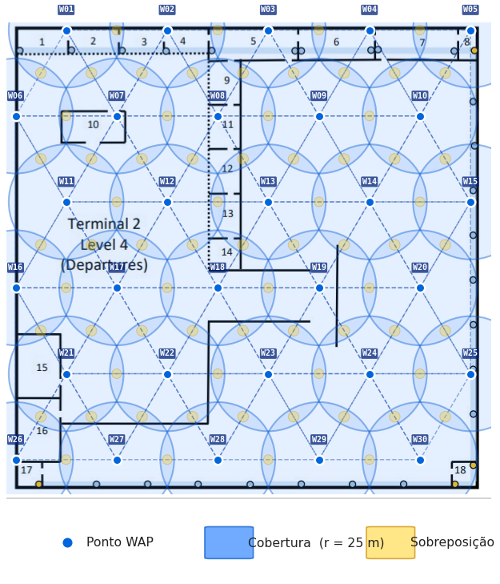

> Uma vez que cada ponto de acesso wireless necessita de uma tomada, serão necessárias mais 30 tomadas, uma para cada WAP, que estará situada no teto falso para que possa haver maximização da cobertura e propagação de sinal, e diminuir a quantidade de obstáculos, não havendo necessidade de colocar pilares para a ligação das tomadas.

---

### 3.6 Plantas Esquemáticas — Nível 4

#### Sala 1


**Explicação:** A Sala 1 tem uma área de 200,00 m² e deve ser equipada com o número standard de tomadas de rede. A sala exige uma distribuição estruturada e uniforme das tomadas de rede, de modo a garantir que todos os utilizadores tenham acesso fiável e de baixa latência à infraestrutura de rede.

**Justificação:** Foram alocadas 40 tomadas de rede na Sala 1, resultando em 20 postos duplos (cada posto com 2 tomadas). Esta alocação baseia-se numa densidade de 0,20 tomadas por m², cumprindo o standard mínimo recomendado (1 tomada dupla a cada 10 m²). Esta configuração responde às necessidades operacionais actuais e antecipa futuras expansões sem requerer alterações significativas na infraestrutura existente.

---

#### Sala 2


**Explicação:** A Sala 2 tem uma área de 200,00 m² e deve ser equipada com o número standard de tomadas de rede, garantindo conectividade fiável a todos os utilizadores.

**Justificação:** Foram alocadas 40 tomadas na Sala 2, resultando em 20 postos duplos. Esta alocação baseia-se numa densidade de 0,20 tomadas por m², cumprindo o standard mínimo recomendado (1 tomada dupla a cada 10 m²). Esta configuração responde às necessidades operacionais actuais e antecipa futuras expansões sem requerer alterações significativas na infraestrutura existente.

---

#### Sala 3


**Explicação:** A Sala 3 tem uma área de 183,33 m² e deve ser equipada com o número standard de tomadas de rede, garantindo conectividade fiável a todos os utilizadores.

**Justificação:** Foram alocadas 37 tomadas na Sala 3, resultando em 19 postos duplos (arredondamento para cima). Esta alocação baseia-se numa densidade de 0,20 tomadas por m², cumprindo o standard mínimo recomendado (1 tomada dupla a cada 10 m²). Esta configuração responde às necessidades operacionais actuais e antecipa futuras expansões sem requerer alterações significativas na infraestrutura existente.

---

#### Sala 4


**Explicação:** A Sala 4 tem uma área de 183,33 m² e deve ser equipada com o número standard de tomadas de rede, garantindo conectividade fiável a todos os utilizadores.

**Justificação:** Foram alocadas 37 tomadas na Sala 4, resultando em 19 postos duplos (arredondamento para cima). Esta alocação baseia-se numa densidade de 0,20 tomadas por m², cumprindo o standard mínimo recomendado (1 tomada dupla a cada 10 m²). Esta configuração responde às necessidades operacionais actuais e antecipa futuras expansões sem requerer alterações significativas na infraestrutura existente.

---

#### Sala 5


**Explicação:** A Sala 5 tem uma área de 427,78 m² e deve ser equipada com o número standard de tomadas de rede. A sua dimensão considerável exige uma distribuição especialmente cuidada para garantir cobertura total sem zonas mortas.

**Justificação:** Foram alocadas 86 tomadas na Sala 5, resultando em 43 postos duplos. Esta alocação baseia-se numa densidade de 0,20 tomadas por m², cumprindo o standard mínimo recomendado (1 tomada dupla a cada 10 m²). Esta configuração responde às necessidades operacionais actuais e antecipa futuras expansões sem requerer alterações significativas na infraestrutura existente.

---

#### Sala 6


**Explicação:** A Sala 6 tem uma área de 369,44 m² e deve ser equipada com o número standard de tomadas de rede, garantindo conectividade fiável e uniforme.

**Justificação:** Foram alocadas 74 tomadas na Sala 6, resultando em 37 postos duplos. Esta alocação baseia-se numa densidade de 0,20 tomadas por m², cumprindo o standard mínimo recomendado (1 tomada dupla a cada 10 m²). Esta configuração responde às necessidades operacionais actuais e antecipa futuras expansões sem requerer alterações significativas na infraestrutura existente.

---

#### Sala 7


**Explicação:** A Sala 7 tem uma área de 408,33 m² e deve ser equipada com o número standard de tomadas de rede. A sua dimensão exige uma distribuição cuidada para garantir cobertura total.

**Justificação:** Foram alocadas 82 tomadas na Sala 7, resultando em 41 postos duplos. Esta alocação baseia-se numa densidade de 0,20 tomadas por m², cumprindo o standard mínimo recomendado (1 tomada dupla a cada 10 m²). Esta configuração responde às necessidades operacionais actuais e antecipa futuras expansões sem requerer alterações significativas na infraestrutura existente.

---

#### Sala 9


**Explicação:** A Sala 9 tem uma área de 194,44 m² e deve ser equipada com o número standard de tomadas de rede, garantindo conectividade fiável a todos os utilizadores.

**Justificação:** Foram alocadas 39 tomadas na Sala 9, resultando em 20 postos duplos (arredondamento para cima). Esta alocação baseia-se numa densidade de 0,20 tomadas por m², cumprindo o standard mínimo recomendado (1 tomada dupla a cada 10 m²). Esta configuração responde às necessidades operacionais actuais e antecipa futuras expansões sem requerer alterações significativas na infraestrutura existente.

---

#### Sala 10


**Explicação:** A Sala 10 tem uma área de 311,11 m² e deve ser equipada com o número standard de tomadas de rede, garantindo conectividade uniforme e fiável.

**Justificação:** Foram alocadas 62 tomadas na Sala 10, resultando em 31 postos duplos. Esta alocação baseia-se numa densidade de 0,20 tomadas por m², cumprindo o standard mínimo recomendado (1 tomada dupla a cada 10 m²). Esta configuração responde às necessidades operacionais actuais e antecipa futuras expansões sem requerer alterações significativas na infraestrutura existente.

---

#### Sala 11


**Explicação:** A Sala 11 tem uma área de 213,89 m² e deve ser equipada com o número standard de tomadas de rede, garantindo conectividade fiável a todos os utilizadores.

**Justificação:** Foram alocadas 43 tomadas na Sala 11, resultando em 22 postos duplos (arredondamento para cima). Esta alocação baseia-se numa densidade de 0,20 tomadas por m², cumprindo o standard mínimo recomendado (1 tomada dupla a cada 10 m²). Esta configuração responde às necessidades operacionais actuais e antecipa futuras expansões sem requerer alterações significativas na infraestrutura existente.

---

#### Sala 12

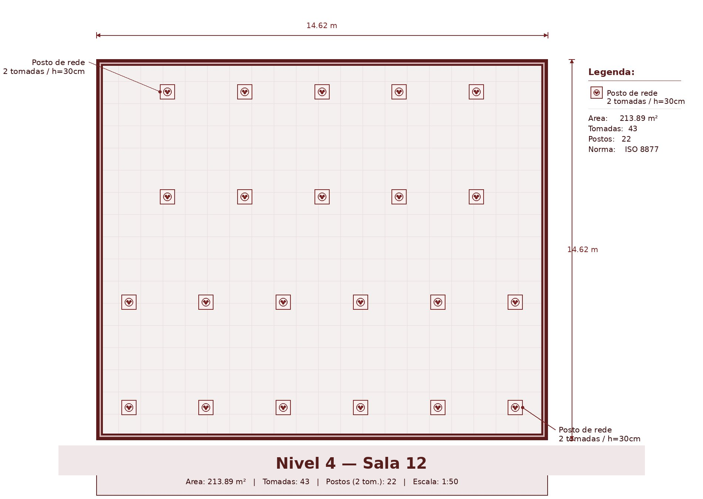

**Explicação:** A Sala 12 tem uma área de 213,89 m² e deve ser equipada com o número standard de tomadas de rede, garantindo conectividade fiável a todos os utilizadores.

**Justificação:** Foram alocadas 43 tomadas na Sala 12, resultando em 22 postos duplos (arredondamento para cima). Esta alocação baseia-se numa densidade de 0,20 tomadas por m², cumprindo o standard mínimo recomendado (1 tomada dupla a cada 10 m²). Esta configuração responde às necessidades operacionais actuais e antecipa futuras expansões sem requerer alterações significativas na infraestrutura existente.

---

#### Sala 13


**Explicação:** A Sala 13 tem uma área de 213,89 m² e deve ser equipada com o número standard de tomadas de rede, garantindo conectividade fiável a todos os utilizadores.

**Justificação:** Foram alocadas 43 tomadas na Sala 13, resultando em 22 postos duplos (arredondamento para cima). Esta alocação baseia-se numa densidade de 0,20 tomadas por m², cumprindo o standard mínimo recomendado (1 tomada dupla a cada 10 m²). Esta configuração responde às necessidades operacionais actuais e antecipa futuras expansões sem requerer alterações significativas na infraestrutura existente.

---

#### Sala 14


**Explicação:** A Sala 14 tem uma área de 116,67 m² e deve ser equipada com o número standard de tomadas de rede, garantindo conectividade fiável a todos os utilizadores.

**Justificação:** Foram alocadas 23 tomadas na Sala 14, resultando em 12 postos duplos (arredondamento para cima). Esta alocação baseia-se numa densidade de 0,20 tomadas por m², cumprindo o standard mínimo recomendado (1 tomada dupla a cada 10 m²). Esta configuração responde às necessidades operacionais actuais e antecipa futuras expansões sem requerer alterações significativas na infraestrutura existente.

---

### 3.7 Cross-Connects Deployment

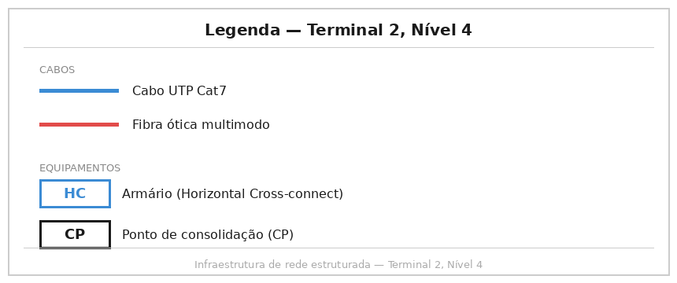
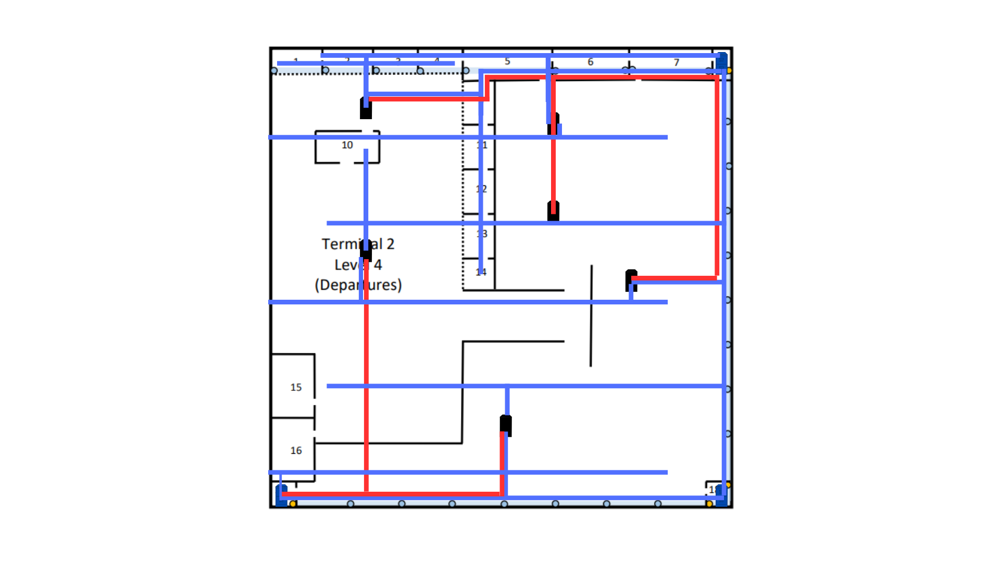

> Foram instalados três Horizontal Cross-connects (HC) para servir o piso, garantindo o cumprimento dos limites normativos de 90 metros para o comprimento real do cabo e de 80 metros para a distância em linha reta entre o repartidor e as tomadas. Para assegurar que toda a área fosse coberta, houve a necessidade de instalar armários de telecomunicações (TE) em salas não dedicadas exclusivamente a telecomunicações, uma vez que as salas exclusivas existentes não permitiam o posicionamento central necessário para respeitar os limites de distância em todo o piso. Os três HC encontram-se localizados na sala 8 (canto superior direito), na sala 17 (canto inferior esquerdo) e na sala 18 (canto inferior direito).
>
> Este piso não possui Intermediate Cross-connect (IC) próprio, uma vez que pertence ao mesmo terminal que o piso de Arrivals (Level 1). Os três HC deste piso ligam-se ao IC localizado no piso inferior através do Subsistema de Cablagem 2 (backbone de edifício), utilizando cabos de fibra ótica multimodo. O percurso das fibras óticas parte de cada HC pelo teto falso, convergindo para a sala 8, onde existem passagens técnicas que permitem a descida até ao piso de Arrivals onde se encontra o IC.
>
> Para a implementação do Subsistema de Cablagem 1 (cablagem horizontal), foram instalados seis Consolidation Points (CP) distribuídos pelo piso, servindo de ponto de consolidação intermédio entre os HC e as tomadas. Cada CP é ligado ao respetivo HC via cabo CAT6A, servindo as tomadas das salas, os pontos de acesso sem fios (WAP) e as tomadas nas paredes externas (parede direita e inferior) da sua zona de influência. A distribuição dos CP é a seguinte: um CP serve as salas 1, 2, 3 e 4 e respetivos WAP; outro serve as salas 5 e 6 e respetivos WAP; a sala 7 é ligada diretamente ao HC da sala 8; outro CP serve as salas 11, 12, 13 e 14 e respetivos WAP; outro serve a sala 10 e respetivos WAP; outro serve as tomadas centrais da parede externa direita e WAP da zona direita; e o último serve as tomadas centrais da parede externa inferior e WAP da zona inferior. As salas 15 e 16 não possuem tomadas de dados. As salas 17 e 18 albergam os HC dos cantos inferiores que se ligam às tomadas das paredes externas próximas (que estão a menos de 80m destes).
>
> Para a implementação do Subsistema de Cablagem 1 (cablagem horizontal), foram definidos caminhos de cabos (pathways) que utilizam passagens técnicas sob o pavimento para ligar a maioria das salas aos respetivos Consolidation Points (CP) e Horizontal Cross-connects (HC). Como exceção, os cabos das salas 11, 12, 13 e 14 seguem percursos através do teto falso, descendo até ao chão sempre por calhas. As tomadas localizadas nas paredes externas do edifício são igualmente servidas por infraestruturas sob o chão até cada CP ou HC respetivo. As salas 1, 2, 3 e 4 têm as tomadas previstas mas não representadas na planta atual.


> Embora as normas estipulem que a área máxima coberta por um Horizontal Cross-connect (HC) deve ser inferior a 1000 m², o dimensionamento deste projeto foi otimizado com base na densidade real de tomadas e na área efetiva a cablar
Uma vez que nem todas as zonas do piso requerem conectividade, não foi necessária a instalação teórica de 40 HCs, optando-se por uma estrutura mais centralizada que respeita os limites de distância regulamentares

---

### 3.8 Inventário CAT7 — Nível 4

#### Salas Internas — 649 cabos

| Sala | Segmentos | Dist. total | Tomadas | Total (m) | Com 15% folga |
|------|-----------|-------------|---------|-----------|---------------|
| Sala 1  | 2,3 + 1,3 cm | 36,8 + 20,8 m | 40  | 2 304,0 m  | 2 649,6 m  |
| Sala 2  | 0,5 + 1,3 cm | 8,0 + 20,8 m  | 40  | 1 152,0 m  | 1 324,8 m  |
| Sala 3  | 1,0 + 1,3 cm | 16,0 + 20,8 m | 37  | 1 361,6 m  | 1 565,8 m  |
| Sala 4  | 2,0 + 1,3 cm | 32,0 + 20,8 m | 37  | 1 953,6 m  | 2 246,6 m  |
| Sala 5  | 1,0 + 2,0 cm | 16,0 + 32,0 m | 86  | 4 128,0 m  | 4 747,2 m  |
| Sala 6  | 1,2 + 2,0 cm | 19,2 + 32,0 m | 74  | 3 788,8 m  | 4 357,1 m  |
| Sala 7  | 1,3 cm       | 20,8 m        | 82  | 1 705,6 m  | 1 961,4 m  |
| Sala 9  | 3,0 cm       | 48,0 m        | 39  | 1 872,0 m  | 2 152,8 m  |
| Sala 10 | 2,7 cm       | 43,2 m        | 62  | 2 678,4 m  | 3 080,2 m  |
| Sala 11 | 1,7 + 3,0 cm | 27,2 + 48,0 m | 43  | 3 233,6 m  | 3 718,6 m  |
| Sala 12 | 2,5 + 3,0 cm | 40,0 + 48,0 m | 43  | 3 784,0 m  | 4 351,6 m  |
| Sala 13 | 3,8 + 3,0 cm | 60,8 + 48,0 m | 43  | 4 678,4 m  | 5 380,2 m  |
| Sala 14 | 4,7 + 3,0 cm | 75,2 + 48,0 m | 23  | 2 833,6 m  | 3 258,6 m  |
| **Total** | | | **649** | **35 473,6 m** | **40 794,6 m** |

#### WAPs — 30 cabos

| WAP | cm | Metros | | WAP | cm | Metros |
|-----|-----|--------|-|-----|-----|--------|
| W01 | 2,0 | 28,6 m | | W16 | 3,0 | 42,9 m |
| W02 | 2,5 | 35,7 m | | W17 | 0,6 | 8,6 m  |
| W03 | 2,5 | 35,7 m | | W18 | 3,5 | 50,0 m |
| W04 | 3,0 | 42,9 m | | W19 | 1,7 | 24,3 m |
| W05 | 0,1 | 1,4 m  | | W20 | 1,4 | 20,0 m |
| W06 | 3,0 | 42,9 m | | W21 | 3,5 | 50,0 m |
| W07 | 0,5 | 7,1 m  | | W22 | 3,5 | 50,0 m |
| W08 | 2,4 | 34,3 m | | W23 | 2,0 | 28,6 m |
| W09 | 0,6 | 8,6 m  | | W24 | 2,0 | 28,6 m |
| W10 | 2,5 | 35,7 m | | W25 | 3,5 | 50,0 m |
| W11 | 2,0 | 28,6 m | | W26 | 2,0 | 28,6 m |
| W12 | 2,4 | 34,3 m | | W27 | 3,0 | 42,9 m |
| W13 | 1,0 | 14,3 m | | W28 | 1,0 | 14,3 m |
| W14 | 2,0 | 28,6 m | | W29 | 2,0 | 28,6 m |
| W15 | 5,0 | 71,4 m | | W30 | 0,5 | 7,1 m  |
| **Subtotal** | | | | | **924,6 m** |

#### Paredes Externas — 70 cabos

##### Parede Inferior

| Zona | HC / CP Destino | Dist. | Nº Cabos | Total (m) |
|------|----------------|-------|----------|-----------|
| Zona esq. (0–80 m) | HC sala 17 (canto inf esq) | variável 0→80 m | 17 | 680,0 m |
| Zona centro | CP central | 33,3 m | 2 | 66,7 m |
| Zona dir. (91,7–171,7 m) | HC sala 18 (canto inf dir) | variável 0→76,7 m | 16 | 626,7 m |
| **Subtotal** | | | **35** | **1 373,3 m** |

##### Parede Direita

| Zona | HC / CP Destino | Dist. | Nº Cabos | Total (m) |
|------|----------------|-------|----------|-----------|
| Zona topo (0–80 m) | HC sala 8 (canto sup dir) | variável 0→80 m | 17 | 680,0 m |
| Zona centro | CP direito | 33,3 m | 2 | 66,7 m |
| Zona base (91,7–171,7 m) | HC sala 18 (canto inf dir) | variável 0→76,7 m | 16 | 626,7 m |
| **Subtotal** | | | **35** | **1 373,3 m** |

#### Total CAT7 — Nível 4

| Categoria | Nº Cabos | Total (m) | Com 15% folga |
|-----------|----------|-----------|---------------|
| Salas internas | 649 | 35 473,6 m | 40 794,6 m |
| WAPs | 30 | 924,6 m | 1 063,3 m |
| Parede inferior | 35 | 1 373,3 m | 1 579,3 m |
| Parede direita | 35 | 1 373,3 m | 1 579,3 m |
| **TOTAL NÍVEL 4** | **749** | **39 144,8 m** | **45 016,5 m** |

---

### 3.9 Inventário Fibra Óptica — Nível 4

| Ligação | Segmentos (cm) | Metros | Com 15% folga | Redundância (×2) |
|---------|---------------|--------|---------------|-----------------|
| Superior Esquerdo | 4,6 + 7,0 + 0,6 cm | 174,3 m | 200,4 m | 400,9 m |
| Superior Direito | 1,5 + 5,0 cm | 92,8 m | 106,7 m | 213,4 m |
| Central | 4,0 + 5,0 cm | 128,5 m | 147,8 m | 295,5 m |
| Central Esquerdo | 7,0 + 2,5 cm | 135,7 m | 156,1 m | 312,1 m |
| Central Direito | 2,5 + 6,3 cm | 125,7 m | 144,6 m | 289,1 m |
| Inferior | 2,0 + 6,6 cm | 122,9 m | 141,3 m | 282,7 m |
| **Ligação ao IC (Level 1)** | 35 + 200 + 35 + 400 + 35 | **705,0 m** | **810,8 m** | **1 621,5 m** |
| **Total** | | **1 484,9 m** | **1 707,6 m** | **3 415,3 m** |

> **Ligação ao IC:** o cabo percorre 35 m (descida L4 → vala) + 200 m (horizontal) + 35 m (subida) + 400 m (horizontal) + 35 m (subida até IC L1) = **705 m**
>
> **Nota de redundância:** a fibra óptica backbone é multiplicada por 2 para garantir um cabo de reserva em cada ligação, assegurando continuidade de serviço em caso de falha.

---

### 3.10 Inventário de Hardware — Nível 4

| Item | Quantidade |
|------|:----------:|
| Patch Panels 24 portas | 41 |
| Patch Cords | 1 334 |
| Switches | 3 |
| WAPs | 30 |
| Cabos de cobre CAT7 | 649 |
| Cabos de fibra óptica | 18 |

---

## 4. Campus Backbone

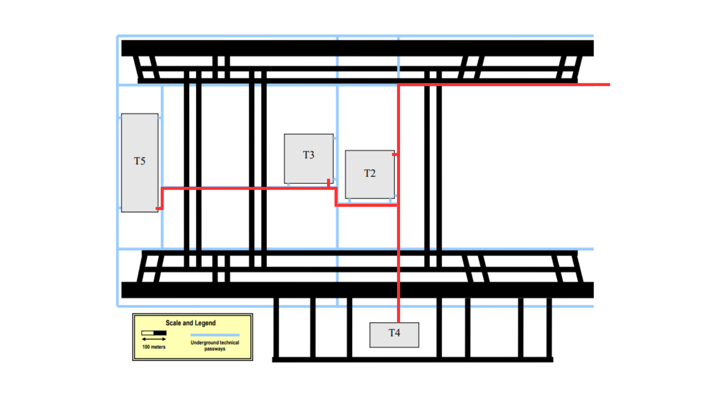

> O Subsistema de Cablagem 3 (backbone de campus) é responsável por interligar todos os terminais do aeroporto, constituindo a espinha dorsal da infraestrutura de rede. A topologia adotada é em estrela, tendo como ponto central de distribuição o Main Cross-connect (MC), localizado no Terminal 2. Todos os Intermediate Cross-connects (IC) dos restantes terminais — Terminal 3, Terminal 4 e Terminal 5 — ligam-se diretamente ao MC através de cabos de fibra ótica monomodo, percorrendo as passagens técnicas subterrâneas (underground technical passways) existentes entre os terminais.
>
> A escolha de fibra ótica monomodo para o backbone de campus justifica-se pelas distâncias envolvidas entre os terminais. O percurso mais longo é o de T5 ao MC (T3), com 712,5 metros, seguido do percurso de T2 ao MC (T3), com 432,5 metros (12,5 + 62,5 + 20 + 137,5 + 200), e do percurso de T4 ao MC (T3), via T2, com 687,5 metros. Estas distâncias, superiores às capacidades da fibra ótica multimodo utilizada no backbone de edifício, tornam a fibra monomodo a solução tecnicamente adequada, garantindo baixa atenuação e elevada largura de banda ao longo de todo o campus.
>
> O MC no Terminal 2 constitui também o ponto de entrada da rede exterior, sendo responsável pela ligação à operadora de telecomunicações. Esta ligação é estabelecida igualmente em fibra ótica monomodo, saindo pelo topo direito do campus com um percurso total de 1300 metros (487,5 + 812,5), assegurando a conectividade entre a infraestrutura interna do aeroporto e a rede da operadora.
>
> No que respeita à articulação entre subsistemas, cada IC de terminal recebe a ligação proveniente do MC e distribui-a pelos Horizontal Cross-connects (HC) do respetivo terminal através do Subsistema de Cablagem 2 (backbone de edifício), utilizando fibra ótica multimodo. Esta hierarquia de três níveis — MC, IC e HC — garante uma arquitetura de rede escalável, organizada e de fácil manutenção, cumprindo os requisitos normativos de cablagem estruturada.

---

## 5. Inventário Final — Terminal 2

| Item                            |   L1   |  L4   | Campus | **Total** | Comprimento total (c/ 15% folga) |
|---------------------------------|:------:|:-----:|:------:|:---------:|:--------------------------------:|
| Patch Panels 24 portas          |   33   |  41   |   1    |  **75**   |                —                 |
| Patch Cords                     | 1 238  | 1 334 |   16   | **2 588** |                —                 |
| Switches                        |   4    |   3   |   1    |   **8**   |                —                 |
| WAPs                            |   30   |  30   |   0    |  **60**   |                —                 |
| Cabos de cobre CAT7             |  603   |  649  |   0    | **1 252** |            76 692,3 m            |
| Cabos de fibra óptica           |   16   |  18   |   8    |  **42**   |   6 284,9 m *(×2 redundância)*   |
| Horizontal Cross-connects (HC)  |   3    |   3   |   0    |   **6**   |                —                 |
| Consolidation Points (CP)       |   5    |   6   |   0    |  **11**   |                —                 |
| Intermediate Cross-connect (IC) |   1    |   0   |   0    |   **1**   |                —                 |
| Main Cross-connect (MC)         |   1    |   0   |   0    |   **1**   |                —                 |
| **Armários (total)**            | **10** | **9** | **0**  |  **19**   |                —                 |
## 6. Inventário Final — Campus
### Inventário Global — Quantidades

| Item | T2 |    T3     | T4 | T5 | **Total** |
|------|:--:|:---------:|:--:|:--:|:---------:|
| Tomadas de rede — internas | 773 |   1 130   | 1 292 | 1 476 | **4 671** |
| Tomadas de rede — WAP | 60 |    30     | 32 | 50 |  **172**  |
| **Tomadas de rede — TOTAL** | **833** | **1 160** | **1 324** | **1 526** | **4 843** |
| Wireless Access Points (WAP) | 60 |    30     | 32 | 50 |  **172**  |
| Consolidation Points (CP) | 12 |    12     | 14 | 19 |  **57**   |
| Horizontal Cross-connects (HC) | 6 |     6     | 2 | 4 |  **18**   |
| Intermediate Cross-connects (IC) | 1 |     1     | 1 | 1 |   **4**   |
| Patch Panels 24 portas (cobre) | 75 |    66     | 66 | 140 |  **347**  |
| Patch Panels fibra 12 portas LC | — |     6     | — | 4 |  **10**   |
| Switches | 8 |     —     | — | — |   **8**   |
| Patch Cords | 2 588 |     —     | — | — | **2 588** |

### Inventário Global — Comprimentos de Cabo

| Item | T2 | T3 | T4 | T5 | **Total** |
|------|:--:|:--:|:--:|:--:|:---------:|
| Cabo CAT7 (c/ 15% folga) | 76 692,3 m | 48 891,8 m | 33 063,0 m | 58 366,5 m | **217 013,6 m** |
| Fibra multimodo (c/ 15% folga, ×2) | 6 284,9 m | 5 141,1 m | 2 350,0 m | 2 013,3 m | **15 789,3 m** |